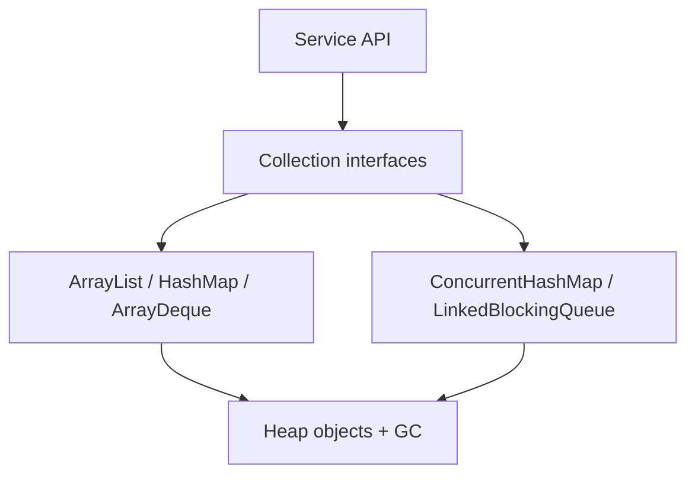
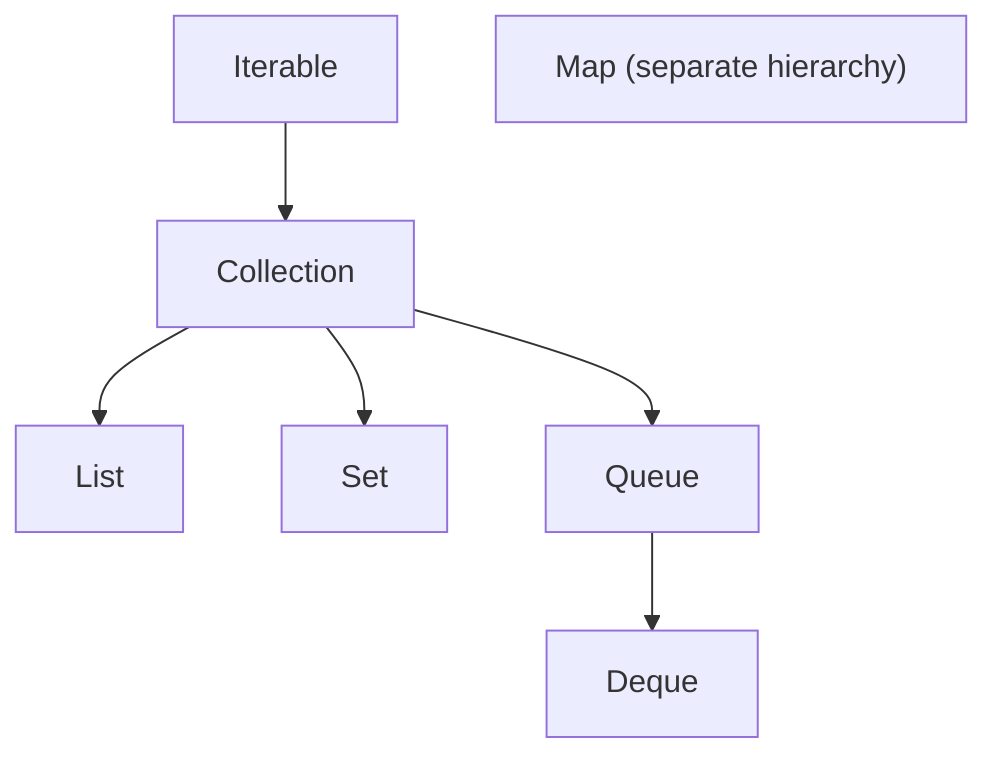

# Lesson 1 — Java Collections Framework Overview

Interfaces, hierarchy, Map vs Collection, and choosing implementations.

## Shared domain models

Examples across Modules 4–9 reuse the same records so mental models transfer:

```java
public record Employee(long id, String name, String department, double salary) {}
public record Order(long id, long employeeId, String sku, int quantity, double unitPrice) {}
public record Payment(long orderId, String method, double amount, java.time.Instant paidAt) {}
```

Use them for grouping (`Collectors.groupingBy`), maps (`Map<Long, Employee>`), optional chains
(`Optional<Employee>`), and exception boundaries around payment APIs.

## Big picture

Core Java Module 4 — **Collections**. This is the canonical Engineering Mastery
lesson; the [Interview Companion](../../../02-interview-companion/core-java/module-04-collections/01-collections-framework-overview.md) compresses interview signal without
introducing new concepts.

## Prerequisites

- Prior modules in the [Core Java track](../../../../java/index.md).
- JDK **17+** for examples unless the lesson notes otherwise.

## Architecture

The JCF splits **contracts** (`java.util` interfaces) from **implementations**
(`java.util` concrete classes and `java.util.concurrent` concurrent variants).
Application layers (REST controllers, batch jobs, stream processors) should depend
on the narrowest interface that expresses required semantics:

| Layer | Typical types | Why |
| --- | --- | --- |
| Domain service | `Map<Long, Employee>`, `Deque<Order>` | Stable API across refactors |
| Integration | `BlockingQueue<Payment>` | Backpressure at boundaries |
| Analytics path | `Stream<Employee>` (Module 6) | Declarative transforms |



## Internal working

1. **Iteration** — every `Collection` extends `Iterable`; enhanced for-loops compile to
   `iterator()` + `hasNext()` / `next()`.
2. **Views** — `Map` exposes `keySet()`, `values()`, `entrySet()` as **live views**
   (mutations reflect back unless unmodifiable wrappers are used).
3. **Algorithms** — `Collections.sort`, `binarySearch`, and stream collectors reuse
   the same ordering contracts (`Comparable` / `Comparator`).
4. **Fail-fast iterators** — structural modification without iterator `remove()` can
   trigger `ConcurrentModificationException` on many non-concurrent implementations.

## Hands-on

```java
import java.util.*;

public class CollectionsOverviewDemo {
    public static void main(String[] args) {
        Map<Long, Employee> roster = new HashMap<>();
        roster.put(1L, new Employee(1L, "Ada", "Eng", 120_000));
        roster.put(2L, new Employee(2L, "Lin", "Eng", 115_000));

        List<Order> orders = new ArrayList<>();
        orders.add(new Order(100L, 1L, "SKU-1", 2, 9.99));
        orders.add(new Order(101L, 1L, "SKU-2", 1, 19.99));

        Map<Long, List<Order>> byEmployee = new HashMap<>();
        for (Order o : orders) {
            byEmployee.computeIfAbsent(o.employeeId(), k -> new ArrayList<>()).add(o);
        }

        Set<String> departments = new TreeSet<>();
        roster.values().forEach(e -> departments.add(e.department()));

        System.out.println(departments); // sorted encounter order
        System.out.println(byEmployee.get(1L).size());
    }

    record Employee(long id, String name, String department, double salary) {}
    record Order(long id, long employeeId, String sku, int quantity, double unitPrice) {}
}
```

Run with `java CollectionsOverviewDemo.java` (single-file source, JDK 11+).

## Performance

| Choice | Read pattern | Write pattern | Memory |
| --- | --- | --- | --- |
| `ArrayList` | `O(1)` indexed | amortized `O(1)` tail | contiguous array |
| `LinkedList` | `O(n)` index | `O(1)` at known node | extra node overhead |
| `HashMap` | average `O(1)` | average `O(1)` | buckets + nodes/tree bins |
| `TreeMap` | `O(log n)` | `O(log n)` | tree nodes |

> **Performance note**
> Pick implementation by **dominant operation** and **ordering requirement**, not folklore
> ("always `LinkedList` for inserts").

## JDK tools and diagnostic clues

- **`ConcurrentModificationException`** in stack traces → iterator invalidation during mutation;
  look for foreach + `remove`, or map iteration + `put`.
- **Heap dumps** showing single giant `HashMap$Node[]` or `Object[]` → unbounded in-memory caches.
- **JFR events** `jdk.ObjectAllocationInNewTLAB` spikes when resizing `ArrayList`/`HashMap` in hot loops.

## Failure scenarios

| Symptom | Likely cause | Mitigation |
| --- | --- | --- |
| Nondeterministic test failures | Assuming iteration order on `HashSet`/`HashMap` | Use `LinkedHash*` or sort explicitly |
| `NullPointerException` in `TreeMap` | Null keys where comparator not null-tolerant | Guard inputs; use `HashMap` if null keys required |
| Memory growth in long-lived service | Unbounded `Map` cache without eviction | Cap size; `LinkedHashMap` LRU; Caffeine |

## Best practices and anti-patterns

- Program to interfaces (`List`, `Map`, `Queue`) at module boundaries.
- Document **ordering** and **null** policies in public APIs.
- Avoid exposing internal mutable collections without wrapping (`Collections.unmodifiable*`).

> **Production insight**
> Microservices often leak ordering assumptions across API versions — document whether JSON arrays
> are semantically ordered or incidental.

## Staff engineer notes

- The JCF is not a performance toolkit; it is a **semantic** toolkit. Performance comes from
  matching implementation to access pattern and from avoiding accidental `O(n²)` patterns
  (e.g., `List.contains` inside nested loops).
- `Map` not extending `Collection` is a modeling choice: keys are a **set-like** domain with
  associated values, not a bag of entries.

## Core concepts (canonical)

# Lesson 1 — Java Collections Framework Overview

The Java Collections Framework (JCF) is a unified architecture of **interfaces**, **implementations**, and **algorithms** for grouping and manipulating in-memory data. It exists so application code depends on **capabilities** (ordered list, unique set, key lookup) rather than on a single concrete class.

## Overview

- **Java assumption:** JDK 17+ for examples; behavior described matches OpenJDK `HashMap`/`ArrayList` unless noted.
- **Scope:** interface hierarchy, ordering semantics, and selection by access pattern.

## Learning objectives

- Explain why `Map` is part of the JCF but does not extend `Collection`.
- Contrast lists, sets, queues, deques, and maps on ordering, duplicates, and access.
- Distinguish interface contract from implementation performance.
- Distinguish encounter order, insertion order, and sorted order.

## 1. Why the framework exists

Before the JCF, each data structure was ad hoc. The framework standardizes:

- **Polymorphism** — program to `List`, swap `ArrayList` for `LinkedList` when justified.
- **Interoperability** — utilities in `Collections` and streams consume common interfaces.
- **Documented complexity** — interface docs state expected behavior; implementations document amortized/average costs.

## 2. Core interface hierarchy



| Type | Extends `Collection`? | Duplicates | Typical use |
| --- | --- | --- | --- |
| `List` | Yes | Allowed | Indexed sequences, stable order |
| `Set` | Yes | No (by `equals`) | Membership, deduplication |
| `Queue` | Yes | Often allowed | FIFO scheduling (implementation-dependent) |
| `Deque` | Yes (via `Queue`) | Often allowed | Both-end ops, stack/queue |
| `Map` | **No** | Keys unique | Key → value lookup |

`Map` is a **first-class JCF member** (`java.util`) but models **associations**, not a bag of elements. Hence `Map` has `entrySet()`, `keySet()`, `values()` views instead of extending `Collection`.

## 3. Interface vs implementation

| Idea | Interface says | Implementation decides |
| --- | --- | --- |
| `List` | Positional access, allows duplicates | `ArrayList` = array backing; `LinkedList` = nodes |
| `Set` | No duplicate elements | `HashSet` = hash table; `TreeSet` = red-black tree |
| `Map` | Unique keys | `HashMap`, `TreeMap`, `LinkedHashMap`, … |

**Interview trap:** Big-O on the interface is not always guaranteed — read the **implementation** javadoc (`HashMap` vs `TreeMap`).

## 4. Ordering vocabulary

| Term | Meaning |
| --- | --- |
| **Encounter / iteration order** | Order produced by iterator; may be undefined (`HashSet`) or defined (`LinkedHashSet` insertion order) |
| **Sorted order** | Total order from `Comparable` or `Comparator` (`TreeSet`, `TreeMap`) |
| **Insertion order** | Order elements were added (`LinkedHashMap` default, `LinkedHashSet`) |
| **Access order** | Order by last access (`LinkedHashMap` with `accessOrder = true`) |

Sorted order ≠ encounter order: iterating a `HashMap` is not sorted by key.

## 5. Choosing by access pattern

| Dominant operation | Often start with |
| --- | --- |
| Random access by index | `ArrayList` |
| Frequent head/tail queue ops | `ArrayDeque` |
| Unique + fast membership | `HashSet` |
| Unique + sorted traversal | `TreeSet` |
| Fast key lookup, order irrelevant | `HashMap` |
| Key lookup + predictable iteration order | `LinkedHashMap` |
| Key lookup + sorted keys | `TreeMap` |
| Next highest-priority element | `PriorityQueue` |

Ordering guarantees and performance trade off: `TreeMap` pays `O(log n)` for sorted keys; `HashMap` averages `O(1)` without sorted iteration.

## Common misconceptions

| Myth | Reality |
| --- | --- |
| "`Collection` includes maps" | Maps are parallel hierarchy under `Map` |
| "Iteration order equals sort order" | Only for sorted implementations or explicit ordering modes |
| "Pick `LinkedList` for all insertions" | Middle insert on linked lists still requires locating the index — often `O(n)` |


## Key takeaways

- Re-read the comparison tables and misconceptions in the canonical section.
- Pair this lesson with the Companion's **30-second revision** before mocks.

## See also

- [Companion chapter](../../../02-interview-companion/core-java/module-04-collections/01-collections-framework-overview.md)
- [Collections production playbook](../../../03-production-playbook/core-java/module-04-collections-production-playbook.md)
- [Module index](index.md)
