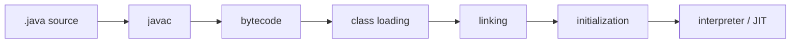

# Lesson 1 — JVM Architecture and Java Execution Lifecycle

Compilation, class loading, linking, initialization, class loaders, interpreter vs JIT.

## Shared domain models

Examples across Modules 4–9 reuse the same records so mental models transfer:

```java
public record Employee(long id, String name, String department, double salary) {}
public record Order(long id, long employeeId, String sku, int quantity, double unitPrice) {}
public record Payment(long orderId, String method, double amount, java.time.Instant paidAt) {}
```

Use them for grouping (`Collectors.groupingBy`), maps (`Map<Long, Employee>`), optional chains
(`Optional<Employee>`), and exception boundaries around payment APIs.

## Big picture

Core Java Module 9 — **JVM basics and GC**. This is the canonical Engineering Mastery
lesson; the [Interview Companion](../../../02-interview-companion/core-java/module-09-jvm-basics/01-jvm-architecture-and-execution-lifecycle.md) compresses interview signal without
introducing new concepts.

## Prerequisites

- Prior modules in the [Core Java track](../../../../java/index.md).
- JDK **17+** for examples unless the lesson notes otherwise.

## Architecture

This lesson sits in **Module 9** of the Core Java track. Service code should treat
collection/generics/stream/JVM choices as **capacity and correctness** decisions, not style preferences.

## Internal working

Review the numbered sections in **Core concepts (canonical)** below. For interviews, pair each
fact with **complexity**, **ordering**, and **concurrency** implications.

## Hands-on

```java
// Extend the snippet in the canonical section with Employee / Order / Payment records.
// JDK 17+: compile with your module's test source set or `java Main.java`.
```

## Performance

State average vs worst-case costs for the structures or APIs introduced in this lesson.
Call out allocation hot spots (boxing, autoboxing in streams, defensive copies).

## JDK tools and diagnostic clues

- Watch for lesson-specific exceptions in logs (`ConcurrentModificationException`, `ClassCastException`
  at erasure boundaries, `OutOfMemoryError` subtypes for JVM modules).
- Use **async profiler**, **JFR**, or **heap histogram** (`jcmd <pid> GC.class_histogram`) when
  production symptoms match this topic.

## Failure scenarios

Document one production failure mode tied to misuse of this lesson's API, and the guardrail
(service validation, bounded queues, explicit comparators, try-with-resources).

## Best practices and anti-patterns

- Prefer clear types over clever one-liners.
- Make null and empty collection policies explicit at API edges.

> **Production insight**
> Align collection mutability with transaction boundaries — shared mutable structures between
> threads remain the top source of subtle bugs.

## Staff engineer notes

- Teach the **contract** first (what callers may assume), then the **implementation** (how it is enforced).
- Link forward to Module 12 concurrent collections when discussing multi-threaded mutation.

## Core concepts (canonical)

# Lesson 1 — JVM Architecture and Java Execution Lifecycle

The JVM is the runtime that loads bytecode, verifies it, allocates memory, and executes methods — first by interpretation, then often by **JIT compilation** after hot code is observed.

## Overview

- **Java assumption:** JDK 17+ examples; behavior described for OpenJDK HotSpot unless labeled as specification-only.
- **Scope:** source → bytecode → class lifecycle → execution engines. Not threading or the Java Memory Model (see [Concurrency](../../../../concurrency/index.md)).

## Conceptual execution flow

```text
Java source → javac → bytecode (.class) → class loading → linking → initialization → execution (interpreter / JIT)
```

This is a **conceptual** pipeline. Real JVMs may merge steps, reorder work, or optimize internally.



## 1. Compilation with `javac`

`javac` compiles `.java` to **platform-independent bytecode** (not native machine code). The same `.class` files can run on any JVM for that Java version (subject to API and module availability).

```bash
javac Hello.java
java Hello
```

Bytecode is stored in the **constant pool**, fields, and methods of each class file. The JVM enforces verification rules before executing untrusted bytecode.

## 2. Class loading, linking, and initialization

The JVM specification defines three phases for a class or interface:

| Phase | What happens (conceptual) |
| --- | --- |
| **Loading** | Find binary form, define the `Class` object |
| **Linking** | **Verification**, **preparation**, **resolution** (resolution may be lazy) |
| **Initialization** | Execute `<clinit>` — assign static fields, run static blocks |

### Linking sub-steps

| Step | Purpose |
| --- | --- |
| **Verification** | Bytecode safety (stack discipline, type rules) |
| **Preparation** | Allocate static storage, apply default values (not user code yet) |
| **Resolution** | Resolve symbolic references to fields, methods, classes (may be deferred) |

### Initialization triggers (examples)

- First active use of a class (e.g. `new`, static field read/write except `final` compile-time constants in some cases)
- Reflection that initializes the class
- Subclass initialization can trigger superclass `<clinit>` first

### Compile-time constants and `<clinit>`

```java
public class Constants {
    public static final int A = 1 + 2; // compile-time constant
    public static final String B = "hi"; // string literal — special pool rules
    public static final int C = (int) System.currentTimeMillis(); // NOT compile-time constant
}
```

If `C` is assigned at class initialization time, running `<clinit>` is required before `C` is read. **Compile-time constants** inlined at use sites may avoid reading the field at runtime (details depend on the compiler and JVM).

### `Class.forName()` and initialization

```java
Class<?> c = Class.forName("com.example.Plugin"); // typically initializes the class
Class<?> c2 = Class.forName("com.example.Plugin", false, loader); // load only — no initialization
```

The two-argument form can load without initializing (used by some frameworks before fields are ready).

## 3. Class loaders (HotSpot model)

| Loader | Typical role |
| --- | --- |
| **Bootstrap** | Core JDK classes (`java.*`) — often `null` in API |
| **Platform** | JDK modules / extensions (Java 9+ module system) |
| **Application** | Classpath / module path for your application |

**Delegation:** loaders usually ask the parent first so core classes are not replaced by application copies.

**Interview angle:** class-loader leaks (redeploy without releasing references) often show up as **Metaspace** growth — diagnosed in [Lesson 7](07-diagnosing-outofmemoryerror-in-production.md), not as a concurrency topic.

## 4. Interpreter versus JIT compiler

| Mechanism | Role |
| --- | --- |
| **Interpreter** | Starts execution quickly, lower peak throughput |
| **JIT (C1/C2 on HotSpot)** | Compiles hot methods to native code for speed |

**Warm-up:** throughput improves after hot paths are compiled. Microbenchmarks without warm-up mislead.

**Deoptimization:** if assumptions break (e.g. monomorphic call site becomes megamorphic), the JVM may **deoptimize** back to interpreter or recompile with different assumptions.

## 5. `ClassNotFoundException` vs `NoClassDefFoundError`

| | `ClassNotFoundException` | `NoClassDefFoundError` |
| --- | --- | --- |
| **Typical cause** | Loader cannot **find** the class binary at load time | Class was present earlier but **cannot be loaded/initialized** when needed |
| **Checked?** | Checked (`Exception`) | `Error` |
| **Example** | Wrong classpath, typo in name | Static init throws; previous failed init |

```java
public class Broken {
    static {
        if (true) throw new RuntimeException("init failed");
    }
}
```

After `Broken` fails initialization, a later `new Broken()` may yield `NoClassDefFoundError` with **cause** linking to the original failure.

## Common misconceptions

| Myth | Reality |
| --- | --- |
| "Bytecode runs directly on the CPU" | JVM interprets or JIT-compiles to native code |
| "`Class.forName` never runs static blocks" | Default `forName(name)` **initializes** the class |
| "Failed init is forgotten on next use" | JVM records failed initialization; subsequent uses can fail with `NoClassDefFoundError` |


## Key takeaways

- Re-read the comparison tables and misconceptions in the canonical section.
- Pair this lesson with the Companion's **30-second revision** before mocks.

## See also

- [Companion chapter](../../../02-interview-companion/core-java/module-09-jvm-basics/01-jvm-architecture-and-execution-lifecycle.md)
- [JVM basics and GC production playbook](../../../03-production-playbook/core-java/module-09-jvm-basics-production-playbook.md)
- [Module index](index.md)
