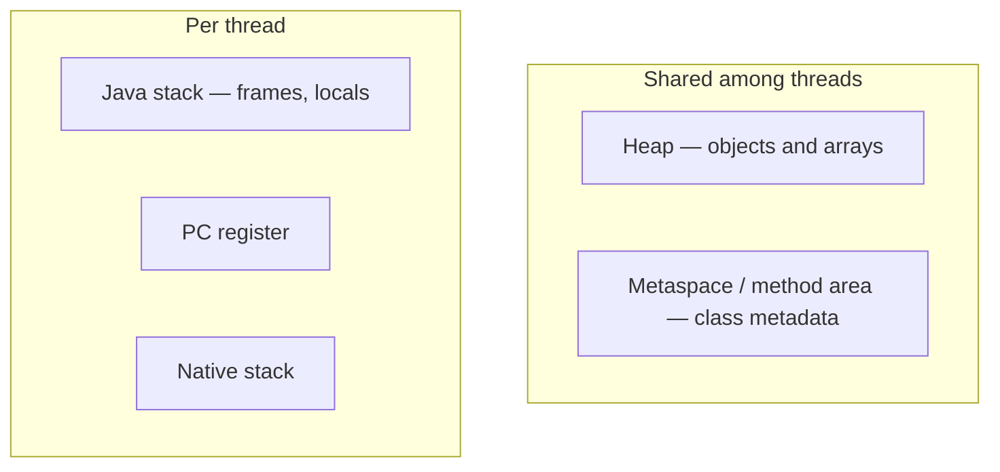
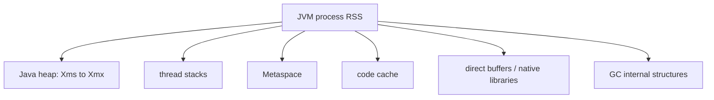

# Lesson 2 — JVM Runtime Memory Areas

Heap, stacks, method area, Metaspace, PC registers, native stacks, OOM vs SOE.

## Shared domain models

Examples across Modules 4–9 reuse the same records so mental models transfer:

```java
public record Employee(long id, String name, String department, double salary) {}
public record Order(long id, long employeeId, String sku, int quantity, double unitPrice) {}
public record Payment(long orderId, String method, double amount, java.time.Instant paidAt) {}
```

Use them for grouping (`Collectors.groupingBy`), maps (`Map<Long, Employee>`), optional chains
(`Optional<Employee>`), and exception boundaries around payment APIs.

## Big picture

Core Java Module 9 — **JVM basics and GC**. This is the canonical Engineering Mastery
lesson; the [Interview Companion](../../../02-interview-companion/core-java/module-09-jvm-basics/02-jvm-runtime-memory-areas.md) compresses interview signal without
introducing new concepts.

## Prerequisites

- Prior modules in the [Core Java track](../../../../java/index.md).
- JDK **17+** for examples unless the lesson notes otherwise.

## Architecture

This lesson sits in **Module 9** of the Core Java track. Service code should treat
collection/generics/stream/JVM choices as **capacity and correctness** decisions, not style preferences.

## Internal working

Review the numbered sections in **Core concepts (canonical)** below. For interviews, pair each
fact with **complexity**, **ordering**, and **concurrency** implications.

## Hands-on

```java
// Extend the snippet in the canonical section with Employee / Order / Payment records.
// JDK 17+: compile with your module's test source set or `java Main.java`.
```

## Performance

State average vs worst-case costs for the structures or APIs introduced in this lesson.
Call out allocation hot spots (boxing, autoboxing in streams, defensive copies).

## JDK tools and diagnostic clues

- Watch for lesson-specific exceptions in logs (`ConcurrentModificationException`, `ClassCastException`
  at erasure boundaries, `OutOfMemoryError` subtypes for JVM modules).
- Use **async profiler**, **JFR**, or **heap histogram** (`jcmd <pid> GC.class_histogram`) when
  production symptoms match this topic.

## Failure scenarios

Document one production failure mode tied to misuse of this lesson's API, and the guardrail
(service validation, bounded queues, explicit comparators, try-with-resources).

## Best practices and anti-patterns

- Prefer clear types over clever one-liners.
- Make null and empty collection policies explicit at API edges.

> **Production insight**
> Align collection mutability with transaction boundaries — shared mutable structures between
> threads remain the top source of subtle bugs.

## Staff engineer notes

- Teach the **contract** first (what callers may assume), then the **implementation** (how it is enforced).
- Link forward to Module 12 concurrent collections when discussing multi-threaded mutation.

## Core concepts (canonical)

# Lesson 2 — JVM Runtime Memory Areas

The JVM partitions memory into **specification-level runtime areas**. HotSpot maps several of these to concrete data structures (for example **Metaspace** for class metadata).

## 1. Specification vs HotSpot

| Concept (JVM spec) | HotSpot implementation note |
| --- | --- |
| **Heap** | Object instances and arrays |
| **Method area** | Class metadata, constant pool, static state (conceptual) |
| — | **Metaspace** stores class metadata (native memory, not Java heap) |
| **Java Virtual Machine stacks** | Per-thread stack frames |
| **PC register** | Current instruction address (per thread, abstract) |
| **Native method stacks** | Native (JNI) calls |

Diagram (conceptual — not exact HotSpot layout):



## 2. Heap

- Stores **objects** and **arrays**.
- Shared by all threads (with synchronization for mutators, not for heap structure itself).
- Garbage-collected (see [Lesson 4](04-garbage-collection-fundamentals.md)).

Local variables hold **references** (or primitives); the objects they point to usually live on the heap.

```java
void method() {
    List<String> items = new ArrayList<>(); // reference on stack, ArrayList on heap
    items.add("a");
}
```

## 3. Java thread stacks and frames

Each thread has a **Java stack** of **frames** (one per active method call). A frame typically holds:

- Local variable slots (primitives and reference values)
- Operand stack for bytecode execution
- Reference to constant pool of the running class

**`StackOverflowError`:** usually too deep recursion or very large stack frames — not fixable by increasing heap (`-Xmx`).

## 4. Method area and Metaspace

The **method area** (spec) holds class-level data: type metadata, runtime constant pool, static fields (conceptually associated with the type).

On HotSpot, **Metaspace** (since Java 8 for class metadata; PermGen removed) grows in **native memory**. Class unloading can reclaim Metaspace when loaders and classes become unreachable.

## 5. PC register and native stacks

- **PC register:** per-thread program counter for bytecode (undefined for native methods in the spec).
- **Native method stacks:** used when executing JNI/native code — contributes to **process RSS** outside the Java heap.

## 6. Stack versus heap

| | Stack (per thread) | Heap (shared) |
| --- | --- | --- |
| **Lifetime** | Frame popped when method returns | Until unreachable / collected |
| **Contents** | Primitives, references, frame metadata | Objects, arrays |
| **Typical failure** | `StackOverflowError` | `OutOfMemoryError: Java heap space` |
| **Sizing flag** | `-Xss` per thread | `-Xms` / `-Xmx` |

## 7. Process memory vs Java heap

The **Java heap is not the entire JVM process footprint**. A process also includes:

- Metaspace / class metadata
- Thread stacks (reserved and partially committed)
- Code cache (JIT compiled code)
- GC bookkeeping
- Direct buffers (`ByteBuffer.allocateDirect`)
- Native libraries, malloc from JNI, etc.

In containers, **`kubectl top` / cgroup limit** can kill the pod even when **heap usage is below `-Xmx`**.

## Process RSS, reservation, commitment, and reclamation

`-Xms2g -Xmx4g` limits the Java heap, not the entire native process. A **6 GB RSS** is possible:
the heap's committed pages, Metaspace, JIT code cache, GC structures, direct buffers, native
libraries/JNI allocations, and thread stacks all contribute. Reservation is address space made
available, commitment is memory the JVM/OS has committed to use, and RSS is resident physical
memory currently mapped into the process; they are related but not interchangeable.

| Area | Typical reclamation mechanism |
| --- | --- |
| Heap | Garbage collector |
| Java stack | Stack-frame return and thread termination |
| Metaspace | Class unloading when class loader/classes become unreachable; JVM allocator |
| Direct buffers | Cleaner/native resource lifecycle; do not rely on prompt collection |
| Code cache | JVM code-cache management |
| JNI allocations | Native allocator/free lifecycle; arbitrary native memory is not magically freed by GC |

References on a stack do not live “inside” their heap objects; a frame can keep an object live.
Class-loader retention can prevent unloading and manifest as Metaspace growth. Non-heap areas do
not necessarily receive the moving/compacting treatment associated with heap collectors.

## JVM threads and CPU scheduling

Platform threads map to native threads scheduled by the operating system. Eight cores can have
dozens of runnable application, JIT, and GC threads; the OS time-slices/preempts them. GC neither
needs an idle core nor uses `ForkJoinPool.commonPool()`—HotSpot creates and schedules its own
parallel-pause and concurrent GC workers. CPU contention can therefore slow both application and
concurrent GC work.



## Comparison table

| Memory area | Purpose | Shared / per-thread | Typical diagnostic signal |
| --- | --- | --- | --- |
| Heap | Objects, arrays | Shared | `Java heap space` OOM; heap dumps |
| Java stack | Frames, locals, operand stack | Per-thread | `StackOverflowError`; thread count × `-Xss` pressure |
| Metaspace (HotSpot) | Class metadata | Shared | `Metaspace` OOM; redeploy without unload |
| PC register | Bytecode position | Per-thread | Rarely surfaced directly |
| Native stacks | JNI / native calls | Per-thread | Native OOM, high RSS |
| Direct / off-heap | NIO, some frameworks | Shared / per-buffer | RSS high, heap “healthy” |

## 8. `OutOfMemoryError` vs `StackOverflowError`

| Error | Area | Typical trigger |
| --- | --- | --- |
| **`OutOfMemoryError`** | Heap, Metaspace, native thread creation, etc. | Cannot satisfy allocation (message names sub-type) |
| **`StackOverflowError`** | Thread stack | Excessive stack depth |

Both extend `Error`, not `Exception` — see [Module 8](../module-08-exception-handling/01-throwable-hierarchy-and-propagation.md).

## 9. Why `-Xmx` is not a universal fix

- Raises **heap ceiling** only; does not fix **retention leaks** or unbounded caches.
- Can **increase GC cost** and **container kill risk** if total process memory exceeds the cgroup limit.
- Does not enlarge Metaspace, thread stacks, or direct memory — other OOM flavors remain.

## Common misconceptions

| Myth | Reality |
| --- | --- |
| "All variables live on the heap" | Locals and parameters live in **stack frames**; objects live on heap |
| "Static fields are on the stack" | Static fields are associated with the class (method area / Metaspace + heap objects they reference) |
| "Heap OOM means buy more RAM" | Classify OOM type and **retention** first |


## Key takeaways

- Re-read the comparison tables and misconceptions in the canonical section.
- Pair this lesson with the Companion's **30-second revision** before mocks.

## See also

- [Companion chapter](../../../02-interview-companion/core-java/module-09-jvm-basics/02-jvm-runtime-memory-areas.md)
- [JVM basics and GC production playbook](../../../03-production-playbook/core-java/module-09-jvm-basics-production-playbook.md)
- [Module index](index.md)
