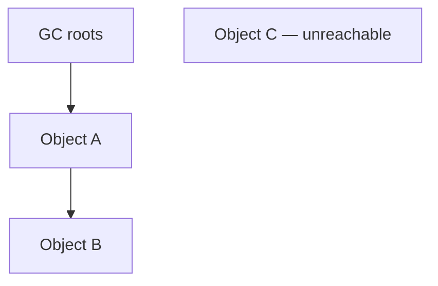

# Lesson 4 — Garbage Collection Fundamentals

Reachability, GC roots, generations, System.gc, memory leaks in Java.

## Shared domain models

Examples across Modules 4–9 reuse the same records so mental models transfer:

```java
public record Employee(long id, String name, String department, double salary) {}
public record Order(long id, long employeeId, String sku, int quantity, double unitPrice) {}
public record Payment(long orderId, String method, double amount, java.time.Instant paidAt) {}
```

Use them for grouping (`Collectors.groupingBy`), maps (`Map<Long, Employee>`), optional chains
(`Optional<Employee>`), and exception boundaries around payment APIs.

## Big picture

Core Java Module 9 — **JVM basics and GC**. This is the canonical Engineering Mastery
lesson; the [Interview Companion](../../../02-interview-companion/core-java/module-09-jvm-basics/04-garbage-collection-fundamentals.md) compresses interview signal without
introducing new concepts.

## Prerequisites

- Prior modules in the [Core Java track](../../../../java/index.md).
- JDK **17+** for examples unless the lesson notes otherwise.

## Architecture

This lesson sits in **Module 9** of the Core Java track. Service code should treat
collection/generics/stream/JVM choices as **capacity and correctness** decisions, not style preferences.

## Internal working

Review the numbered sections in **Core concepts (canonical)** below. For interviews, pair each
fact with **complexity**, **ordering**, and **concurrency** implications.

## Hands-on

```java
// Extend the snippet in the canonical section with Employee / Order / Payment records.
// JDK 17+: compile with your module's test source set or `java Main.java`.
```

## Performance

State average vs worst-case costs for the structures or APIs introduced in this lesson.
Call out allocation hot spots (boxing, autoboxing in streams, defensive copies).

## JDK tools and diagnostic clues

- Watch for lesson-specific exceptions in logs (`ConcurrentModificationException`, `ClassCastException`
  at erasure boundaries, `OutOfMemoryError` subtypes for JVM modules).
- Use **async profiler**, **JFR**, or **heap histogram** (`jcmd <pid> GC.class_histogram`) when
  production symptoms match this topic.

## Failure scenarios

Document one production failure mode tied to misuse of this lesson's API, and the guardrail
(service validation, bounded queues, explicit comparators, try-with-resources).

## Best practices and anti-patterns

- Prefer clear types over clever one-liners.
- Make null and empty collection policies explicit at API edges.

> **Production insight**
> Align collection mutability with transaction boundaries — shared mutable structures between
> threads remain the top source of subtle bugs.

## Staff engineer notes

- Teach the **contract** first (what callers may assume), then the **implementation** (how it is enforced).
- Link forward to Module 12 concurrent collections when discussing multi-threaded mutation.

## Core concepts (canonical)

# Lesson 4 — Garbage Collection Fundamentals

Garbage collection reclaims **heap** memory for objects that are **no longer reachable** from GC roots. Eligibility is about **reachability**, not about whether you still “need” the object logically.

## 1. Reachability and eligibility

An object is eligible for collection when no **live reference chain** exists from a **GC root** to that object.

**GC roots** (conceptual set — exact set is implementation-dependent) include:

- Local variables and active stack frames
- Static fields of loaded classes
- JNI globals
- Objects used as monitors for blocked threads
- Objects held for JVM internal purposes



`C` has no path from roots → eligible for GC (timing not guaranteed).

## 2. Strong references

Default references are **strong**: while reachable, the object **cannot** be collected.

```java
Map<String, byte[]> cache = new HashMap<>();
cache.put("session-1", largePayload); // strongly reachable via map
```

Setting a reference to `null` removes **one** path; other strong paths may still exist.

## 3. Eligibility vs immediate collection

| Action | Effect |
| --- | --- |
| `ref = null` | May make object eligible — **does not** force immediate free |
| `System.gc()` | **Hint only** — JVM may ignore |
| GC run | Reclaims unreachable objects — **when** the collector runs is not application-controlled |

## 4. Generational hypothesis

Most objects die young. Generational collectors split the heap:

| Generation | Typical role |
| --- | --- |
| **Young** | New allocations; frequent **minor** collections |
| **Old (tenured)** | Long-lived objects; **major** / **mixed** / **full** collections |

**Terminology warning:** “minor”, “major”, and “full” mean different things per collector (G1 **mixed** vs Parallel **full**). Read logs in context — [Lesson 5](05-garbage-collectors-and-g1.md).

## 5. Memory leaks in Java

A **Java memory leak** is usually **unintended reachability**: objects stay strongly reachable though the application no longer needs them.

```java
public class LeakyRegistry {
    private static final List<byte[]> EVER_SEEN = new ArrayList<>();

    public void onEvent(byte[] payload) {
        EVER_SEEN.add(payload); // never removed — grows without bound
    }
}
```

GC cannot reclaim entries still referenced from `EVER_SEEN`.

**Not a leak:** a single large but **intentional** cache with bounds and eviction — though it may still need sizing.

## 6. `System.gc()`

- Documented as a **request** to run the garbage collector.
- May trigger stop-the-world work on some JVMs — avoid in latency-sensitive hot paths.
- Does not fix retention leaks.

## Common misconceptions

| Myth | Reality |
| --- | --- |
| "GC runs when I call `finalize`" | `finalize` is deprecated; lifecycle uses cleaner patterns |
| "No references in my code means object is dead" | Static collections, thread locals, queues may still hold strong refs |
| "Frequent GC always means a leak" | May be **high allocation churn** — see [module interview practice](../../../02-interview-companion/core-java/module-09-jvm-basics/module-interview-practice.md) |


## Key takeaways

- Re-read the comparison tables and misconceptions in the canonical section.
- Pair this lesson with the Companion's **30-second revision** before mocks.

## See also

- [Companion chapter](../../../02-interview-companion/core-java/module-09-jvm-basics/04-garbage-collection-fundamentals.md)
- [JVM basics and GC production playbook](../../../03-production-playbook/core-java/module-09-jvm-basics-production-playbook.md)
- [Module index](index.md)
