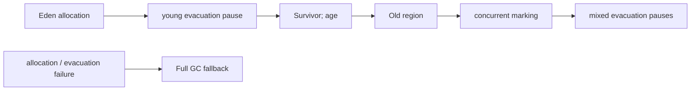

# Lesson 5 — Garbage Collectors and G1 GC

STW pauses, Parallel vs G1 vs ZGC, regions, mixed GC, humongous objects.

## Shared domain models

Examples across Modules 4–9 reuse the same records so mental models transfer:

```java
public record Employee(long id, String name, String department, double salary) {}
public record Order(long id, long employeeId, String sku, int quantity, double unitPrice) {}
public record Payment(long orderId, String method, double amount, java.time.Instant paidAt) {}
```

Use them for grouping (`Collectors.groupingBy`), maps (`Map<Long, Employee>`), optional chains
(`Optional<Employee>`), and exception boundaries around payment APIs.

## Big picture

Core Java Module 9 — **JVM basics and GC**. This is the canonical Engineering Mastery
lesson; the [Interview Companion](../../../02-interview-companion/core-java/module-09-jvm-basics/05-garbage-collectors-and-g1.md) compresses interview signal without
introducing new concepts.

## Prerequisites

- Prior modules in the [Core Java track](../../../../java/index.md).
- JDK **17+** for examples unless the lesson notes otherwise.

## Architecture

This lesson sits in **Module 9** of the Core Java track. Service code should treat
collection/generics/stream/JVM choices as **capacity and correctness** decisions, not style preferences.

## Internal working

Review the numbered sections in **Core concepts (canonical)** below. For interviews, pair each
fact with **complexity**, **ordering**, and **concurrency** implications.

## Hands-on

```java
// Extend the snippet in the canonical section with Employee / Order / Payment records.
// JDK 17+: compile with your module's test source set or `java Main.java`.
```

## Performance

State average vs worst-case costs for the structures or APIs introduced in this lesson.
Call out allocation hot spots (boxing, autoboxing in streams, defensive copies).

## JDK tools and diagnostic clues

- Watch for lesson-specific exceptions in logs (`ConcurrentModificationException`, `ClassCastException`
  at erasure boundaries, `OutOfMemoryError` subtypes for JVM modules).
- Use **async profiler**, **JFR**, or **heap histogram** (`jcmd <pid> GC.class_histogram`) when
  production symptoms match this topic.

## Failure scenarios

Document one production failure mode tied to misuse of this lesson's API, and the guardrail
(service validation, bounded queues, explicit comparators, try-with-resources).

## Best practices and anti-patterns

- Prefer clear types over clever one-liners.
- Make null and empty collection policies explicit at API edges.

> **Production insight**
> Align collection mutability with transaction boundaries — shared mutable structures between
> threads remain the top source of subtle bugs.

## Staff engineer notes

- Teach the **contract** first (what callers may assume), then the **implementation** (how it is enforced).
- Link forward to Module 12 concurrent collections when discussing multi-threaded mutation.

## Core concepts (canonical)

# Lesson 5 — Garbage Collectors and G1 GC

Collectors trade **throughput**, **pause time**, and **memory overhead**. No collector is universally best — choose from **workload measurements** and **GC logs**.

## 1. Stop-the-world (STW) pauses

During some GC phases, **application threads may be paused** so the collector can move or mark objects safely. Pause duration and frequency depend on heap size, live set, collector, and flags.

**Throughput collectors** (e.g. Parallel) may accept longer pauses for less total GC overhead. **Low-pause** collectors (G1, ZGC) target shorter pauses with different trade-offs.

## 2. Collector overview (HotSpot, Java 17+)

| Collector | Orientation | Notes |
| --- | --- | --- |
| **Parallel** (`UseParallelGC`) | Throughput | STW young + old collections; good for batch |
| **G1** (`UseG1GC`) | Balanced / pause goals | Default on many server configs; region-based |
| **ZGC** | Low pause | Scalable heaps; different architecture; evaluate on JDK docs for your version |
| **Serial** | Small / single-core | Simple, long pauses on large heaps |

Enable with flags from [Lesson 3](03-jvm-memory-configuration-and-options.md). Validate with `-Xlog:gc*`.

## 3. G1 region-based heap

G1 divides the heap into **regions** (commonly 1–32 MB, configurable). Region **roles** include:

| Region type | Role |
| --- | --- |
| **Eden** | New allocations |
| **Survivor** | Objects surviving young collections |
| **Old** | Tenured objects |
| **Humongous** | Large objects that do not fit comfortably in half a region |

**Humongous objects:** objects larger than roughly **half a G1 region** may be allocated in humongous regions — can fragment and affect collection behavior; avoid unnecessary giant arrays/objects when possible.

## 4. G1 collection types (conceptual)

| Event | What it generally means |
| --- | --- |
| **Young collection** | Collect Eden + Survivor; promote survivors |
| **Mixed collection** | Collect some Old regions along with young (after concurrent marking) |
| **Full GC** | Fallback STW collection of whole heap — **undesirable** on healthy G1; investigate logs |

`-XX:MaxGCPauseMillis` influences **G1 pacing** — a **goal**, not a hard cap.

## 5. G1 lifecycle, marking, and Full GC fallback

Most ordinary objects begin in Eden, survive a young evacuation into Survivor regions, age, and
may be promoted to Old regions. Humongous allocations are an important exception. Young and mixed
collections both have stop-the-world evacuation pauses. A mixed collection includes young regions
and selected old regions chosen using information from concurrent marking; it is not “a young GC
that happens to scan all old objects.” Full GC is a serious stop-the-world whole-heap fallback
with marking/compaction work and can be expensive in both pause time and CPU.



G1's concurrent marking uses Snapshot-At-The-Beginning (SATB) style reasoning: it preserves a
conservative view of objects reachable at the snapshot even while the application mutates the
graph. An object that becomes unreachable after the snapshot can remain marked live until later.
Concurrent marking data is not a substitute for whatever complete marking work a Full GC needs;
Full GC is not simply the normal final stage of that concurrent cycle. Concurrent work and actual
reclamation are distinct phases.

`ParallelGCThreads` configures parallel pause work and `ConcGCThreads` concurrent background work
(subject to JVM ergonomics/flags). They are JVM-managed workers, separate from application
executors. CPU saturation can lengthen concurrent phases; a stop-the-world pause stops JVM
application threads, not arbitrary processes on the host.

### Log interpretation: do not diagnose from one line

```text
Pause Full (Allocation Failure) 3900M -> 3700M (4096M) 2450ms
```

This is a 2.45-second pause that reclaimed only 200 MB from a near-full heap: a large retained
live set, allocation pressure, or a leak are hypotheses. Look for repeated events, allocation
rate, old-gen trend, workload changes, and retained graphs before declaring a memory leak. Repeated
Full GC increases latency/OOM risk; one event does not prove root cause.

## 5. Evaluation workflow

1. Enable **GC logging** (`-Xlog:gc*`).
2. Correlate pauses with traffic and deployment changes.
3. If retention suspected, capture **heap dump** at steady state or after OOM.
4. Change collector or flags only with **before/after** metrics.

```text
Workload → logs (time series) → hypothesis → targeted dump / NMT → change → verify
```

## Common misconceptions

| Myth | Reality |
| --- | --- |
| "Switch to ZGC for every service" | Measure pause vs throughput vs JDK support |
| "G1 never does full GC" | Full GC can still occur under pressure or mis-tuning |
| "Humongous regions are rare in business apps" | Large `byte[]`, serialized plans, buffers can trigger them |


## Key takeaways

- Re-read the comparison tables and misconceptions in the canonical section.
- Pair this lesson with the Companion's **30-second revision** before mocks.

## See also

- [Companion chapter](../../../02-interview-companion/core-java/module-09-jvm-basics/05-garbage-collectors-and-g1.md)
- [JVM basics and GC production playbook](../../../03-production-playbook/core-java/module-09-jvm-basics-production-playbook.md)
- [Module index](index.md)
