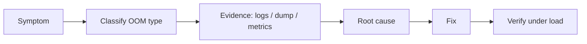

# Lesson 7 — Diagnosing `OutOfMemoryError` in Production

OOM categories, native vs heap, workflow, jcmd, NMT, container kills.

## Shared domain models

Examples across Modules 4–9 reuse the same records so mental models transfer:

```java
public record Employee(long id, String name, String department, double salary) {}
public record Order(long id, long employeeId, String sku, int quantity, double unitPrice) {}
public record Payment(long orderId, String method, double amount, java.time.Instant paidAt) {}
```

Use them for grouping (`Collectors.groupingBy`), maps (`Map<Long, Employee>`), optional chains
(`Optional<Employee>`), and exception boundaries around payment APIs.

## Big picture

Core Java Module 9 — **JVM basics and GC**. This is the canonical Engineering Mastery
lesson; the [Interview Companion](../../../02-interview-companion/core-java/module-09-jvm-basics/07-diagnosing-outofmemoryerror-in-production.md) compresses interview signal without
introducing new concepts.

## Prerequisites

- Prior modules in the [Core Java track](../../../../java/index.md).
- JDK **17+** for examples unless the lesson notes otherwise.

## Architecture

This lesson sits in **Module 9** of the Core Java track. Service code should treat
collection/generics/stream/JVM choices as **capacity and correctness** decisions, not style preferences.

## Internal working

Review the numbered sections in **Core concepts (canonical)** below. For interviews, pair each
fact with **complexity**, **ordering**, and **concurrency** implications.

## Hands-on

```java
// Extend the snippet in the canonical section with Employee / Order / Payment records.
// JDK 17+: compile with your module's test source set or `java Main.java`.
```

## Performance

State average vs worst-case costs for the structures or APIs introduced in this lesson.
Call out allocation hot spots (boxing, autoboxing in streams, defensive copies).

## JDK tools and diagnostic clues

- Watch for lesson-specific exceptions in logs (`ConcurrentModificationException`, `ClassCastException`
  at erasure boundaries, `OutOfMemoryError` subtypes for JVM modules).
- Use **async profiler**, **JFR**, or **heap histogram** (`jcmd <pid> GC.class_histogram`) when
  production symptoms match this topic.

## Failure scenarios

Document one production failure mode tied to misuse of this lesson's API, and the guardrail
(service validation, bounded queues, explicit comparators, try-with-resources).

## Best practices and anti-patterns

- Prefer clear types over clever one-liners.
- Make null and empty collection policies explicit at API edges.

> **Production insight**
> Align collection mutability with transaction boundaries — shared mutable structures between
> threads remain the top source of subtle bugs.

## Staff engineer notes

- Teach the **contract** first (what callers may assume), then the **implementation** (how it is enforced).
- Link forward to Module 12 concurrent collections when discussing multi-threaded mutation.

## Core concepts (canonical)

# Lesson 7 — Diagnosing `OutOfMemoryError` in Production

Production memory failures split into **Java-thrown `OutOfMemoryError`**, **excessive retention/churn**, and **process/container kills** where the JVM may not throw or dump at all.

## Diagnostic workflow

```text
Symptom → Classify → Collect Evidence → Find Cause → Fix → Verify
```



## 1. Major `OutOfMemoryError` categories (Java)

| Message / area | Often indicates |
| --- | --- |
| **`Java heap space`** | Heap cannot satisfy allocation — retention, churn, or `-Xmx` too low |
| **`GC overhead limit exceeded`** | GC spending excessive time with little reclamation (often retention or tiny heap) |
| **`Metaspace`** | Class metadata / class-loader growth |
| **`unable to create native thread`** | Thread limit or **native memory** exhaustion (stacks, process limits) |

**Container / OS OOM kill:** cgroup memory limit exceeded — RSS may include heap + native + stacks. Heap metrics can look **healthy** while the kernel kills the process. **No guaranteed** Java exception or heap dump.

## 2. Failure modes to distinguish

| Mode | What to check |
| --- | --- |
| Heap exhaustion | Heap used vs `-Xmx`, dominators in dump |
| Excessive retention | Growing old-gen after GC, dominator tree |
| High allocation churn | Young GC frequency, short-lived objects — not always a leak |
| Metaspace / class loaders | Redeploy, generated classes, frameworks |
| Native memory pressure | NMT summary, thread count, direct buffers |
| Thread stacks | Thread count × `-Xss`, `unable to create native thread` |
| Direct / off-heap | `ByteBuffer.allocateDirect`, Netty, mapped files |
| Container limits | cgroup max vs JVM flags + native overhead |

## 3. Evidence sources

| Source | Reveals |
| --- | --- |
| **GC logs** (`-Xlog:gc*`) | Pause pattern, promotion, full GC, allocation rate over **time** |
| **Heap dump** | **Object graph** and retention at a **point in time** |
| **Application logs** | What the service was doing (queries, batch size) |
| **Metrics** | Heap %, GC time, thread count, RSS, container memory |
| **JVM flags** | `jcmd … VM.flags` — configured limits |

## 4. `jcmd` essentials (Java 17+)

List JVMs:

```bash
jcmd -l
```

Examples (replace `<pid>`):

```bash
jcmd <pid> GC.heap_info
jcmd <pid> GC.class_histogram
jcmd <pid> GC.heap_dump filename=/path/heapdump.hprof
jcmd <pid> VM.flags
jcmd <pid> VM.native_memory summary
```

| Command | Purpose |
| --- | --- |
| `GC.heap_info` | Heap configuration and usage snapshot |
| `GC.class_histogram` | Live instances per class (lightweight) |
| `GC.heap_dump` | Full heap dump (disk, I/O, sensitivity) |
| `VM.flags` | Effective flags |
| `VM.native_memory summary` | NMT categories — must be enabled at startup for full value |

**NMT:** start with `-XX:NativeMemoryTracking=summary` (or `detail` with higher overhead). NMT does **not** list every native malloc.

## 5. Heap dumps in operations

- May be **multi-gigabyte** — ensure **disk space** and **IO** capacity.
- Treat as **confidential** — credentials, PII, business data.
- `-XX:+HeapDumpOnOutOfMemoryError` helps only for **Java OOM** paths that support it.

## 6. Java OOM vs container kill

| | Java `OutOfMemoryError` | Container / OOM killer |
| --- | --- | --- |
| **Exception in logs** | Often yes | Often no — abrupt exit |
| **Heap dump** | Possible if configured | Unlikely |
| **Heap % metric** | May be below `-Xmx` | RSS includes non-heap |

## Common misconceptions

| Myth | Reality |
| --- | --- |
| "Thread dump fixes heap leaks" | Thread dumps show stacks, not full retention graph |
| "One histogram proves a leak" | Need trend + dominators + paths to roots |


## Key takeaways

- Re-read the comparison tables and misconceptions in the canonical section.
- Pair this lesson with the Companion's **30-second revision** before mocks.

## See also

- [Companion chapter](../../../02-interview-companion/core-java/module-09-jvm-basics/07-diagnosing-outofmemoryerror-in-production.md)
- [JVM basics and GC production playbook](../../../03-production-playbook/core-java/module-09-jvm-basics-production-playbook.md)
- [Module index](index.md)
