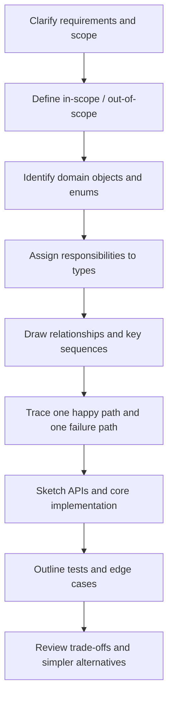
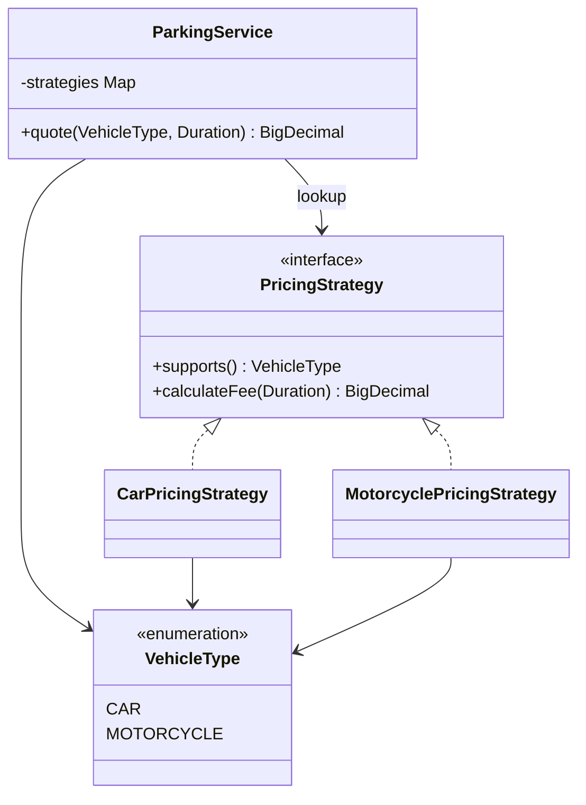
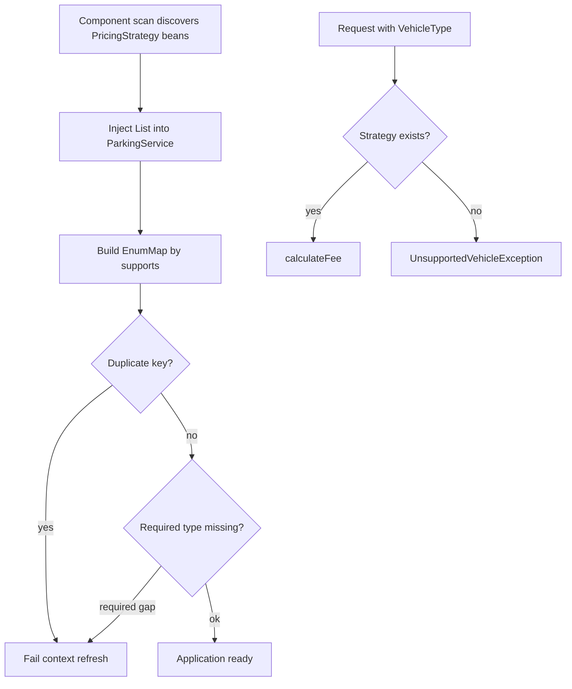
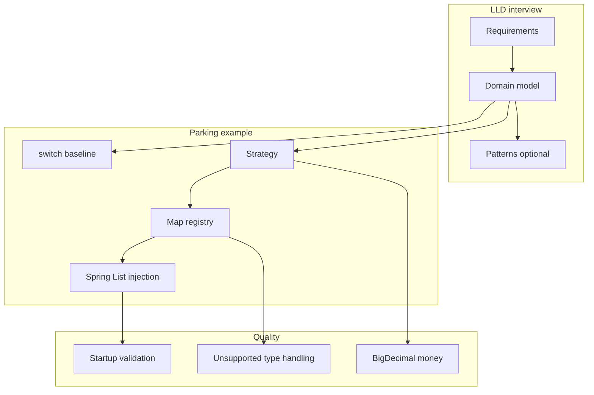

# Lesson 1 — LLD Foundations: What Senior LLD Interviews Evaluate

Senior **low-level design (LLD)** interviews test whether you can turn ambiguous requirements into **clear objects, responsibilities, and interactions** — with trade-offs, extensibility, and testability — not whether you memorized Gang-of-Four names.

**Companion (interview revision):** [Book 2 — LLD Lesson 1](../../../02-interview-companion/lld/module-05-lld/01-lld-foundations-what-senior-lld-interviews-evaluate.md)

**JDK / stack:** Java **17+**, Spring Boot **3.x** for DI examples; use `BigDecimal` for money in production-oriented snippets.

---

## 1. LLD fundamentals

### What senior LLD interviews evaluate

Interviewers typically score:

| Dimension | What they listen for |
| --- | --- |
| **Requirements** | Clarifying scope, assumptions, out-of-scope, NFRs (latency, consistency) |
| **Modeling** | Entities, value objects, enums, services — not a single god class |
| **Responsibilities** | Who owns pricing, persistence, validation — single reason to change |
| **Interactions** | Sequence for one use case; where failures surface |
| **Extensibility** | Where behavior changes — without rewriting unrelated code |
| **APIs & tests** | Public methods, error cases, how you would unit-test |
| **Trade-offs** | Simplicity vs patterns; startup vs request-time validation |

They are **not** asking for a full distributed architecture in a 45-minute LLD round unless the prompt explicitly blends HLD + LLD.

### LLD vs HLD

| | **High-level design (HLD)** | **Low-level design (LLD)** |
| --- | --- | --- |
| **Focus** | Services, data stores, queues, scaling, consistency across nodes | Classes, modules, methods, in-process collaboration |
| **Artifacts** | Boxes-and-arrows, capacity, partitions, failure domains | Class diagram, sequence diagram, interfaces |
| **Typical questions** | “Design Twitter / payments at scale” | “Design parking lot / rate limiter / in-memory cache API” |
| **Failure modes** | Network partitions, replication lag | Null inputs, duplicate keys, wrong strategy selected |

### Why a separate HLD is not always required before LLD

Many LLD prompts are **single-process** or **single-service** exercises (“design a library”, “design the billing module”). You still need **implicit** boundaries (what is in memory vs DB), but a full multi-region HLD first would waste interview time. Senior candidates **state assumptions** (“one JVM”, “prices loaded at startup”, “no distributed cache”) and proceed to objects and flows.

### Practical LLD interview workflow



**10+ YOE pitch:** “I time-box clarification, then model nouns and verbs, assign ownership, walk one sequence aloud, and only then introduce patterns where the **source of change** justifies them.”

---

## 2. Choosing the right level of abstraction

**Running example:** parking fee calculator for **cars** and **motorcycles** (extendable to more vehicle types and pricing rules).

### 2.1 Switch-based design — when it is appropriate

For two vehicle types and stable rules, a direct mapping is readable:

```java
public enum VehicleType { CAR, MOTORCYCLE }

public final class ParkingFeeCalculator {

    public BigDecimal calculateFee(VehicleType type, Duration stay) {
        long hours = Math.max(1, stay.toHours());
        return switch (type) {
            case CAR -> BigDecimal.valueOf(5).multiply(BigDecimal.valueOf(hours));
            case MOTORCYCLE -> BigDecimal.valueOf(2).multiply(BigDecimal.valueOf(hours));
        };
    }
}
```

**Appropriate when:**

- Few variants, rules change together, no need for polymorphic testing hooks.
- Team prioritizes obvious control flow over extension points.

**Limitations as behavior grows:**

- Each new **pricing dimension** (weekend surcharge, member discount, EV tariff) inflates the switch or duplicates logic across methods.
- Harder to unit-test one algorithm in isolation or plug alternate implementations (e.g. promotional pricing for A/B tests).
- Open/Closed tension: you **can** extend via new `case` labels, but the **calculator class** keeps changing for every new vehicle **or** rule combination.

> **Open/Closed Principle (balanced):** Prefer extension over modification when **pricing algorithms** are an expected source of change. A new `VehicleType` alone does not **always** require a new strategy class — sometimes one strategy handles a family of types. Conversely, not every `if` or `switch` violates OCP; a two-case switch can be the right design.

### 2.2 Strategy pattern — interchangeable pricing algorithms

Encapsulate fee logic behind a common interface:

```java
public interface PricingStrategy {
    VehicleType supports();
    BigDecimal calculateFee(Duration stay);
}
```

```java
@Component
public class CarPricingStrategy implements PricingStrategy {
    private static final BigDecimal HOURLY = new BigDecimal("5.00");

    @Override
    public VehicleType supports() {
        return VehicleType.CAR;
    }

    @Override
    public BigDecimal calculateFee(Duration stay) {
        long billableHours = Math.max(1, stay.toHours());
        return HOURLY.multiply(BigDecimal.valueOf(billableHours));
    }
}
```

```java
@Component
public class MotorcyclePricingStrategy implements PricingStrategy {
    private static final BigDecimal HOURLY = new BigDecimal("2.00");

    @Override
    public VehicleType supports() {
        return VehicleType.MOTORCYCLE;
    }

    @Override
    public BigDecimal calculateFee(Duration stay) {
        long billableHours = Math.max(1, stay.toHours());
        return HOURLY.multiply(BigDecimal.valueOf(billableHours));
    }
}
```

**Benefits:** each algorithm tested independently; new behavior can be added by new types without editing existing strategy classes (when selection is registry-based).

**Costs:** more types and indirection; overkill if rules never diverge.

---

## 3. Strategy registry and Spring dependency injection

Four ideas often conflated in interviews — keep them separate:

| Concept | Role |
| --- | --- |
| **Strategy pattern** | Interface + interchangeable implementations of one behavior |
| **Strategy selection** | Choosing which implementation applies for a request (`VehicleType`) |
| **Map-based registry** | `Map<VehicleType, PricingStrategy>` for O(1) lookup |
| **Spring DI** | Container discovers `@Component` beans and injects `List<PricingStrategy>` at startup |

### 3.1 Manual registry (no Spring)

```java
public final class ParkingService {
    private final Map<VehicleType, PricingStrategy> strategies;

    public ParkingService(List<PricingStrategy> strategies) {
        this.strategies = strategies.stream()
            .collect(Collectors.toUnmodifiableMap(PricingStrategy::supports, Function.identity()));
    }

    public BigDecimal quote(VehicleType type, Duration stay) {
        PricingStrategy strategy = strategies.get(type);
        if (strategy == null) {
            throw new UnsupportedVehicleException(type);
        }
        return strategy.calculateFee(stay);
    }
}
```

### 3.2 Spring: inject all strategies, build map at startup

```java
@Service
public class ParkingService {
    private final Map<VehicleType, PricingStrategy> strategies;

    public ParkingService(List<PricingStrategy> strategies) {
        this.strategies = buildRegistry(strategies);
    }

    private static Map<VehicleType, PricingStrategy> buildRegistry(List<PricingStrategy> strategies) {
        Map<VehicleType, PricingStrategy> map = new EnumMap<>(VehicleType.class);
        for (PricingStrategy strategy : strategies) {
            VehicleType key = strategy.supports();
            if (map.put(key, strategy) != null) {
                throw new IllegalStateException("Duplicate pricing strategy for " + key);
            }
        }
        return Map.copyOf(map);
    }

    public BigDecimal quote(VehicleType type, Duration stay) {
        PricingStrategy strategy = strategies.get(type);
        if (strategy == null) {
            throw new UnsupportedVehicleException(type);
        }
        return strategy.calculateFee(stay);
    }
}
```

**Component scanning:** Spring Boot discovers `@Component` / `@Service` classes under the application’s `@SpringBootApplication` package (and configured scan roots). Matching beans are created at **context refresh** (startup). `ParkingService` receives the **list of all `PricingStrategy` beans** in one constructor injection.

**Adding a new strategy:** implement `PricingStrategy`, annotate with `@Component`, ensure `supports()` returns a unique `VehicleType`. **`ParkingService` need not change** if the registry is built from the injected list. You may still need enum values, configuration properties, migrations, or feature flags — the pattern removes **selection** churn, not all domain work.



---

## 4. Configuration validation

| Failure | Handling |
| --- | --- |
| **Duplicate strategy keys** | Fail **at startup** (`IllegalStateException` during registry build) — misconfiguration, not a user error |
| **Missing required strategy** | Fail at startup if product requires all enum values covered; or document optional types |
| **Unsupported vehicle type at runtime** | `UnsupportedVehicleException` — **intentionally** unsupported capability vs bug |
| **Invalid config file** | Startup failure (fail-fast) vs lazy failure on first request — prefer startup for required strategies |

**Invalid configuration** (two beans for `CAR`) differs from **unsupported capability** (client sends `TRUCK` when you only sell car/motorcycle pricing): the former is deploy-time; the latter is a domain/API response (400/422), not necessarily a 500.



Optional strict validation example:

```java
@Component
public class PricingRegistryValidator {
    public PricingRegistryValidator(
            List<PricingStrategy> strategies,
            @Value("${parking.required-vehicle-types:CAR,MOTORCYCLE}") List<VehicleType> required) {
        Map<VehicleType, PricingStrategy> map = strategies.stream()
            .collect(Collectors.toUnmodifiableMap(PricingStrategy::supports, Function.identity(),
                (a, b) -> { throw new IllegalStateException("Duplicate strategy"); }));
        for (VehicleType type : required) {
            if (!map.containsKey(type)) {
                throw new IllegalStateException("Missing strategy for required type: " + type);
            }
        }
    }
}
```

---

## 5. Senior-engineer design judgment

| Situation | Prefer | Why |
| --- | --- | --- |
| 2 types, rules stable, no external config | **`switch` / simple method** | Lowest cognitive load |
| Several algorithms, tests per rule, product adds tariffs | **Strategy + map registry** | Localized change, testability |
| Many Spring beans, ops adds plugins without editing service | **Spring `List` injection + startup map** | Discovery; fail-fast validation |
| Selection logic is one line and rarely changes | **Don't force a pattern** | Patterns have maintenance cost |

**Explicit note:** Maps and design patterns are **not** inherently superior to simpler code. Choose based on **expected sources of change** and whether that change justifies extra types, indirection, and operational validation.

---

## 6. Revision aids

### Summary

- LLD = objects, responsibilities, interactions, tests, trade-offs; HLD = distributed topology and scale.
- Workflow: clarify → model → assign → sequence → implement → test → trade-offs.
- Parking example: switch OK small; Strategy + registry when pricing rules diverge.
- Separate **Strategy pattern**, **registry**, and **Spring DI**; startup validation for duplicates and required keys; runtime exception for unsupported types.

### Common interview mistakes

| Mistake | Correction |
| --- | --- |
| Jumping to code without scope | State assumptions and out-of-scope first |
| One giant `ParkingManager` class | Split fee policy vs session vs repository |
| “Strategy for everything” | Two-case switch can be correct |
| Confusing duplicate bean with unsupported type | Startup fail vs client-facing error |
| Using `double` for money | Use `BigDecimal` with explicit scale/rounding policy |

### Decision guide (one line each)

- **Switch** — minimal variants, joint evolution of rules.
- **Map registry** — polymorphic algorithms, same selection mechanism.
- **Spring list injection** — many deployable implementations, startup discovery.

### Recall questions (open-ended)

1. What would you clarify before drawing classes for a parking lot LLD?
2. When would you **not** introduce the Strategy pattern in the parking fee example?
3. How does Spring populate `List<PricingStrategy>` and when does duplicate detection run?
4. Difference between missing strategy at startup vs unsupported `VehicleType` on a request?
5. How would you test `CarPricingStrategy` without starting Spring?

### Concept map



## Cross-links

- Payment/idempotency (distributed): [Concurrency L22](../../../../concurrency/22-backend-concurrency-scenarios.md)
- Spring reliability: [M8 — retries and idempotency](../../core-java/module-08-exception-handling/03-production-spring-retries-idempotency.md)
