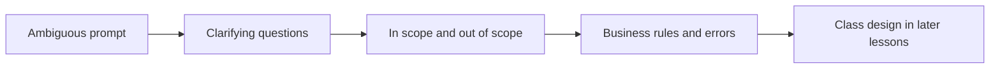

# Lesson 2 — Requirement Clarification and Scope Definition

Convert an ambiguous LLD prompt into **functional requirements, constraints, and business rules** before naming classes. Implementation choices (which class owns a spot, whether a floor type exists) belong in later lessons.

**Companion:** [Book 2 — Lesson 2](../../../02-interview-companion/lld/module-05-lld/02-requirement-clarification-and-scope.md)

**Next:** [Lesson 3 — Domain modeling](03-domain-modeling-and-class-responsibilities.md). Foundations: [Lesson 1](01-lld-foundations-what-senior-lld-interviews-evaluate.md).

---

## Learning objectives

- Separate functional requirements from non-functional ones.
- Name actors, use cases, inputs, outputs, and error cases.
- State scope and **out of scope** explicitly.
- Keep requirements distinct from implementation decisions.
- Surface concurrency, lifecycle, consistency, and failure handling.
- Ask a few high-value questions instead of designing immediately.

---

## Core concepts

| Kind | Examples in this problem |
| --- | --- |
| **Functional** | Allocate a compatible spot; charge at exit; release after successful payment |
| **Non-functional** | Never double-allocate a spot; fee stable across retries; later rate changes must not reprice an open session |
| **Constraint** | Walk-in only; cars and bikes now; hourly billing, partial hours round **up** |
| **Out of scope** | Advance reservations; a real payment-provider integration in the initial scope |

A requirement says **what** must be true. “Use a `HashMap` of spots” or “introduce `ParkingFloor`” is an implementation choice. Do not lock those in while clarifying.

---

## Requirements-to-design workflow

Stop at rules if the interviewer has not asked for classes yet. Overengineering here usually means drawing services before the fee and allocation rules are stable.

---

## Parking Lot — requirements (source of truth)

These are **problem decisions**, not class designs.

- Multiple parking floors.
- Initially cars and bikes; more vehicle types may appear later.
- Only a **compatible** spot may be allocated.
- **Walk-in only.** No advance reservations.
- Allocate the **nearest available compatible** spot using configured distance or priority relative to the entrance.
- Ties between equally preferred spots may be resolved **arbitrarily**.
- Charge **hourly by vehicle type**. Round partial hours **up**.
- **Cash and card at exit.** No real payment-provider integration in the initial scope.
- If payment **fails**, the vehicle stays on its spot until payment succeeds.
- Never allocate the same spot to two vehicles.
- Create a parking session **only after** successful spot allocation.
- If no compatible spot exists, return **“No compatible spot available”** and do **not** create a session.
- Release a spot only after **successful payment**, or as a **safe rollback** of a failed entry.
- Preserve the **calculated fee** across payment retries.
- The rate **effective at entry** prices that session. Capture it when the session begins so later configuration changes do not change that visit.

### Scope table

| In scope | Out of scope (initial) |
| --- | --- |
| Walk-in entry and exit | Reservations, permits, EV charging rules |
| Floors, compatible spots, nearest-available | UI, maps, camera ANPR |
| Hourly fee by type, round up | Dynamic surge pricing algorithms |
| Cash and card as payment **methods** | Stripe/Razorpay SDK, webhooks, settlement |
| One spot, one vehicle; session after claim | Multi-lot networks, monthly passes |

### Business rules and edge cases

| Rule | Edge case |
| --- | --- |
| Compatible spot only | Bike must not take a car-only spot |
| Nearest available | Two spots at the same priority: either is acceptable |
| No spot | Message “No compatible spot available”; no session row |
| Session after claim | Failed session create must not leave a silent occupied spot without a recovery path (designed in [Lesson 4](04-encapsulation-invariants-and-tell-dont-ask.md)) |
| Payment failure | Spot stays occupied; fee unchanged on retry |
| Rate at entry | Config change at 18:00 does not reprice a car that entered at 09:00 |
| Partial hour | 61 minutes bills as 2 hours |

---

## Clarification questions worth asking

- Which vehicle types exist on day one, and is “future types” only a rate or also a spot-compatibility change?
- How is “nearest” defined: floor order, walking distance, or an explicit priority number?
- Is rounding always ceiling of hours, including a stay under one hour?
- On card decline, is the session still active with the same amount?
- May two entrances exist, or is proximity always relative to one entrance?
- Is concurrent entry in scope (two drivers, one last spot)?

Skip questions that only choose a framework (“Redis or Postgres?”) until requirements need a durability answer.

---

## Concurrency, lifecycle, consistency, failure

Call these out as requirements even if the design is still in-memory:

- **Concurrency:** two entries must not both own one spot.
- **Lifecycle:** no session without a successful allocation; spot release is tied to payment success or entry rollback.
- **Consistency:** fee and entry rate are fixed for that visit.
- **Failure:** payment failure is a business outcome (stay parked), not “delete the session and free the spot.”

---

## Common mistakes

- Designing `ParkingFloor`, strategies, and payment gateways before writing the fee and allocation rules.
- Treating “support cards” as “integrate a PSP” when the prompt only needs a payment method.
- Inventing reservations because parking systems often have them.
- Mixing “we will use optimistic locking” into the requirements list. That is a design option for the invariant “one vehicle per spot.”

## Interview guidance

Spend the first minutes on scope, actors (driver, attendant or kiosk), and the four failure lines: no spot, claim then session failure, payment decline, retry. Say what you are **not** building. Then ask permission to model classes.

## Revision summary

Requirements first: walk-in, compatible nearest spot, session only after claim, hourly fee rounded up, rate snapshotted at entry, cash/card without a PSP, payment failure keeps the spot, no double allocation.

## Practice questions

1. Which sentences in the parking prompt are requirements, and which would be premature design?
2. Why is “no reservation” a scope decision rather than a missing feature you should add?
3. What must remain true if the hourly rate configuration changes while a car is still parked?
4. Payment fails at the exit kiosk. What is the required system state?
5. Two drivers request the last compatible spot together. What requirement applies before you pick a lock or a database constraint?

**Expected reasoning:** (1) Rules about fees, compatibility, and session creation are requirements; class names are not. (2) The problem forbids reservations; adding them changes scope. (3) The session keeps the entry rate. (4) Session stays active, spot stays occupied, fee unchanged. (5) The same spot must not be given to both; how you enforce that is Lesson 4, not this list.
