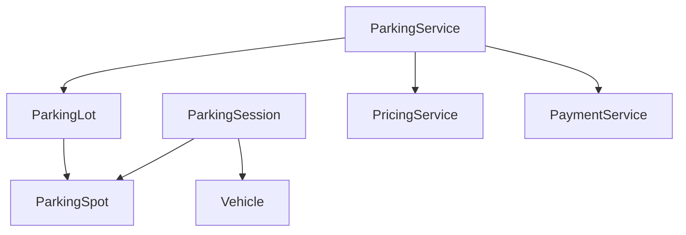

# Lesson 3 — Domain Modeling and Class Responsibilities

Assign **state and behavior** from the [Lesson 2](02-requirement-clarification-and-scope.md) rules. Do not add a type that has no responsibility.

**Companion:** [Book 2 — Lesson 3](../../../02-interview-companion/lld/module-05-lld/03-domain-modeling-and-class-responsibilities.md)

**Next:** [Lesson 4 — Encapsulation](04-encapsulation-invariants-and-tell-dont-ask.md)

---

## Learning objectives

- Separate entities, value-like data, and services.
- Give each type a single reason to change, pragmatically.
- Keep invariants on the object that owns the state.
- Avoid god objects and empty `XService` wrappers.
- Leave persistence and vendor APIs out of the domain story until a requirement needs them.

---

## Core concepts

| Idea | In this design |
| --- | --- |
| **Entity** | `ParkingSpot`, `ParkingSession`, `Vehicle` — identity and lifecycle |
| **Aggregate coordination** | `ParkingLot` orders candidates and coordinates claims; it does not price or charge |
| **Service** | `ParkingService` runs entry and exit; `PaymentService` takes payment |
| **Value-like data** | Floor number, hourly rate captured on the session, money as `BigDecimal` |

High cohesion: spot occupancy lives on the spot. Low coupling: the service asks the lot to allocate; it does not set occupancy fields. An anemic model would expose setters and put every `if` in one service. A god object would make `ParkingLot` also price, pay, and persist.

Introduce a class when it owns state, an invariant, or a policy. Do not introduce one to mirror a database table or a layer name.

---

## Domain model

### Core types

- `ParkingLot` — collection of spots, candidate search, proximity order, claim coordination.
- `ParkingSpot` — occupancy, compatibility, claim, release.
- `Vehicle` — type and identity needed for compatibility and the visit.
- `ParkingSession` — one visit: ids, vehicle, spot, entry and exit times, captured pricing, payment outcome.

### ParkingFloor — omitted

Requirements mention floors. They do **not** require floor-level behavior (open/close a floor, per-floor policy). Store `floorNumber` on `ParkingSpot`. Add `ParkingFloor` only when a floor gains its own operations.

### No separate allocation service

`ParkingLot` already finds and orders candidates and retries the next spot when a claim fails. A second allocator would split one policy across two types. Revisit only if allocation rules outgrow the lot (multiple lots, reservations).

### ParkingSpot

- Owns occupancy.
- Knows whether it can take a vehicle.
- Attempts to claim itself.
- Releases only the current allocation.
- Protects those invariants (API in [Lesson 4](04-encapsulation-invariants-and-tell-dont-ask.md)).

### ParkingLot

- Holds spots.
- Finds compatible candidates.
- Orders them by configured distance or priority from the entrance.
- If a concurrent claim fails, tries the next candidate.

It is not the place for fee math or card networks.

### ParkingService

Orchestrates entry and exit: allocate, create session, price, pay, clean up. It does **not** poke spot fields.

### ParkingSession

A ticket type is unnecessary until a requirement distinguishes a printable ticket from the visit record. Lifecycle stays small: `ACTIVE` and `CLOSED`. Keep **payment outcome** separate so “active and unpaid” is not a pile of booleans.

### Pricing and payment (initial)

- Algorithms that truly differ can be strategies later ([Lesson 5](05-abstraction-composition-and-pattern-selection.md), [Lesson 6](06-ocp-and-dip.md)).
- Capture the hourly rate on the session at entry ([Lesson 2](02-requirement-clarification-and-scope.md)).
- `PaymentService` orchestrates cash and card. A simple conditional is enough while there is no provider SDK. Provider ports arrive when integrations vary.

---

## Responsibility matrix

| Type | Owns | Does not own |
| --- | --- | --- |
| `ParkingSpot` | Occupied or free, allocation id, `canFit` | Searching other spots, fees |
| `ParkingLot` | Candidate order, claim loop | Payment, session persistence |
| `ParkingSession` | Visit facts and captured rate | Choosing the next spot |
| `ParkingService` | Entry/exit sequence | Spot invariants |
| `PricingService` | Fee from captured rate and duration | Occupancy |
| `PaymentService` | Cash/card attempt | Spot release policy |

---

## Misplaced responsibilities

| Smell | Correction |
| --- | --- |
| `ParkingService` sets `spot.occupied = true` | Spot claims itself |
| `ParkingLot.exitAndCharge()` | Lot allocates; service and payment handle exit |
| `ParkingFloor` with only a list already on the lot | Drop it; keep `floorNumber` on the spot |
| `AllocationService` that only forwards to the lot | Keep coordination on the lot |
| Session created before a successful claim | Violate the Lesson 2 rule |

---

## Class-design review

Walk one entry: vehicle arrives → service asks lot → lot orders compatible free spots → spot claims → service creates `ACTIVE` session and stores the rate. If you cannot name the type that rejects a second claim, the model is wrong.

## Interview guidance

Draw four boxes first: lot, spot, session, vehicle. Add services only for workflows. Say aloud why floor and ticket are absent. Interviewers listen for omitted types as much as included ones.

## Revision summary

Spot owns occupancy. Lot orders and retries claims. Service orchestrates. Session records the visit and the entry rate. No floor class, no extra allocator, no ticket, no PSP yet.

## Practice questions

1. Why is `floorNumber` on the spot enough?
2. What breaks if `ParkingLot` also calculates fees?
3. Where does “try the next spot” live, and why not a new service?
4. What would force you to add `ParkingFloor` later?
5. Why can payment stay a conditional in `PaymentService` for this scope?

**Expected reasoning:** (1) No floor behavior. (2) Lot changes for every tariff. (3) One policy, already on the lot. (4) Floor open/close or floor-specific rules. (5) Cash and card only; no vendor APIs yet. Lesson 6 adds a gateway when providers appear.
