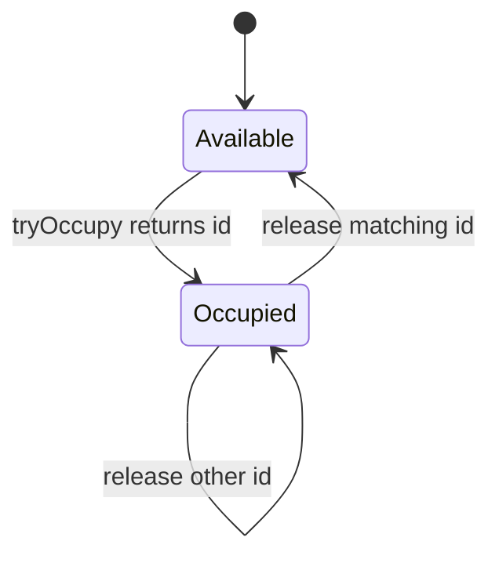
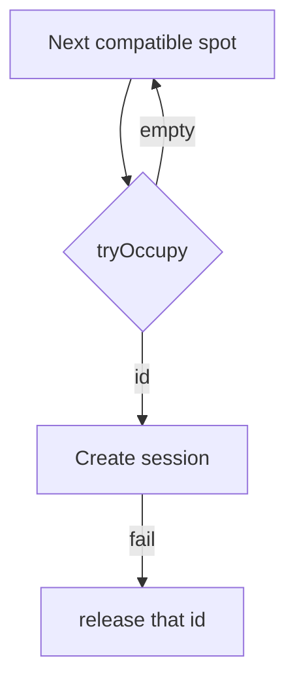

# Lesson 4 — Encapsulation, Invariants, and Tell-Don't-Ask

Encapsulation means **valid transitions**, not only `private` fields. Callers tell the spot to claim or release; they do not assemble occupancy themselves.

**Companion:** [Book 2 — Lesson 4](../../../02-interview-companion/lld/module-05-lld/04-encapsulation-invariants-and-tell-dont-ask.md)

Builds on [Lesson 2](02-requirement-clarification-and-scope.md) and [Lesson 3](03-domain-modeling-and-class-responsibilities.md).

Illustrative API — not a production class.

---

## Learning objectives

- State invariants and the operations that preserve them.
- Prefer intention-revealing methods over setters.
- Treat a failed claim as a normal outcome.
- Compensate a claim when session creation fails, using the allocation id.
- Keep payment failure from freeing the spot.
- See why object correctness is not the same as a multi-step workflow transaction.

---

## Core concepts

**Invariant:** a free spot has no allocation id; an occupied spot has exactly one current allocation id.

**Tell, don't ask:** do not `if (!spot.isOccupied()) spot.setOccupied(true)`. Two callers both observe free and both set occupied. `tryOccupy()` performs the check and the write together.

Public setters for occupancy or allocation id let any workflow break the invariant. `canFit` and `isOccupied` may stay public **reads**. They must not be the only step before a claim.

| Outcome | Mechanism |
| --- | --- |
| Normal: spot already taken | `Optional.empty()` from `tryOccupy()` |
| Exceptional: programming bug, missing session | Exception or error return at the workflow boundary — do not use exceptions for “try the next spot” |

---

## ParkingSpot API

```java
public boolean canFit(Vehicle vehicle);
public boolean isOccupied();
public Optional<String> tryOccupy();
public boolean release(String allocationId);
```

- `canFit` — compatibility only.
- `isOccupied` — current state. Not sufficient to claim.
- `tryOccupy` — if free, occupy and return a **new allocation id**; otherwise `Optional.empty()`. The id is created inside the successful claim. It identifies **this allocation**, not the vehicle. The same vehicle may park again later with a different id.
- `release` — frees the spot only when `allocationId` equals the current one. Returns whether this call released it.



### Weak design

```java
spot.setOccupied(true);
spot.setAllocationId(id); // caller invents identity; races and stale cleanup
```

### Stronger design

The spot generates the id inside `tryOccupy` and ignores `release` unless the id matches.

---

## Failure scenarios

### A — Claim succeeds, session creation fails

Retry session creation only when the retry cannot create a second session for the same claim. If entry still fails, **release that allocation id**. Do not `release()` with a null id or “whatever is there now.”

### B — Payment fails

Leave the session `ACTIVE`. Leave the spot occupied. Keep the fee already calculated ([Lesson 2](02-requirement-clarification-and-scope.md)).

### C — Concurrent claim

`tryOccupy` is the atomic transition. Empty means the coordinator ([Lesson 3](03-domain-modeling-and-class-responsibilities.md) `ParkingLot`) tries the next compatible candidate. That empty result is expected.



### D — Stale cleanup

A claims, then releases. B claims the same spot. A’s delayed cleanup calls `release` with **A’s** id. The spot stays with B because the id does not match.

---

## In-memory rollback vs a database

In memory, compensation is an explicit `release(id)` because there is no transaction around “claim + insert session.” In a database, a single transaction can allocate a row and insert the session, or a constraint can reject a second occupant. You still want an allocation token (or row version) so a late cleanup cannot clear someone else’s stay. Per-vehicle locks can serialize one vehicle’s entry; they do **not** replace the spot invariant. This lesson does not design a distributed lock service.

Object-level correctness: the spot never has two ids. Workflow-level consistency: a session exists iff the claim should remain. The second needs compensation or a transaction, not only a private field.

## Common mistakes

- Check-then-act with `isOccupied` plus a setter.
- One id per vehicle for life, so a second visit collides with cleanup of the first.
- Freeing the spot when the card is declined.
- Throwing for every lost race instead of trying the next spot.

## Interview guidance

Draw the state machine, then scenario D on a timeline. Say `Optional` is the lost race and `release(id)` is ownership. Mention that a DB unique constraint is the durable form of the same invariant, without designing replication.

## Revision summary

`tryOccupy` returns an allocation id or empty. `release` matches that id. Session failure releases that id. Payment failure does not. Stale cleanup must not release the next occupant.

## Practice questions

1. Why is `isOccupied` not enough before assignment?
2. Who generates the allocation id, and what does it identify?
3. Session insert fails after a successful claim. What do you call?
4. Why must payment failure leave the spot occupied?
5. How can request A’s cleanup run after B’s claim and still be safe?

**Expected reasoning:** (1) Two threads can both see free. (2) The spot, on success; this allocation, not the vehicle forever. (3) `release` with that id. (4) The requirement says the vehicle stays until payment succeeds. (5) Release checks the current id.
