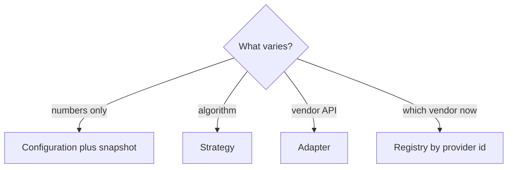

# Lesson 5 — Abstraction, Composition, Interfaces, and Pattern Selection

Add an interface or a named pattern when a **real** variation or boundary exists. “We might need it” is not enough.

**Companion:** [Book 2 — Lesson 5](../../../02-interview-companion/lld/module-05-lld/05-abstraction-composition-and-pattern-selection.md)

Uses [Lessons 2–4](02-requirement-clarification-and-scope.md). Provider DIP details continue in [Lesson 6](06-ocp-and-dip.md).

---

## Learning objectives

- Treat an interface as a contract, not a Spring ritual.
- Separate dependency **inversion** (who you depend on) from dependency **injection** (how a collaborator is passed in).
- Compose services without an interface per field.
- Keep one pricing formula in configuration; snapshot the rate on the session.
- Pick a pattern from a problem, and name the simpler design you rejected.

---

## A. Interfaces and abstraction

An interface is a contract callers can use without the concrete type. It pays off when:

- Implementations **vary independently** (different algorithms or vendors).
- You need a **substitution** point at a boundary (SDK, test double with different behavior).
- A test seam is **meaningful** (the collaborator is slow, remote, or non-deterministic).

It does not pay off when there is one class and no boundary. Spring Boot will inject a concrete `@Service`. You do not need `PricingService` plus `PricingServiceImpl` for that.

Future extensibility alone is a weak reason: you can extract an interface when the second implementation appears. That extraction is the OCP move; an empty interface today is not.

---

## B. Composition

Composition is a HAS-A relationship and a way to split responsibilities. It does not require an interface on every collaborator.

```text
ParkingService
    ├── ParkingLot
    ├── PricingService
    └── PaymentService
```

`ParkingService` sequences entry and exit. The lot, pricing, and payment keep their own reasons to change ([Lesson 3](03-domain-modeling-and-class-responsibilities.md)). Concrete fields are fine until something must be swapped.

---

## C. Strategy and configuration

Car, bike, and bus **rates** differ. The formula does not: `rate × ceil(hours)`.

**Algorithm = how. Configuration = what. Snapshot = when.**

| Piece | Role |
| --- | --- |
| Rate provider | Current configured rate |
| Pricing service | The one formula |
| Session | Rate captured at entry |

Do not add `CarPricingStrategy`, `BikePricingStrategy`, and `BusPricingStrategy` for three numbers. Introduce Strategy when the **calculation** changes (a daily cap versus hourly, a holiday rule versus a flat rate). See [Lesson 6](06-ocp-and-dip.md) for interacting rules.

---

## D. Pattern guide

GoF patterns are specific shapes. Composition, configuration, and snapshots are techniques. Use the shape only when the problem matches.

### 1. Strategy

**Problem:** interchangeable algorithms. **Example:** holiday pricing versus flat hourly, not three rate constants. **Justified** when behavior changes. **Skip** when only inputs change. **Mistake:** a strategy per enum constant.

### 2. Adapter

**Problem:** a vendor API does not match yours. **Example:** provider charge call versus `PaymentGateway.pay`. **Justified** at the process boundary. **Skip** inside one codebase with matching types. **Mistake:** adapters between your own services that you control.

### 3. Decorator

**Problem:** optional behavior around an object without editing it. **Example:** timing wrapper around a gateway. **Justified** when the wrap is reusable and independent. **Skip** when logging belongs in one orchestrator. **Mistake:** a decorator “in case we add metrics.”

### 4. Factory

**Problem:** construction has rules (which concrete type, required fields). **Example:** building a session only after a claim returns an id. **Skip** for `new ParkingSpot(...)` with two fields. **Mistake:** a factory that only calls `new`.

### 5. Registry / dispatch

**Problem:** pick an implementation by a key. **Example:** provider id → adapter. **Skip** a `Map<VehicleType, Strategy>` when a rate map is enough. **Mistake:** keying providers only by “card” when two acquirers both take cards.

### 6. Observer / messaging

**Problem:** several consumers react, and the publisher should not list them. **Example:** session closed → receipt and analytics. **Skip** when one service must finish payment before release. **Mistake:** events for a single in-process call.

### 7. State

**Problem:** behavior depends on lifecycle. **Example:** exit is legal in `ACTIVE`, not in `CLOSED`. **Skip** when a status field plus one method is still readable. **Mistake:** a state class per trivial flag.

### 8. Builder

**Problem:** many construction combinations. **Example:** a search criteria object. **Skip** for a session with a handful of required fields. **Mistake:** builders on every entity.

### 9. Facade

**Problem:** callers need one simple entry over a subsystem. **Example:** `ParkingService` in front of lot, pricing, and payment. **Skip** a facade that forwards one method. **Mistake:** facades that hide the only object you have.



---

## E. Payment-provider adapters

Initial scope ([Lesson 2](02-requirement-clarification-and-scope.md)) is cash and card **without** a PSP. When providers exist, the flow is:

```text
ParkingService → PaymentService → PaymentGateway
                      ├── Provider A adapter
                      └── Provider B adapter
```

Adapters translate. Spring **injects** the beans that exist. It does **not** choose the business route. A registry maps **provider id** → adapter. A map keyed only by payment method is ambiguous. Routing uses configuration plus a provider id. Retries need an idempotency key and a path for “unknown” (charged or not). Lesson 6 expands qualifiers, conditionals, and resolvers.

---

## F. Decorator versus orchestration

Logging, metrics, and retries can live in:

- `PaymentService`, when they are part of this workflow’s policy.
- A decorator, when the same wrap must sit on every gateway call and stay out of the service.
- Framework instrumentation (HTTP filters, Micrometer) when that is enough.

Do not add a decorator because a future requirement might want one.

---

## G. Spots and vehicles

Spot behavior is the same for every vehicle: fit or not, claim, release. Different **sizes or allowed types** are data on the spot (`canFit`), not `CarSpot` and `BikeSpot` subclasses. Keep `ParkingSpot` concrete until behavior diverges. An interface named `IParkingSpot` does not create variation.

---

## H. Decision table

| Problem | Candidate approach |
| --- | --- |
| Divide responsibilities among collaborators | Composition |
| Algorithm genuinely varies | Strategy |
| External API is incompatible | Adapter |
| Add optional behavior around an object | Decorator |
| Complex creation logic | Factory or Builder |
| Choose among implementations | Registry / dispatch |
| Multiple consumers react to an event | Observer or messaging |
| Same behavior, different values | Configuration |
| Preserve a business decision over time | Snapshot |

These are aids, not laws. Say which row you used and which you rejected.

## Common mistakes

- `XService` / `XServiceImpl` with one implementation.
- Strategy for rate tables.
- Adapter between two classes you own.
- Registry keyed only by CARD.
- Subclass per vehicle type.

## Interview guidance

For each pattern you name, give the parking sentence that **forces** it, and the sentence that means you should stop. Configuration plus snapshot covers the current fee rules.

## Revision summary

Compose concrete collaborators. Configure rates; snapshot them at entry. Add Strategy, Adapter, or Registry only for real variation or a vendor boundary. Spring injects; your policy routes.

## Practice questions

1. Why is one pricing service enough for car, bike, and bus?
2. What is the difference between the rate provider and the session’s stored rate?
3. When would you add `PaymentGateway` relative to Lesson 2’s scope?
4. Why is a map of payment method → provider unsafe?
5. Why not `CarSpot` and `BikeSpot`?

**Expected reasoning:** (1) One formula. (2) Provider is “now”; session is “at entry.” (3) When a real provider API appears; not for cash versus card alone. (4) Two card acquirers collide. (5) Behavior is `canFit`, not a subclass.
