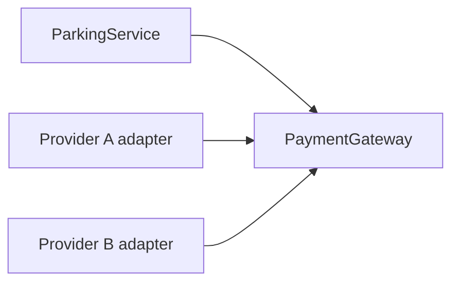
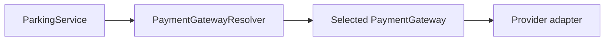
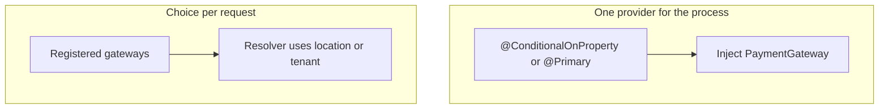
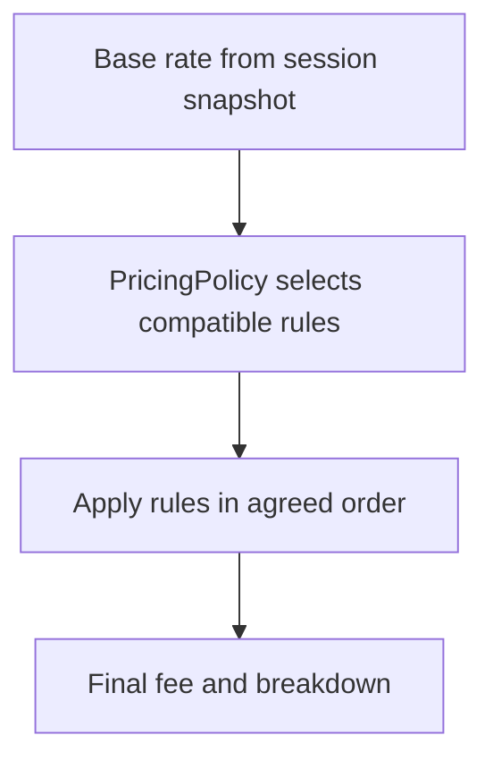

# Lesson 6 — Open/Closed Principle (OCP) and Dependency Inversion (DIP)

Running example: **Parking Lot** fees and exit payment. Snippets are **illustrative** — they show the design, not a complete production service.

**Companion:** [Book 2 — Lesson 6](../../../02-interview-companion/lld/module-05-lld/06-ocp-and-dip.md)

Related: [Lesson 1](01-lld-foundations-what-senior-lld-interviews-evaluate.md) (Strategy vs switch, Spring list injection). [Lesson 2](02-requirement-clarification-and-scope.md) (rate captured at entry, payment failure keeps the spot). [Lesson 3](03-domain-modeling-and-class-responsibilities.md) (who owns pricing vs payment). [Lesson 4](04-encapsulation-invariants-and-tell-dont-ask.md) (payment failure does not release the spot). [Lesson 5](05-abstraction-composition-and-pattern-selection.md) (composition, config vs Strategy, adapters).

Use `BigDecimal` for money. Examples use `VehicleType.CAR`, `BIKE`, and `BUS`.

---

## Learning outcomes

- Explain OCP without treating it as “never edit code.”
- Separate **data/configuration** changes from **behavior/algorithm** changes.
- Decide when a rate table is enough and when Strategy or pricing rules are justified.
- Recognize when a growing set of pricing rules should be refactored, using complexity and interaction rather than a rule count.
- Apply DIP so parking exit logic does not depend on a vendor SDK.
- Distinguish DIP from Dependency Injection.
- Place interfaces, adapters, resolvers, and Spring bean selection in the right jobs.
- Add a new payment provider without rewriting the exit workflow, when the contract already allows registration.

---

## A. Open/Closed Principle

**OCP:** software entities should be **open for extension** and **closed for modification**.

That does **not** mean the codebase is frozen. It means **stable** calculation or workflow code should not need a new branch every time a supported variation appears. You still change code to fix bugs, change the stable contract, or introduce the extension point the first time.

### A.1 Initial pricing design

```java
public class PricingService {

    public BigDecimal calculateFee(VehicleType type, long billableHours) {
        if (type == VehicleType.CAR) {
            return BigDecimal.valueOf(50L * billableHours);
        } else if (type == VehicleType.BIKE) {
            return BigDecimal.valueOf(20L * billableHours);
        }
        throw new IllegalArgumentException("Unsupported vehicle type");
    }
}
```

Adding BUS (or any new type) edits the same method. Repeated additions grow a conditional that is hard to test in isolation. [Lesson 1](01-lld-foundations-what-senior-lld-interviews-evaluate.md) already showed the same pressure on a `switch`.

### A.2 Configuration versus Strategy

**Only data changes** when every vehicle uses the same formula:

`fee = hourlyRate(type) × billableHours`

| Type | Rate |
| --- | --- |
| CAR | 50 per hour |
| BIKE | 20 per hour |
| BUS | 100 per hour |

```yaml
parking:
  hourly-rates:
    CAR: 50
    BIKE: 20
    BUS: 100
```

```java
public BigDecimal calculateFee(VehicleType type, long billableHours) {
    BigDecimal rate = rates.get(type);
    if (rate == null) {
        throw new IllegalArgumentException("Unsupported vehicle type: " + type);
    }
    return rate.multiply(BigDecimal.valueOf(billableHours));
}
```

One service looks up a configured rate and applies the shared formula. `billableHours` is already the rounded-up duration from [Lesson 2](02-requirement-clarification-and-scope.md); this method does not re-decide rounding. **Do not** add `CarPricingStrategy`, `BikePricingStrategy`, and `BusPricingStrategy` only because the numbers differ.

**Behavior changes** when the algorithm is not the same formula:

- Weekend multiplier
- Holiday pricing
- Commercial-vehicle surcharge
- A different algorithm (for example daily cap vs pure hourly)

Then a **Strategy** or a **pricing-rule** abstraction is justified, because each variation can evolve and be tested on its own. A new vehicle type that only needs a rate still belongs in configuration.

### A.3 Refactoring signals

Refactor a growing `PricingService` when:

- Every new rule edits the same method.
- Branches keep accumulating.
- Rules evolve independently.
- Rules interact (precedence, mutual exclusion).
- A change to one rule risks another.
- Tests must reconstruct a large conditional to prove one rule.

**Count of rules is not the trigger.** Two interacting multipliers can justify a policy; ten independent rates in a map may not.

---

## B. Composing multiple pricing rules

Roles (introduce types only when a real variation needs them):

| Role | Responsibility |
| --- | --- |
| `PricingService` | Orchestrates calculation for a session |
| `BaseRateProvider` | Supplies configured base rates |
| `PricingRule` | One independently varying adjustment |
| `PricingPolicy` | Which rules apply together, precedence, conflicts |
| `PricingContext` | Inputs rules may read (type, timestamps, vehicle class) |

### B.1 Rule contract

```java
public interface PricingRule {
    boolean appliesTo(PricingContext context);
    BigDecimal apply(BigDecimal currentFee, PricingContext context);
}
```

Examples: `WeekendPricingRule`, `HolidayPricingRule`, `CommercialVehicleSurchargeRule`.

Spring can inject `List<PricingRule>`. The service depends on the interface. Registering another `@Component` rule does not require editing `PricingService` **if** selection and conflict rules already live in `PricingPolicy`.

### B.2 Rule-composition semantics

Example:

- Base fee: 200
- Weekend multiplier: 1.5
- Holiday multiplier: 2.0
- Commercial surcharge: 50

**Agreed policy for this example:**

- If weekend and holiday both apply, use the **holiday** multiplier. Do **not** compound 1.5 and 2.0.
- Apply an eligible commercial surcharge **after** the multiplier.

So holiday + commercial: `200 × 2 + 50 = 450`. Weekend + commercial (no holiday): `200 × 1.5 + 50 = 350`.

A priority integer alone does **not** define compatibility. `PricingPolicy` selects a compatible set and resolves conflicts. Illustrative selection — not a production policy:

```java
public BigDecimal calculate(PricingContext context, List<PricingRule> rules) {
    List<PricingRule> selected = selectCompatible(rules, context);
    BigDecimal fee = context.baseFee();
    for (PricingRule rule : selected) {
        fee = rule.apply(fee, context);
    }
    return fee;
}
```

`selectCompatible` drops the weekend multiplier when holiday applies, then keeps an eligible commercial surcharge. The loop assumes `selected` is already in that order. Also decide:

- **Deterministic order** of application.
- **Rounding** (scale and mode) once, and document it.
- **Combination tests** (weekend only, holiday only, both, plus surcharge).
- A **pricing breakdown** (base, rules applied, rules skipped, final) for support and audits.

### B.3 Session pricing consistency

For an open parking session:

- Capture the applicable hourly rate (and any policy version or effective-date inputs you rely on) **when the session starts**.
- Persist the terms needed to recompute **that** session’s fee.
- A later config change must not silently reprice an in-progress session.
- Payment retries charge the **same calculated amount**.
- If rates are effective-dated, store the policy version or the captured rate, not “whatever is in YAML now.”

---

## C. Dependency Inversion Principle

**DIP:** high-level business logic should not depend on low-level vendor details. Both depend on an **abstraction**.

### C.1 Before DIP

`ParkingService → ConcretePaymentProvider / third-party SDK`

Exit workflow compiles against the vendor API. Swapping providers, or testing exit without the SDK, means editing `ParkingService`.


### C.2 After DIP

`ParkingService → PaymentGateway ← ProviderAdapter`

```java
public interface PaymentGateway {
    PaymentResult pay(PaymentRequest request);
}
```

| Type | Responsibility |
| --- | --- |
| `ParkingService` | Exit workflow: load session, fee already calculated, call pay, record outcome |
| `PaymentGateway` | Application-owned contract |
| Provider adapter | Maps `PaymentRequest` / `PaymentResult` to one vendor API |



The arrows into `PaymentGateway` from adapters are **implements**. Source dependency of the service points at the interface, not the SDK.

### C.3 What “inverted” means

- The business service depends on an application-owned abstraction.
- The adapter implements that abstraction and is the only type that should import the SDK.
- DIP is a **design** rule. **Dependency Injection** is a **technique** for passing collaborators in (constructor injection, Spring, manual `new`).

Spring does **not** imply DIP. Constructor-injecting a concrete vendor client still couples `ParkingService` to that vendor.

---

## D. Spring bean selection and provider resolution

### D.1 `@Qualifier`

`@Qualifier` picks **one bean at an injection point** when several candidates exist. It does **not** choose a provider per transaction.

```java
public ParkingService(
        @Qualifier("providerAGateway") PaymentGateway paymentGateway) {
    this.paymentGateway = paymentGateway;
}
```

Illustrative: the string names a bean, fixed for that service instance.

### D.2 `@Primary`

`@Primary` marks the **default** candidate when several beans match and the injection point has no qualifier.

### D.3 `@ConditionalOnProperty`

`@ConditionalOnProperty` decides whether a bean is **registered when the context starts**.

- Fits **one provider for the whole application**.
- Changing the property does **not** swap the bean in an already running context. Restart (or a refresh mechanism you explicitly built) is required.
- It is **not** per-request selection.
- If the value matches no provider, fail **startup** — do not serve traffic with a missing gateway.

### D.4 Resolver or registry

Use a `PaymentGatewayResolver` when:

- Several providers are registered **at the same time**, and
- The choice depends on location, tenant, or the payment request.



Skip the resolver when one provider is selected for the process and direct `PaymentGateway` injection is enough.

If the resolver holds a map injected by Spring, Spring **supplies** the registered beans. The resolver **selects** at runtime. Those are different jobs. A `Map<String, PaymentGateway>` from Spring is keyed by **bean name**. Use those names as provider ids only when you chose them that way; otherwise the resolver builds its own id-to-gateway registry from the injected beans.

```java
public PaymentGateway resolve(String providerId) {
    PaymentGateway gateway = gatewaysById.get(providerId);
    if (gateway == null) {
        throw new IllegalStateException("No gateway for provider " + providerId);
    }
    return gateway;
}
```

Illustrative. A missing id is a configuration or routing bug, not a cue to call a random provider. A factory that `new`s a gateway per call is unnecessary when the adapters are already Spring beans.



### D.5 Adapter versus resolver

| Component | Responsibility |
| --- | --- |
| `PaymentGateway` | Application-owned contract |
| Provider adapter | Translates between that contract and an external API |
| Resolver / registry | Selects a provider at runtime |
| `@Qualifier` | Selects a bean at an injection point |
| `@ConditionalOnProperty` | Registers a bean from configuration at startup |
| Spring DI | Supplies dependencies to components |

The resolver is **not** the Adapter pattern. Both can exist: adapters translate, the resolver chooses which adapter handles this request.

---

## E. Adding Provider C

If the design already supports registration and selection:

| Change | Usually required |
| --- | --- |
| New class implementing `PaymentGateway` | Yes |
| Spring registration (`@Component` or equivalent) | Yes |
| Config key and/or resolver map entry | Yes, if selection is config- or map-driven |

| Leave stable | When the extension point already exists |
| --- | --- |
| `ParkingService` exit workflow | Yes |
| `PaymentGateway` method contract | Yes, unless the contract itself is wrong |
| Existing adapters | Yes |

This is OCP (extend by a new adapter, don’t fork the workflow) and DIP (the workflow already depends on the abstraction). Registration and configuration **can** still change. OCP does not mean zero edits anywhere in the repo.

---

## Diagram — pricing flow



Holiday replaces weekend; surcharge runs after the chosen multiplier. The base rate comes from the **session snapshot**, not from live config at exit time.

---

## F. Interview-ready explanations

1. **OCP in your own words.** Stable logic stays free of a new branch per variation. You extend through data or a new type behind an existing abstraction. You still edit code to introduce that abstraction or to fix the stable rules.

2. **Configuration instead of Strategy.** Same formula, different numbers (CAR 50, BIKE 20, BUS 100). A map or YAML rate is enough. A strategy class per vehicle only adds types.

3. **When to refactor pricing.** When rules change independently, interact, or make one method untestable — not merely because there are “many” rates.

4. **Combining rules.** Write the business rule: holiday supersedes weekend; commercial surcharge applies after. Put that in `PricingPolicy`. Test combinations. Emit a breakdown. Do not pretend a priority number equals compatibility.

5. **DIP and parking payment.** `ParkingService` calls `PaymentGateway`. A provider adapter implements it and talks to the SDK. The exit flow does not import the SDK.

6. **DIP vs DI.** DIP is who depends on which type. DI is how a dependency is passed in. You can inject a concrete SDK and still violate DIP.

7. **Why a concrete Spring bean is not DIP.** The service’s source still names the vendor type. Tests and a second provider still require editing that service.

8. **`@Qualifier` vs `@Primary` vs `@ConditionalOnProperty`.** Qualifier: this injection point wants that bean. Primary: default if several match. Conditional: create the bean or not **at startup** from a property. None of them, by themselves, pick a provider per HTTP request. A property change does not hot-swap a running context.

9. **When a resolver is needed.** Multiple gateways live at once and location, tenant, or request chooses. One global provider: inject `PaymentGateway` and skip the resolver.

10. **Provider C.** Add an adapter, register it, and point config or the registry at it. Do not rewrite `ParkingService` or existing adapters if the contract already fits. Say that registration can still change.

---

## Exercises

Attempt these before reading Section F again.

1. Add `TRUCK` with only a different hourly rate. Which types change?
2. Add a festival-day rule without editing `PricingService` orchestration. What must `PricingPolicy` already know?
3. Weekend and holiday both match. What is the fee on a 200 base with commercial surcharge 50, using this lesson’s policy?
4. Replace the payment vendor. Which class must stay source-compatible?
5. One provider per deployment vs one provider per parking location: `@ConditionalOnProperty`, `@Qualifier`, or a resolver?

## Revision checklist

- Same formula → configuration, not one strategy per rate.
- Interacting rules → policy with explicit precedence and tests.
- Session stores the rate (or policy version) it will be billed on.
- Retries use that stored amount.
- Service depends on `PaymentGateway`; adapter owns the SDK.
- DI ≠ DIP.
- Qualifier and conditional config are startup wiring, not per-request routing.
- Resolver selects among beans Spring already registered.

## Key takeaways

OCP is about **where** change lands: config for data, new rule or adapter types for behavior, policy for conflicts. DIP keeps the parking exit workflow on an application contract so a new provider is an adapter plus registration, not a rewrite of exit logic.
