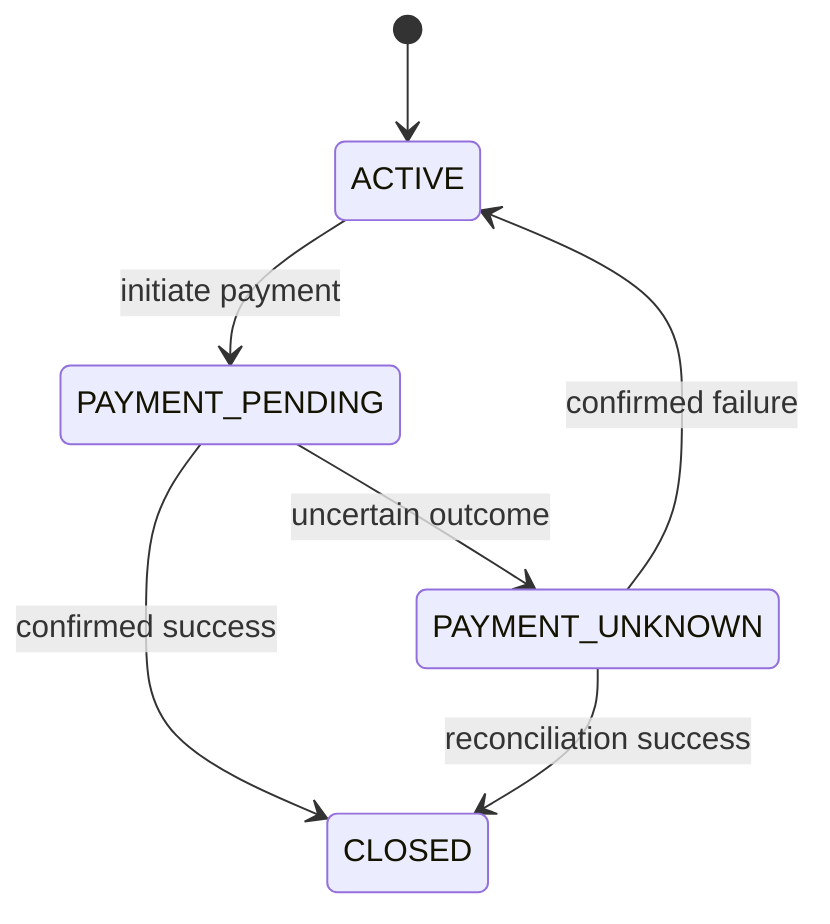
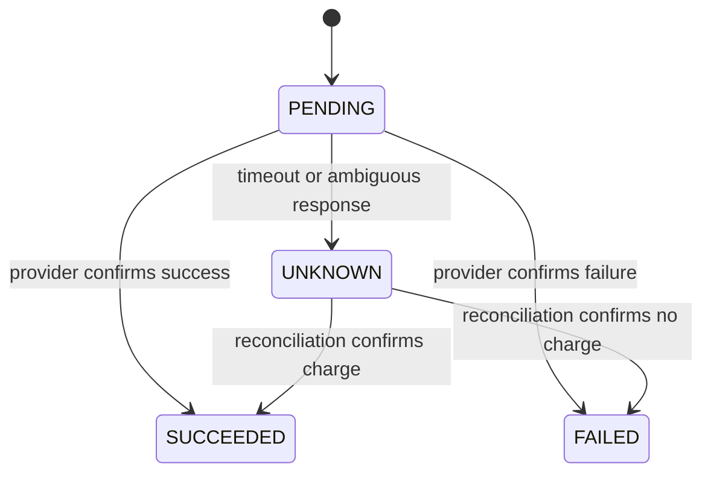
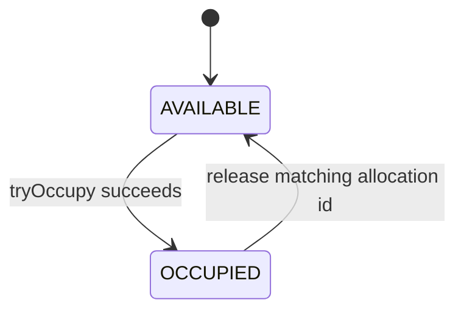
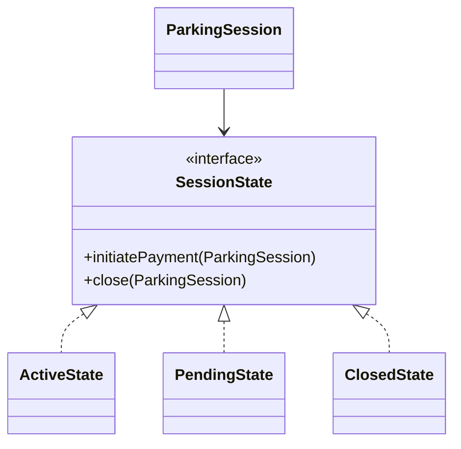
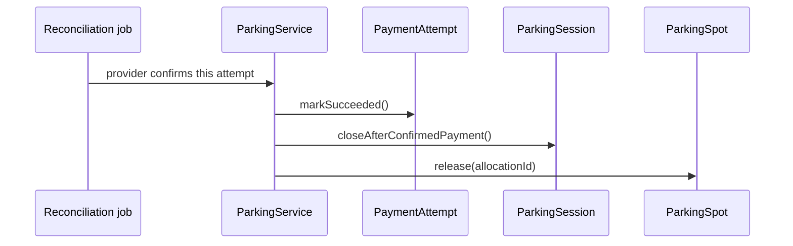
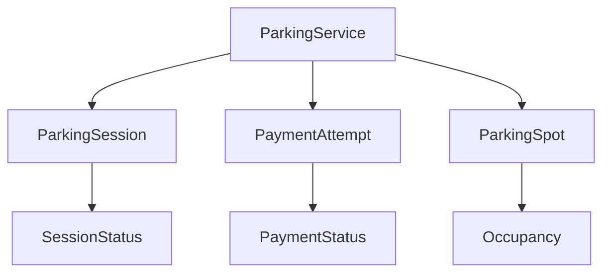
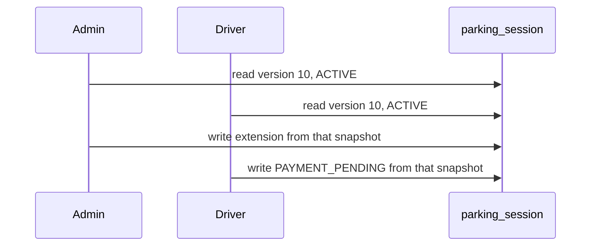

# Lesson 7 — State Modeling and State Transitions

Running example: **Parking Lot** exit, grace period, and payment reconciliation. Snippets are **illustrative**. They show ownership and transitions, not a production persistence layer.

**Companion:** [Book 2 — Lesson 7](../../../02-interview-companion/lld/module-05-lld/07-state-modeling-and-transitions.md)

Related: [Lesson 3](03-domain-modeling-and-class-responsibilities.md) (who owns the spot and the session), [Lesson 4](04-encapsulation-invariants-and-tell-dont-ask.md) (`tryOccupy` / `release(allocationId)`), [Lesson 6](06-ocp-and-dip.md) (payment gateway stays outside the session, fee is snapshotted).

Assumption for the SQL: one relational database, row updates are atomic, and these entities share that database unless a section says otherwise.

---

## Learning outcomes

- Model a lifecycle as valid transitions, not a bag of flags.
- Keep state ownership on the entity and workflow coordination on the service.
- Choose an enum state machine or the GoF State pattern for a real reason.
- Keep ordinary facts (a grace-period extension) out of the lifecycle enum.
- Let session, payment attempt, and spot move on separate lifecycles.
- Make conflicting transitions atomic with a version or a conditional update.
- Treat an optimistic-lock conflict as stale business state, not as a blind retry.
- Keep the payment-provider call outside the database transaction.

---

## 1. What state modeling is

State modeling names the **modes** an entity can be in and the **transitions** that are legal. A parking session is not “a row with a string we overwrite.” It is parked, paying, uncertain, or closed, and only some of those arrows exist.

A useful state is a mode that **changes which operations are legal**. `ACTIVE` may accept a grace-period extension. `PAYMENT_PENDING` may not. `floorNumber` is data. It does not change what the session is allowed to do.

---

## 2. Domain model used here

| Component | Responsibility |
| --- | --- |
| `ParkingLot` | Holds spots and allocation order |
| `ParkingSpot` | Owns occupancy and the allocation id |
| `ParkingSession` | Owns the visit lifecycle |
| `PaymentAttempt` | Owns one payment try |
| `ParkingService` | Coordinates entry, exit, and reconciliation |

No extra state-manager type. [Lesson 4](04-encapsulation-invariants-and-tell-dont-ask.md) still applies: the spot claims itself with `tryOccupy()` and releases only a matching allocation id.

---

## 3. ParkingSession lifecycle

Illustrative session states:

```java
public enum SessionStatus {
    ACTIVE,
    PAYMENT_PENDING,
    PAYMENT_UNKNOWN,
    CLOSED
}
```

| Status | Meaning |
| --- | --- |
| `ACTIVE` | The vehicle is parked. The visit is open. |
| `PAYMENT_PENDING` | Exit has started and a payment attempt is in flight. |
| `PAYMENT_UNKNOWN` | The provider outcome is uncertain. A timeout does **not** prove the customer was not charged. |
| `CLOSED` | Payment is confirmed and the visit is closed. |



This session enum is a **teaching model**. A production design keeps the payment-attempt lifecycle on `PaymentAttempt`. The session should not grow a value for every provider status (authorized, captured, refunded, partially captured). `PAYMENT_UNKNOWN` exists so the visit does not pretend the money failed when the call timed out.

There is no arrow from `CLOSED` back to `ACTIVE`. Reopening a paid visit is a new business rule, not a silent setter.

---

## 4. PaymentAttempt lifecycle

```java
public enum PaymentStatus {
    PENDING,
    UNKNOWN,
    FAILED,
    SUCCEEDED
}
```



A definite failure may go `PENDING → FAILED`. Unknown is only for an outcome you cannot classify. Do not map a timeout to `FAILED`.

Why a second lifecycle:

- The attempt can be `UNKNOWN` while the session stays open (`PAYMENT_UNKNOWN` or still not closed).
- `FAILED` does not close the session and does not free the spot.
- `SUCCEEDED` is what allows the session to close.
- A timeout is not evidence of failure. [Lesson 2](02-requirement-clarification-and-scope.md) still holds: the vehicle stays on the spot until payment succeeds, and the fee already calculated is reused.

---

## 5. ParkingSpot occupancy



The spot owns occupancy. Callers do not get `setOccupied` or `setAllocationId`. `tryOccupy()` either returns a new allocation id or empty. `release(allocationId)` no-ops or returns false when the id is not the current one, so a late cleanup cannot free the next vehicle ([Lesson 4](04-encapsulation-invariants-and-tell-dont-ask.md)).

The spot stays `OCCUPIED` through `PAYMENT_PENDING` and `PAYMENT_UNKNOWN`. It returns to `AVAILABLE` only after confirmed payment and a matching release, or after a safe rollback of a failed **entry**.

---

## 6. Ownership versus orchestration

**Ownership:** the entity validates its own transitions and refuses illegal ones.

**Orchestration:** `ParkingService` orders the steps, calls the gateway, and decides the next entity method from the provider result. It does not assign status fields.

| Operation | Owner |
| --- | --- |
| Change payment-attempt status | `PaymentAttempt` |
| Close the parking session | `ParkingSession` |
| Release the spot | `ParkingSpot` |
| Coordinate a successful exit | `ParkingService` |
| Coordinate reconciliation | `ParkingService` |

Simplified guards. This `close()` only allows `PAYMENT_PENDING`, which is the happy path in the first half of the diagram:

```java
public class ParkingSession {

    private SessionStatus status;

    public void initiatePayment() {
        if (status != SessionStatus.ACTIVE) {
            throw new IllegalStateException(
                "Payment cannot be initiated in current state");
        }
        status = SessionStatus.PAYMENT_PENDING;
    }

    public void close() {
        if (status != SessionStatus.PAYMENT_PENDING) {
            throw new IllegalStateException(
                "Session cannot be closed in current state");
        }
        status = SessionStatus.CLOSED;
    }
}
```

The diagram also closes from `PAYMENT_UNKNOWN` after reconciliation, and it returns to `ACTIVE` when reconciliation proves there was no charge. One method has to allow those arrows or the picture and the code disagree:

```java
public void markPaymentUnknown() {
    if (status != SessionStatus.PAYMENT_PENDING) {
        throw new IllegalStateException(
            "Only an in-flight payment can become unknown");
    }
    status = SessionStatus.PAYMENT_UNKNOWN;
}

public void closeAfterConfirmedPayment() {
    if (status != SessionStatus.PAYMENT_PENDING
            && status != SessionStatus.PAYMENT_UNKNOWN) {
        throw new IllegalStateException(
            "Session cannot close before a confirmed payment");
    }
    status = SessionStatus.CLOSED;
}

public void reopenAfterConfirmedFailure() {
    if (status != SessionStatus.PAYMENT_UNKNOWN) {
        throw new IllegalStateException(
            "Only an uncertain session can return to active");
    }
    status = SessionStatus.ACTIVE;
}
```

`closeAfterConfirmedPayment()` does not call the provider and does not prove money moved. The service may call it only after `PaymentAttempt` is `SUCCEEDED`. The session enforces **its** legal arrows. The service enforces **when** those arrows are allowed in the workflow.

This is safer than `session.setStatus(SessionStatus.CLOSED)`, which can close an `ACTIVE` visit with no payment. Domain methods are the in-process invariant. They do not stop two JVMs from both seeing `ACTIVE`. The database has to make the conflicting updates atomic. Section 10 covers that.

Do not put “load the spot, call the gateway, commit” inside `ParkingSession`. The entity would then orchestrate neighbors and I/O. Do not let `ParkingService` write `status` fields because that bypasses the guards.

---

## 7. Enum machine versus the State pattern

### 7.1 Enum-based machine

State is a value. Methods reject illegal transitions. Behavior that depends on status is a small conditional or a separate method per action.

```java
public BigDecimal payableAmount() {
    if (status == SessionStatus.CLOSED) {
        throw new IllegalStateException("Closed session has no payable amount");
    }
    return capturedFee;
}
```

This stays readable while the rules are “which arrows exist” and a few guards. Payment retries, timeouts, and reconciliation are usually **attempt and workflow** concerns. They do not, by themselves, require a class per session status.

### 7.2 GoF State pattern

The pattern’s intent: an object changes behavior when its internal state changes, so it appears to change its class.

```text
ParkingSession
      |
      v
 SessionState
      |
      +-- ActiveState
      +-- PendingState
      +-- ClosedState
```

```java
public interface SessionState {
    void initiatePayment(ParkingSession session);
    void close(ParkingSession session);
}
```



`ActiveState.initiatePayment` moves the session to `PendingState`. `ClosedState.initiatePayment` refuses. Each class holds the behavior for one mode.

### 7.3 Comparison

| Aspect | Enum-based | State pattern |
| --- | --- | --- |
| Representation | Enum value | State object |
| Behavior | Guarded methods and small conditionals | Methods on the state class |
| Complexity | Lower | Higher |
| Types | Few | One class per state, plus the context |
| Fits | Simple or moderate lifecycle rules | Large state-specific behavior |
| Adding a variation | Often edits a conditional or a guard | New behavior can sit in a new state class |

### 7.4 What to choose here

Start with the enum. Several statuses are not a reason to add the pattern. Introduce it when state-specific behavior is large enough that the conditionals are hard to test — different operations, side effects, and rules per mode — not when a new provider status appears.

The pattern does not remove `ParkingService`. Provider calls stay in the service (behind `PaymentGateway` from [Lesson 6](06-ocp-and-dip.md)). A state class that opens HTTP calls hides I/O inside the domain and makes transactions harder to bound.

---

## 8. Lifecycle state versus an ordinary attribute

Requirement: an administrator may extend the grace period **once**, and only while the session is `ACTIVE`. Extension is refused after payment starts. Exceptional approval is still that same rule unless a new workflow is specified.

`GRACE_PERIOD_EXTENDED` should not be a session status. The visit is still parked. The extension is a fact about an `ACTIVE` session.

```java
public class ParkingSession {

    private SessionStatus status;
    private Instant expectedExitTime;
    private boolean gracePeriodExtended;
    private Instant gracePeriodExtendedAt;
    private Duration extensionDuration;

    public void extendGracePeriod(Duration duration) {
        if (status != SessionStatus.ACTIVE) {
            throw new IllegalStateException(
                "Cannot extend a non-active session");
        }
        if (gracePeriodExtended) {
            throw new IllegalStateException(
                "Grace period already extended");
        }
        if (duration == null || duration.isNegative() || duration.isZero()) {
            throw new IllegalArgumentException(
                "Extension duration must be positive");
        }
        expectedExitTime = expectedExitTime.plus(duration);
        gracePeriodExtended = true;
        gracePeriodExtendedAt = Instant.now();
        extensionDuration = duration;
    }
}
```

Illustrative. Production code takes a `Clock` (or an `Instant` from the caller) instead of `Instant.now()`, so tests can fix the time.

A separate `GracePeriodExtension` entity earns its place when the extension has its own lifecycle: requested, approved, rejected; more than one extension; an audit trail; or a policy that is not a single boolean. Until then the fields on the session are enough.

Not every business event is a new lifecycle state.

---

## 9. Independent lifecycles

```text
ParkingSession:   ACTIVE → PAYMENT_PENDING → CLOSED
PaymentAttempt:   PENDING → UNKNOWN → SUCCEEDED
ParkingSpot:      AVAILABLE → OCCUPIED → AVAILABLE
```

Those arrows are not one machine.

- `UNKNOWN` on the attempt does not close the session.
- A failed attempt does not free the spot.
- The spot stays occupied while money is unresolved.
- `ParkingService` tells each owner to take its next legal step. It does not set the three fields itself.

Successful reconciliation after the provider confirms the charge:



The service calls methods. In one database, session close and spot release commit in the **same** local transaction. The provider call already finished **before** that transaction, or it is a reconciliation read of a stored result. Section 12 is the boundary.



---

## 10. The grace-period race

The session is `ACTIVE`. An administrator extends the grace period. The driver starts payment at the same time. Extension is legal only before payment starts.



Both passed an in-memory check. Both are about to write.

```java
if (session.getStatus() == SessionStatus.ACTIVE) {
    session.extendGracePeriod(duration);
}
```

That `if` is not atomic with the update across requests or JVMs. The status can change after the read. Domain guards still matter for a single-threaded call. They are not the concurrency control.

---

## 11. Optimistic locking

Optimistic locking assumes conflicts are uncommon. Readers do not block each other. The write fails if the row changed.

JPA:

```java
@Version
private Long version;
```

A successful flush updates the version. A second flush that still has the old version affects zero rows and surfaces as an optimistic-lock failure (`OptimisticLockException` or the Spring translation).

`@Version` detects a stale write. It does **not** add `status = 'ACTIVE'` by itself. If you save a whole stale object after a bad merge, you can persist whatever status was in memory as long as the version matches. Load, run the domain method, and flush inside one transaction so the version check and the business change are one write. Do not catch the conflict and copy fields onto a newer row without re-running the guards.

Conditional SQL makes the business rule part of the same statement. Use this **or** JPA’s version column, not both increment styles on one update (`version = version + 1` in SQL plus `@Version` will fight).

Grace-period extension:

```sql
UPDATE parking_session
SET expected_exit_time = :newExitTime,
    grace_period_extended = TRUE,
    grace_period_extended_at = :extendedAt,
    extension_duration = :duration,
    version = version + 1
WHERE session_id = :sessionId
  AND status = 'ACTIVE'
  AND grace_period_extended = FALSE
  AND version = :expectedVersion;
```

Payment initiation:

```sql
UPDATE parking_session
SET status = 'PAYMENT_PENDING',
    version = version + 1
WHERE session_id = :sessionId
  AND status = 'ACTIVE'
  AND version = :expectedVersion;
```

One statement wins (`1` row). The other matches `0` rows or throws on version. Both cannot commit from version 10. Update the related columns in that one statement and one transaction. Check the update count. A zero-row update is a conflict or a state change, not a success.

The database is the authority for the atomic transition. The Java `if` is the readable form of the same rule for a single caller.

---

## 12. Pessimistic locking

Pessimistic locking takes the row before the decision. The other transaction waits.

```sql
BEGIN;

SELECT *
FROM parking_session
WHERE session_id = :sessionId
FOR UPDATE;

-- Domain rule on the locked row, then UPDATE.

COMMIT;
```

The lock lasts until commit or rollback. Keep the transaction short. Do not call the payment provider while `FOR UPDATE` is held. Deadlock risk goes up if two transactions lock session and spot in opposite orders. Lock in a fixed order (session, then spot) when both rows are needed.

| | Optimistic | Pessimistic |
| --- | --- | --- |
| Idea | Detect a conflict at write time | Block the other writer |
| Cost when quiet | One version check | Lock and wait machinery |
| Cost when hot | Retries and user-visible conflicts | Waiting, lock timeouts, deadlocks |
| Fits | Moderate contention, cheap to re-read | Conflicts are frequent or very expensive |
| External HTTP | Natural: no lock held across the call | Unsafe if the lock stays open during the call |

For this parking lot, start with optimistic locking plus a conditional status predicate. Move a specific hotspot to `FOR UPDATE` only if lost updates or retry storms show up. That is a measurement decision, not a default for every table.

---

## 13. Handling a lost update

1. Administrator reads version 10, `ACTIVE`.
2. Driver starts payment. Version becomes 11, status `PAYMENT_PENDING`.
3. Administrator writes the extension with version 10.
4. The database rejects the stale write.

Do not retry the extension with the old decision.

**Technical retry:** the database timed out or the connection dropped, and you can safely repeat the same statement (same idempotency, no second side effect).

**Business retry:** the row changed meaning. Reload. Show the current status. If it is still `ACTIVE` and not extended, the administrator may submit a **new** action. If it is `PAYMENT_PENDING` or `PAYMENT_UNKNOWN`, the extension is no longer legal. Say so. Do not loop “read, extend” until a version matches.

---

## 14. Transactions and the payment provider

If the session and the spot share a database, close the session and `release(allocationId)` in one local transaction. Either both commit or the spot stays occupied and the session stays open.

Do not hold that transaction open across the provider HTTP call.

- Start payment: conditional transition to `PAYMENT_PENDING`, commit, then call `PaymentGateway` with an idempotency key ([Lesson 6](06-ocp-and-dip.md)).
- Definite success: a **new** short transaction runs `markSucceeded`, `closeAfterConfirmedPayment`, and `release`.
- Definite failure: mark the attempt `FAILED`, return the session to `ACTIVE` if you had moved it, leave the spot occupied, keep the snapshotted fee.
- Timeout: `UNKNOWN` / `PAYMENT_UNKNOWN`, leave the spot occupied, reconcile later.
- If the provider confirms success and the local commit fails, retry the **local** completion with the same confirmed result and the same idempotency key. Do not charge again because the database update failed.
- If session and spot are in different databases, `@Transactional` on one method is not atomic across both. You need an explicit completion path (retry the second write, or an outbox). This lesson does not design that coordination.

---

## 15. Shape of the design

```text
                 ParkingService
                 /      |      \
                v       v       v
      ParkingSession  PaymentAttempt  ParkingSpot
            |              |             |
            v              v             v
      SessionStatus   PaymentStatus   occupancy
```

The service orchestrates. Entities own state and guard transitions. The database makes the contested update atomic. The provider stays outside the local transaction.

---

## 16. Interview-ready explanations

1. **What is state modeling?** Naming the modes that change which operations are legal, and the arrows between them. A parking session is active, paying, unknown, or closed. Not every column is a state.

2. **How do you find lifecycle states?** Walk one use case and ask what must become illegal. Extension is illegal after payment starts, so “payment started” is a mode. A one-time grace extension does not make a new mode; the session is still parked.

3. **Why should the entity guard transitions?** `setStatus(CLOSED)` can close an unpaid visit from any caller. `closeAfterConfirmedPayment()` encodes the legal arrows in one place. The service can still get the workflow order wrong; it cannot invent a transition the entity rejects.

4. **Ownership versus orchestration?** The session changes session status. The attempt changes payment status. The spot releases only a matching allocation id. The service sequences those calls and talks to the gateway. If the service sets fields, the guards are optional. If the session calls the gateway and the spot, the entity is a workflow.

5. **Enum or State pattern?** Enum plus guarded methods while rules are arrows and small conditions. State objects when each mode has a lot of distinct behavior. The pattern’s intent is behavior that changes with state, not “we have four constants.”

6. **When is the State pattern unnecessary?** Four session statuses, a boolean grace extension, and payment retries. Retries and timeouts belong to the attempt and the service. Extra state classes would scatter a small rule.

7. **Why isn’t grace extension a status?** The car is still parked. The rule is “once, and only while `ACTIVE`.” A boolean and timestamps record that fact. A new status is justified when the extension itself is approved or rejected over time, or when many extensions exist.

8. **Why separate payment and session?** The attempt can be unknown without the visit being closed. Failure must not free the spot. Success is the signal to close. Folding every provider status into `SessionStatus` makes one enum do two jobs and invites `CLOSED` on a timeout.

9. **How do you stop concurrent transitions?** Put the predicate and the write in one database statement, or lock the row for the length of a short transaction. An `if (status == ACTIVE)` in a previous request is not that statement. `@Version` rejects a stale snapshot; the `WHERE status = 'ACTIVE'` clause rejects the wrong business mode even when you are writing SQL by hand.

10. **Optimistic versus pessimistic?** Optimistic lets both reads proceed and fails the stale write. Pessimistic makes the second transaction wait on `FOR UPDATE`. Optimistic fits this exit path if conflicts are rare. Pessimistic fits a row that is constantly contended, and only if the lock is not held during HTTP.

11. **Two updates at once?** Both read version 10. One conditional update commits and bumps the version. The other updates zero rows. You cannot both extend and start payment from the same version. Check the count. Do not treat zero rows as success.

12. **What do you do with the conflict?** Do not replay the administrator’s extension. Reload. If the session is already `PAYMENT_PENDING`, refuse and show that status. A technical retry is for a dropped connection on a statement that is still valid, not for a changed business state.

13. **Why is the provider call outside the transaction?** The row lock or the open transaction would sit for the whole HTTP timeout. Pool connections stall, and a lock on the session blocks the reconciler. Commit the “payment started” transition, call the gateway, then commit the result in a second short transaction.

14. **Provider success, database failure?** The customer may already be charged. Retry closing the session and releasing the spot using the stored success and the same idempotency key. Do not send a second pay call to “finish” the database error. If you are not sure the provider succeeded, stay in `UNKNOWN` and reconcile.

---

## 17. Common mistakes

- Public setters for lifecycle status.
- `ParkingService` writing entity fields.
- The session calling the gateway, the spot, and the attempt.
- A new enum constant for every event, including a one-time grace extension.
- The State pattern because a diagram has several boxes.
- One enum that is both the visit and the payment attempt.
- Treating a Java `if` as concurrency control.
- Assuming `@Version` adds business predicates and covers every race without a transaction and a real flush.
- `FOR UPDATE` held across the provider call.
- Blind retry after an optimistic conflict.
- Releasing the spot before payment is confirmed.
- Recording a timeout as `FAILED`.

---

## 18. Exercises

Work these before the hints.

1. Add administrative cancellation. From which statuses is it legal, and what happens to the spot and to an in-flight payment?
2. Make the grace-period extension impossible once payment has started, including the version-10 race.
3. Close the session and release the spot so a crash cannot leave one done and the other not, when both rows share a database.
4. The provider call times out. Later reconciliation shows the charge succeeded. Which entities move, and in what order?
5. A new rule: “VIP customers may extend twice, and a supervisor must approve the second.” Is that a session status, fields on the session, or another entity?

### Hints

1. Cancellation is a session transition with preconditions. Decide whether `PAYMENT_PENDING` can cancel before you free the spot. Unknown money cannot cancel as if the attempt failed.
2. The predicate `status = 'ACTIVE' AND grace_period_extended = FALSE` belongs in the same `UPDATE` as the version check. A zero-row result is a refusal.
3. One local transaction, spot release by allocation id, payment HTTP already finished or not started.
4. Attempt `SUCCEEDED`, session `CLOSED`, then spot `release`. Do not pay again.
5. The second extension has its own approval lifecycle. That is more than a boolean and less than a new `SessionStatus` for the parked car.

---

## Revision checklist

- Session arrows and payment-attempt arrows are different machines.
- Timeout is `UNKNOWN`, not failure. The spot stays occupied.
- Entities guard transitions. The service sequences them.
- Enum first. State objects only when behavior per mode is large.
- Grace extension is data on an `ACTIVE` session until approval is its own workflow.
- Contested writes use a version or `WHERE` status in one statement.
- Conflicts reload and re-decide. They do not replay a stale yes.
- Provider I/O is outside the database transaction. Local completion retries without a second charge.

## Key takeaways

Model the arrows that change what is legal, and put each arrow on the entity that owns it. `ParkingService` may order the work. It may not set status fields. Use the database to make two legal-looking updates mutually exclusive, and do not treat a timeout as a failed payment or a grace extension as a new lifecycle.
