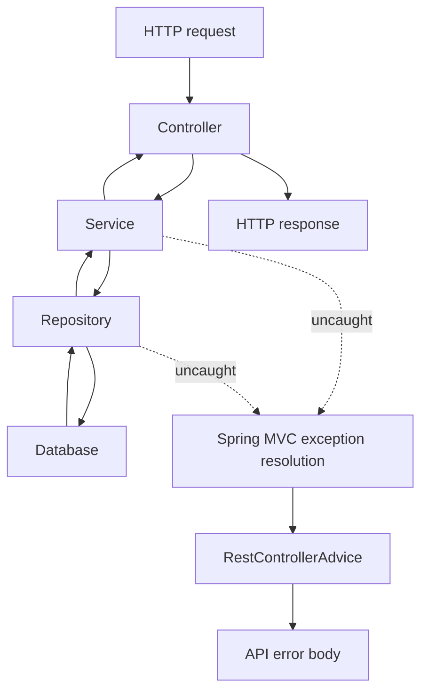
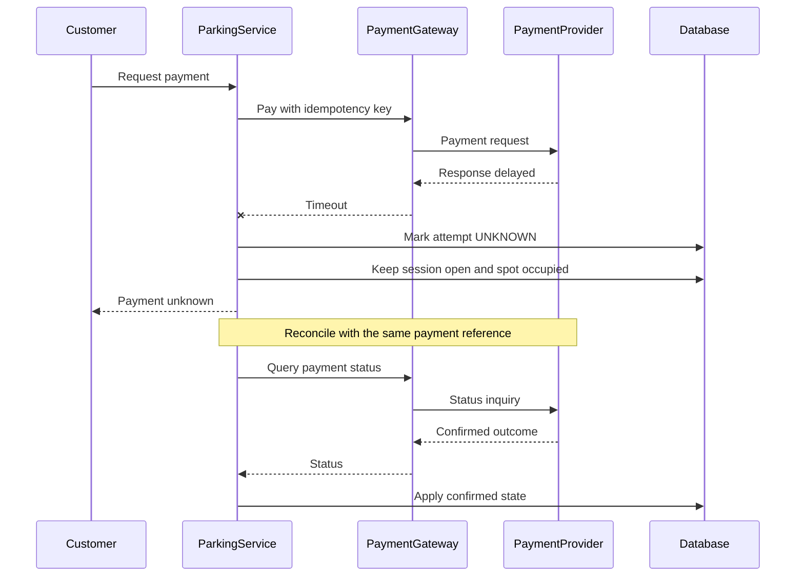
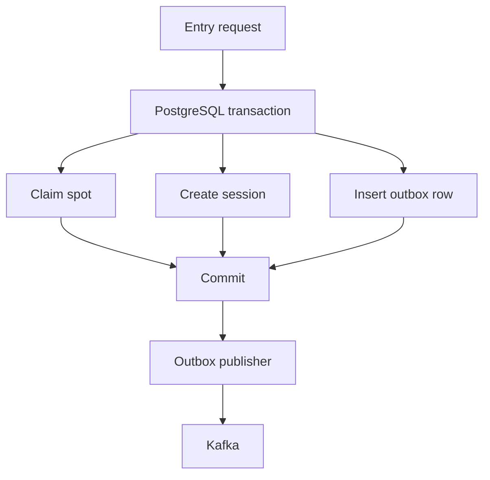
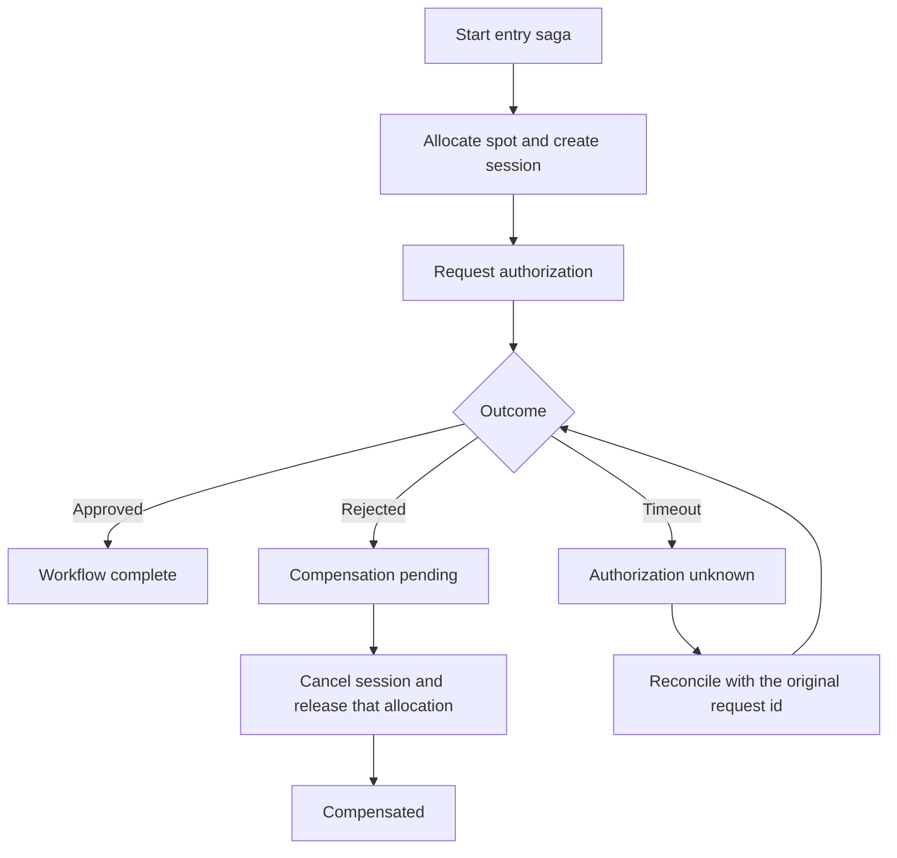

# Lesson 8 — Error Handling, Exceptions, and Failure Modeling

Error handling is not “throw and catch.” It is classifying the failure, keeping business invariants, deciding whether a retry is safe, and recovering when the outcome is **unknown**.

Running example: **Parking Lot** entry, exit payment, and a separate entry-authorization step. Snippets and SQL are **illustrative**. They are not a production schema or a copy-paste Spring module.

Language-level `try` / `catch` and the throwable hierarchy live in [Core Java — exception handling](../../core-java/module-08-exception-handling/index.md). This lesson is the LLD failure model.

Related: [Lesson 4](04-encapsulation-invariants-and-tell-dont-ask.md) (release only the matching allocation id), [Lesson 5](05-abstraction-composition-and-pattern-selection.md) (ports at the provider boundary), [Lesson 6](06-ocp-and-dip.md) (payment gateway and idempotency), [Lesson 7](07-state-modeling-and-transitions.md) (session versus payment state, optimistic conflicts, HTTP outside the database transaction).

**Database assumption:** PostgreSQL is the source of truth for spots and sessions. SQL that uses partial indexes, `INTERVAL`, or `NOW()` is **PostgreSQL-specific**.

---

## Learning outcomes

- Separate expected business outcomes from technical failures and from **uncertain** external outcomes.
- Map failures at the HTTP boundary without leaking Java types, and keep recovery out of `@RestControllerAdvice`.
- Catch, translate, or propagate for a reason.
- Treat a provider timeout as unknown, and reuse the same request identity.
- Make entry idempotent, and enforce one open session per vehicle in the database.
- Bound a local transaction to one database. Use an outbox for Kafka. Use a saga when another service must agree.
- Recover stuck compensation without two workers releasing the same spot.

---

## 1. Business outcomes and technical failures

| Scenario | Classification |
| --- | --- |
| No compatible parking spot | Business outcome |
| Vehicle already has an open session | Business conflict |
| Invalid vehicle type | Validation / bad input |
| Payment declined | Known payment outcome |
| Database unavailable | Infrastructure failure |
| Payment provider timeout | External failure with **uncertain** outcome |
| Invalid SQL | Defect |
| Optimistic locking conflict | Concurrency conflict; re-read and re-decide |

An empty lot is a normal answer to “park this car,” not a broken process. Callers can branch on it. A timeout is not a decline: the provider may never have seen the request, may still be charging, or may have charged and lost the response. That split drives the HTTP status, whether you retry, what you alert on, and whether you free the spot.

You do not have to throw for every unsuccessful operation. A result type fits a routine outcome:

```java
public enum AllocationStatus {
    SUCCESS,
    NO_COMPATIBLE_SPOT
}

public record ParkingAllocationResult(
        AllocationStatus status,
        ParkingSession session) {
}
```

Illustrative. `session` is null when nothing was created — the same rule as [Lesson 2](02-requirement-clarification-and-scope.md): no compatible spot, no session. A project that already uses domain exceptions for every business refusal can throw instead. Pick one style per outcome and keep it. Do not return `null` from `allocate` and hope the controller notices.

Suggested HTTP shape, as a **contract choice** rather than a law:

| Outcome | Typical response |
| --- | --- |
| Session created | 201 or 200 with the session |
| No compatible spot | 200 with `NO_COMPATIBLE_SPOT`, or 409 if this command promises a session |
| Vehicle already parked | 409 `VEHICLE_ALREADY_PARKED` |
| Bad vehicle type | 400 |
| Payment declined | 200 or 402/422 with a payment code; the spot stays occupied |
| Payment unknown | 202 or 200 with `UNKNOWN`; not a 500, and not a decline |
| Unexpected defect | 500 with a generic message |

Never put exception class names, stack traces, or SQL in the body.

---

## 2. An exception hierarchy that matches handling

```text
RuntimeException
|
+-- BusinessException
|   +-- VehicleAlreadyParkedException
|   +-- InvalidVehicleException
|   +-- ParkingSessionNotActiveException
|
+-- TechnicalException
    +-- DatabaseUnavailableException
    +-- PersistenceOperationException
    +-- ExternalDependencyException
        +-- PaymentProviderTimeoutException
```

This tree is unchecked so workflows are not wrapped in `throws` clauses. Checked versus unchecked is a Java mechanism. The design question is whether the **handler** differs.

One `ParkingException` for every case forces string matching. A type per field-validation message is noise. Add a type when catch sites, retries, or API codes diverge.

`PaymentProviderTimeoutException` means “outcome unknown,” not “declined.” Its name should make a blind `markFailed()` look wrong.

Domain types do not mention HTTP status. The repository does not throw `ResponseStatusException`. Persistence types (`PSQLException`, `DataIntegrityViolationException`) stay inside the repository adapter. Business code depends on `VehicleAlreadyParkedException`, which is Dependency Inversion at the error boundary ([Lesson 6](06-ocp-and-dip.md)): the service owns the vocabulary; the adapter translates the driver.

```java
public class VehicleAlreadyParkedException extends BusinessException {
    public VehicleAlreadyParkedException(String message, Throwable cause) {
        super(message, cause);
    }
}

public class PaymentProviderTimeoutException extends ExternalDependencyException {
    public PaymentProviderTimeoutException(String message, Throwable cause) {
        super(message, cause);
    }
}
```

Always keep the cause. A translated exception without a cause hides the constraint name you need in logs.

---

## 3. `@RestControllerAdvice` is an HTTP mapper



An exception walks the stack until something catches it. If the controller does not, Spring MVC looks up `@ExceptionHandler` methods. `@RestControllerAdvice` is that lookup for controller requests. Controllers stay thin: call the service, return the body. The advice **maps** a type to status and `ApiError`. It does not reconcile payments, release spots, or run saga compensation.

```java
public record ApiError(String code, String message) {
}

@RestControllerAdvice
public class GlobalExceptionHandler {

    @ExceptionHandler(VehicleAlreadyParkedException.class)
    public ResponseEntity<ApiError> handleVehicleAlreadyParked(
            VehicleAlreadyParkedException ex) {
        return ResponseEntity.status(HttpStatus.CONFLICT)
                .body(new ApiError("VEHICLE_ALREADY_PARKED", ex.getMessage()));
    }

    @ExceptionHandler(Exception.class)
    public ResponseEntity<ApiError> handleUnexpected(Exception ex) {
        // Log the stack and a correlation id. Do not return them.
        return ResponseEntity.status(HttpStatus.INTERNAL_SERVER_ERROR)
                .body(new ApiError("INTERNAL_ERROR", "An unexpected error occurred"));
    }
}
```

Illustrative. Order more specific handlers before the catch-all. Spring already prefers the more specific type; still do not let `Exception` swallow a business type you meant to map.

`@RestControllerAdvice` does **not** run for a Kafka consumer, a `@Scheduled` job, or an `@Async` method. Those need their own boundary: catch, record the workflow state, retry or park the message, and alert. A listener that only throws will not hit this class unless you also use that listener’s error handler.

---

## 4. Catch, translate, or propagate

| Layer | Job |
| --- | --- |
| Domain | Reject illegal states. Express domain failures |
| Repository | Talk to the database. Translate **known** persistence errors |
| Service | Orchestrate the workflow and any recovery |
| Controller | HTTP in and out |
| `RestControllerAdvice` | Map uncaught request exceptions to `ApiError` |
| Consumer or job | That execution path’s retry and recovery |

**Catch** when this layer can do something real. On `PaymentProviderTimeoutException`, the parking workflow marks the attempt `UNKNOWN`, leaves the session open, leaves the spot occupied, and returns an uncertain result. That is [Lesson 7](07-state-modeling-and-transitions.md), not a 500.

**Translate** at a boundary. A PostgreSQL unique violation on `uq_active_vehicle_session` becomes `VehicleAlreadyParkedException`. The service never imports `PSQLException`.

**Propagate** when you cannot recover, translate, or add a fact the caller needs. This usually adds nothing:

```java
try {
    repository.save(entity);
} catch (Exception ex) {
    log.error("Failed to save", ex);
    throw ex;
}
```

The outer handler logs the same stack again. Catch-log-rethrow is justified only when you add a correlation id or a business key that the lower log does not have, and you do not log the same stack at every frame.

The advice class does not insert outbox rows, release spots, or query the payment provider.

---

## 5. A payment timeout is not a decline

1. The driver pays.
2. `ParkingService` asks `PaymentService` / `PaymentGateway` to pay.
3. The provider may charge.
4. The response is late or lost.
5. The client sees a timeout.

You cannot treat that as `FAILED`. The request might not have arrived, might be in progress, or might have succeeded.



`PaymentService` owns the provider call and the status query. `ParkingService` owns the session and when the spot may be released. `GlobalExceptionHandler` only maps an exception if one escapes the request. A handled unknown outcome should be a normal response, not an uncaught timeout.

A **new** idempotency key on retry can charge the customer twice. Reuse the same provider reference. Do not release the spot because the socket timed out. The fee stored on the session stays the fee ([Lesson 2](02-requirement-clarification-and-scope.md), [Lesson 6](06-ocp-and-dip.md)).

The provider call stays **outside** the database transaction ([Lesson 7](07-state-modeling-and-transitions.md)).

---

## 6. What is safe to retry

Retrying every exception replays declines, bad SQL, and double allocations.

| Failure | Handling |
| --- | --- |
| Brief database connection failure | Retry if the operation is idempotent or still inside an uncommitted transaction |
| Deadlock | Retry the **whole** transaction from the start, in a new transaction |
| Serialization failure (`40001`) | Same: new transaction, full unit of work |
| Unique constraint | Usually do not retry. Read which constraint fired |
| Invalid SQL | Defect. Do not retry |
| Optimistic lock conflict | Reload and re-evaluate the business rule. Do not write the stale decision again |
| Provider timeout | Unknown. Reconcile with the **same** key |
| Validation error | Not retryable until the input changes |

Retryability is a property of the **failure and the operation**. A second `INSERT` of a session is safe only with an idempotency key or the partial unique index. Bound the attempts. Use backoff and jitter so every instance does not retry on the same millisecond.

A deadlock aborts the transaction. Re-running the last statement on the dead connection is not a retry. Spring Retry or Resilience4j can implement the policy. The policy is the design; the library is not.

---

## 7. Idempotency when the response is lost

Entry succeeds, the database commits, the HTTP response dies, the client sends the same request again. Without a stored result, the second call takes another spot.

Persist an idempotency record: key, request hash, status (`PROCESSING` or `COMPLETED`), session id once known, timestamps.

| Situation | Behavior |
| --- | --- |
| Same key, same hash, completed | Return the original session |
| Same key, different hash | Conflict. Do not run a second entry |
| Same key, still processing | In-progress response, or wait on the original transaction’s unique insert |
| Two instances, same key | Database unique constraint on the key; one insert wins |
| Commit succeeded, response lost | Retry reads the completed record |

An in-memory map is invisible to the other instance and vanishes on restart. The record has to be in PostgreSQL with the session it created.

Illustrative table:

```sql
CREATE TABLE idempotency_record (
    idempotency_key text PRIMARY KEY,
    request_hash    text NOT NULL,
    status          text NOT NULL,
    session_id      uuid,
    created_at      timestamptz NOT NULL,
    updated_at      timestamptz NOT NULL
);
```

### One open session per vehicle

The idempotency key identifies **one client request**. A second key is a different request and can still try to park the same car. PostgreSQL can protect that invariant with a partial unique index:

```sql
CREATE UNIQUE INDEX uq_active_vehicle_session
ON parking_session (vehicle_id)
WHERE status IN ('ACTIVE', 'PAYMENT_PENDING', 'PAYMENT_UNKNOWN');
```

This syntax is **PostgreSQL-specific**. Many `CLOSED` (and other terminal) rows for the same vehicle are allowed. A second row whose status is in that list is rejected. The index does not replace the idempotency key. The key deduplicates one logical call. The index deduplicates an open visit.

Translate **this** constraint, not every integrity error:

```java
catch (DataIntegrityViolationException ex) {
    if (isConstraint(ex, "uq_active_vehicle_session")) {
        throw new VehicleAlreadyParkedException(
                "Vehicle already has an open session", ex);
    }
    throw new PersistenceOperationException(
            "Unexpected persistence failure", ex);
}
```

`isConstraint` has to match the driver-specific cause (`PSQLException` / constraint name). A not-null violation or a spot unique key must stay technical, or you will tell the client the vehicle is parked when the SQL was wrong.

---

## 8. Where translation sits

```text
ParkingService
      |
      v
ParkingSessionRepository
      |
      v
Spring Data
      |
      v
PostgreSQL
```

The service does not catch vendor SQL types. The repository (or a thin adapter around it) maps a **known** constraint to a domain exception and wraps everything else as a technical failure with the cause attached. A catch of `Exception` that always throws `VehicleAlreadyParkedException` hides defects.

HTTP status is chosen in the advice or controller, not in the repository. That is the same port idea as [Lesson 5](05-abstraction-composition-and-pattern-selection.md) and [Lesson 6](06-ocp-and-dip.md): the application owns the error vocabulary; the adapter speaks SQL.

---

## 9. One local transaction, and a commit you might have missed

When the idempotency row, the spot claim, the session, and the stored result share **one** PostgreSQL database and one transaction manager, commit them together:

1. Insert the idempotency row as `PROCESSING` (or complete it in the same commit if you have the session id).
2. Claim the spot.
3. Insert the session.
4. Store the session id on the idempotency row.

Rollback before a successful commit undoes all of them. `@Transactional` here is that one database. It does not include Redis, Kafka, or the payment provider.

The hard case is a dropped connection **during** commit. The database may have committed and the driver never saw the acknowledgment. You must not assume rollback. The client or the next worker retries with the **same** idempotency key. If the row is `COMPLETED`, return it. If it is absent, the transaction rolled back and entry may run again. If it is `PROCESSING` and no session exists, a reconciler has to decide from the database, not from the lost packet.

---

## 10. PostgreSQL, Redis, and Kafka are not one transaction

Ordinary `@Transactional` does not enlist Redis and Kafka into the PostgreSQL commit. There is no automatic atomic update of cache, table, and topic.

PostgreSQL owns spot and session state. Redis is a cache. Allocation is a conditional update in PostgreSQL ([Lesson 4](04-encapsulation-invariants-and-tell-dont-ask.md), [Lesson 7](07-state-modeling-and-transitions.md)). If Redis is down or stale, you still claim the row in Postgres. A cache miss must not mint a second occupant. Refresh or invalidate the cache **after** commit, or asynchronously. A failed cache delete is a stale read, repaired by the database predicate, not a reason to skip the commit.

### Dual-write

```text
PostgreSQL commit succeeds
        |
        v
Kafka send fails
```

The visit exists and the event does not. The reverse (event sent, commit lost) is just as bad if you publish first.

### Transactional outbox



The business rows and the outbox row commit together. A publisher reads pending rows and sends them. Kafka being down leaves rows pending. The publisher can crash after the broker accepted the record and before the row is marked sent, so **duplicates happen**. Consumers deduplicate by event id or session id. The outbox makes publication **intent** durable with the business commit. It does not give exactly-once processing, and it does not promise the event is on the topic before the HTTP response returns.

If downstream systems are analytics or notifications, entry is done when Postgres and the outbox row commit. If the business is not done until another service acts, model that as a workflow (section 11). Do not hold the database transaction open while you wait for Kafka.

---

## 11. Saga: another service, another commit

Outbox delivers a fact. A saga is for a **business process** whose steps commit in different places and sometimes must be undone.

Example: Postgres allocates a spot and opens a session. A separate authorization service must approve entry. Rejection must cancel that allocation. Approval completes the workflow. There is no single ACID transaction across both services. Compensation is a **new** operation. It is not `ROLLBACK` of a commit that already happened. Keep the session row and an audit trail. Move it to a terminal status that is **outside** the partial unique index (for example `CANCELLED`) and `release(allocationId)` for that allocation only. Deleting the row destroys history and races with a late reply.



**Orchestration:** one coordinator stores the step and decides the next command, including compensate. Easier to read when there are branches, timeouts, and recovery. The coordinator is a workflow, not a god object that sets spot fields directly; it calls the same domain methods as the synchronous service.

**Choreography:** each service reacts to events. No single component lists every branch. Coupling is looser, and the full story is harder to see once timeouts and compensation exist. Neither style is the default winner. A two-step entry approval with a timeout is usually clearer with a coordinator.

---

## 12. Timeout, expiry, and a late approval

Authorization timeout after the spot is taken is not a rejection.

- Keep the allocation.
- Mark the workflow `AUTHORIZATION_PENDING` (or the session analogue you already use for unknown payment).
- Query with the **original** authorization request id.
- Do not free the spot only because the RPC timer fired.

A business rule may still **expire** a hold: unknown longer than a configured threshold, then release. That expiry is a policy, not the RPC timeout. The release is a conditional update: this saga still owns this allocation id, and the spot’s current allocation id still matches ([Lesson 4](04-encapsulation-invariants-and-tell-dont-ask.md)). If another vehicle already holds the spot, the update matches zero rows.

A late “approved” must not grab the spot back. The response names an allocation that is no longer current. Ask the customer to retry, allocate again and reauthorize, or send the case to a person. Which one is a product rule. The technical rule is fixed: a stale success does not overwrite a newer occupant.

---

## 13. Compensation can fail

Authorization is rejected. The coordinator tries to cancel and release. PostgreSQL is down. The spot is still held and the workflow is not compensated. Do not log and drop that fact.

Store `COMPENSATION_PENDING`. Retry with a bound, backoff, and jitter. Compensation must be idempotent: cancelling a session that is already `CANCELLED`, and releasing an allocation id that is already gone, are successes. A reconciler scans for abandoned rows. Alert when the same saga exceeds a threshold. A human queue exists for rows that stay stuck. Keep the history.

Illustrative find (PostgreSQL `NOW()` / `INTERVAL`):

```sql
SELECT *
FROM parking_saga
WHERE status = 'COMPENSATION_PENDING'
  AND updated_at < NOW() - INTERVAL '30 minutes';
```

Thirty minutes is an example. The cutoff belongs in configuration.

Illustrative claim:

```sql
UPDATE parking_saga
SET recovery_owner = :workerId,
    recovery_started_at = NOW()
WHERE saga_id = :sagaId
  AND status = 'COMPENSATION_PENDING'
  AND recovery_owner IS NULL;
```

Check the update count. A production claim needs a **lease**: `recovery_owner` expires so a dead worker does not pin the row forever. Two workers must not both release the spot. The winner is the one whose claim update changed a row.

The worker then:

1. Selects stale `COMPENSATION_PENDING` rows.
2. Claims one.
3. Reads which steps already finished.
4. Repeats only incomplete idempotent steps.
5. Moves the saga to `COMPENSATED` or leaves it pending with the error recorded.
6. Emits a metric. Alerts on repeated failure.
7. Stops automatic retries when the case needs a person.

---

## 14. How the mechanisms fit

| Mechanism | What it is for |
| --- | --- |
| Retry | A transient failure of a safe operation |
| Idempotency | A duplicate call does not allocate twice |
| Transactional outbox | Business rows and “publish this” commit together |
| Saga | Several committed steps, plus compensation when a later step refuses |
| Reconciliation | Unknown or stuck outcomes, including lost commit acks |

They stack. A saga command is idempotent, its events can leave through an outbox, transient SQL is retried as a whole transaction, and a worker reconciles `COMPENSATION_PENDING` and `UNKNOWN` payments.

An at-least-once pipeline (Kafka consumed into an append-only store, then merged into a warehouse) tolerates duplicates by key and timestamp. That is eventual consistency and deduplication. It is not a saga unless something **undoes a business action** that already committed. Publishing “session opened” is an outbox concern. Releasing a spot because authorization failed is a saga concern.

---

## 15. Common mistakes

1. One exception type and a message string for every failure.
2. `return null` when the lot is full.
3. A retry interceptor on `Exception`.
4. Timeout stored as `FAILED`, or a new idempotency key “to be safe.”
5. Catch, log, and throw the same stack.
6. Stack traces or SQL in the HTTP body.
7. Reconciliation or spot release inside `@RestControllerAdvice`.
8. Every `DataIntegrityViolationException` mapped to “vehicle already parked.”
9. `@Transactional` described as covering PostgreSQL, Redis, and Kafka.
10. Commit, then `kafkaTemplate.send`, with no outbox and no recovery if send fails.
11. “Outbox means exactly once.”
12. Compensation described as rollback. The first transaction is already committed.
13. No durable `COMPENSATION_PENDING` state, so a failed release is only a log line.
14. Spot released on an unknown payment or unknown authorization with no expiry policy.
15. Payment retried with a fresh idempotency key while the first outcome is unknown.
16. A late approval applied with a blind update and no allocation-id check.
17. Several reconcilers scanning the same saga with no claim.

---

## 16. Interview-ready explanations

1. **Result object or exception?** Use a result when the outcome is a normal answer the caller branches on, such as no compatible spot. Use an exception when the situation is a broken rule or a fault the current method will not handle, such as a second open session discovered at commit. Stay consistent. Do not use `null`.

2. **How do you split the hierarchy?** Business types are refusals the API can name. Technical types are infrastructure and defects. A further subtype exists only when handling changes. Timeout is its own type because it is uncertain, unlike a decline. Domain types do not carry HTTP codes. Keep `cause`.

3. **What does `@RestControllerAdvice` cover?** Uncaught exceptions from a Spring MVC request. It does not run because a Kafka listener, a scheduler, or a random executor threw. Those need their own policy. The advice maps status and body. It does not repair money or spots.

4. **Catch, translate, or propagate?** Catch to record `UNKNOWN` and keep the spot. Translate a known constraint at the repository boundary. Propagate when you have nothing to add. Catch-log-rethrow duplicates logs.

5. **Retry classes?** Connection blips and deadlocks can retry a whole idempotent transaction with a bound and jitter. Bad SQL and validation do not. Unique violations need a look at the constraint. Optimistic conflicts reload. Provider timeouts reconcile; they are not “try pay again with a new key.”

6. **Why not blind-retry an optimistic conflict?** The row’s meaning changed. [Lesson 7](07-state-modeling-and-transitions.md): the other request may have started payment. Re-read. If the extension is no longer legal, stop.

7. **How do you translate one constraint?** Catch the Spring integrity exception, match `uq_active_vehicle_session` on the driver cause, throw `VehicleAlreadyParkedException` with that cause. Any other constraint stays `PersistenceOperationException`. The controller advice turns only the business type into 409.

8. **Commit ack lost?** The transaction might have committed. Same idempotency key on the next attempt. Completed record means return it. Missing record means it rolled back. `PROCESSING` with no session is a reconciler case. Do not start a second allocation “because the client saw an error.”

9. **Idempotent entry?** Persist key, payload hash, status, and session id in the same database as the session. Same key and hash returns the first session. A different hash conflicts. The unique key makes concurrent duplicates safe across instances. Memory is not enough.

10. **Idempotency key versus the partial index?** The key is one HTTP retry. The PostgreSQL partial unique index is one open visit per vehicle, even if the client sends two keys. `CLOSED` rows stay. Terminal compensated rows must use a status outside the `WHERE` list.

11. **Dual-write?** Insert the outbox row in the same PostgreSQL transaction as the spot and session. A publisher sends later. Do not pretend `@Transactional` publishes Kafka. If the product only needs the event for downstream readers, entry is done at that commit. If another service must approve, that is a saga, not a longer transaction.

12. **Why not exactly once?** The publisher can crash after Kafka accepted the message and before the outbox row is marked sent. The consumer must ignore a duplicate event id. The outbox guarantees a durable intent, not a single side effect and not delivery before the HTTP call returns.

13. **Orchestration or choreography?** A coordinator when the process has rejection, timeout, expiry, and compensation and you need one place that shows the step. Choreography when services only react to facts and the graph stays small. Visibility is the trade. Do not pick from fashion.

14. **Compensation failed?** The first commit is still there. Leave `COMPENSATION_PENDING`, retry idempotent cancel and `release(allocationId)`, alert, and allow a manual fix. A log line is not a workflow state.

15. **Authorization timeout?** Not a rejection. Hold the spot, mark the workflow unknown, poll with the original request id. An expiry that later releases the spot is a separate business timer, implemented as a conditional update.

16. **Late approval after expiry?** If the allocation id is no longer on the spot, do nothing to occupancy. Do not steal the next vehicle. Retry entry, allocate anew, or hand off to an operator — product choice. The conditional update is the safety rail.

17. **Reconciler design?** Select stale pending rows, claim with a compare-and-set and a lease, inspect completed steps, rerun only idempotent gaps, record status, metric, and stop after repeated failure. Two workers without a claim will double-release or fight.

18. **Pipeline versus saga?** At-least-once into an append-only store, with a merge that keeps the latest key, tolerates duplicates. A saga runs when a committed business step must be compensated by another business step. Deduplicating events is not the same as releasing a parking spot.

---

## 17. Exercises

No full solution. Hints would collapse the design work; the notes below are the bar, not the code.

### 1. Exception hierarchy

**Objective:** types a parking service can catch on purpose.  
**Requirements:** business, validation, conflict, technical, and one uncertain provider failure. Preserve `cause`. No HTTP types in the domain module.  
**Edge cases:** timeout versus decline; a constraint that is not “already parked.”  
**Interviewer:** you added a class only where handling changes.

### 2. API mapping

**Objective:** one `@RestControllerAdvice` and an `ApiError` without stack traces.  
**Requirements:** 409 for the vehicle conflict, 400 for bad input, 500 with a fixed message, a handled “no spot” path that is not a 500.  
**Edge cases:** a Kafka consumer must not depend on this advice.  
**Interviewer:** the advice maps. It does not release spots.

### 3. Retry policy

**Objective:** a table of retry / don’t / reconcile for the failures in section 6.  
**Requirements:** whole-transaction retry for deadlocks, no new payment key after timeout, optimistic conflict re-reads.  
**Edge cases:** retry storm, non-idempotent insert.  
**Interviewer:** you named the operation, not only the exception class.

### 4. Idempotent entry

**Objective:** two instances and a lost HTTP response create one session.  
**Requirements:** persisted key, hash check, unique key, completed result returned.  
**Edge cases:** same key with a different vehicle; crash while `PROCESSING`.  
**Interviewer:** you refused an in-memory map for a multi-instance app.

### 5. Active-session constraint

**Objective:** the partial unique index and a translator that checks the constraint name.  
**Requirements:** many closed visits allowed; a second open visit becomes `VehicleAlreadyParkedException`; other integrity errors stay technical.  
**Edge cases:** `PAYMENT_UNKNOWN` is still “open”; a compensated status must fall outside the predicate.  
**Interviewer:** you said the index is PostgreSQL-specific and is not the idempotency key.

### 6. Outbox

**Objective:** spot, session, and event intent in one commit; a publisher; an idempotent consumer.  
**Requirements:** duplicates tolerated; Kafka down does not roll back the visit; no claim of exactly once.  
**Edge cases:** crash after the broker ack.  
**Interviewer:** you separated “entry succeeded” from “the other service has approved.”

### 7. Saga

**Objective:** approve, reject, timeout, compensate, expire.  
**Requirements:** compensation is a new status plus `release(allocationId)`; history remains; timeout does not free the spot; a late approval cannot reclaim it.  
**Edge cases:** compensation when the database is down.  
**Interviewer:** you did not call compensation a rollback, and you chose orchestration only if the branches need a coordinator.

### 8. Reconciliation worker

**Objective:** stale `COMPENSATION_PENDING` rows recovered by more than one worker.  
**Requirements:** claim, lease, idempotent steps, metric, manual escape hatch.  
**Edge cases:** worker dies after claim; compensation runs twice.  
**Interviewer:** you checked the update count and did not scan-and-act without a claim.

---

## Revision checklist

- No spot is a result or a mapped business error, not a stack trace.
- Timeout is `UNKNOWN`. Same idempotency key. Spot stays occupied until a confirmed success or an explicit expiry policy.
- Advice maps HTTP. Jobs and consumers have their own boundary.
- Translate one constraint. Keep the cause on everything else.
- One `@Transactional` is one database. Commit ack loss is resolved with the idempotency row.
- Outbox is durable intent plus at-least-once publish. Consumers dedupe.
- Saga compensation is a new business write. It can fail and must be claimed by one worker.
- A late success checks the allocation id and does not overwrite a newer occupant.

## Key takeaways

Classify the failure before you catch it. Expected refusals become API codes. Timeouts stay unknown and keep the same request identity. PostgreSQL commits are atomic only inside PostgreSQL: cache is not truth, Kafka needs an outbox, and a second service needs a saga whose compensation is durable, idempotent, and safe against a late reply.
