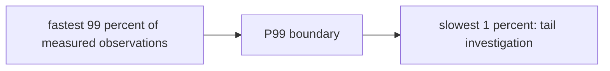
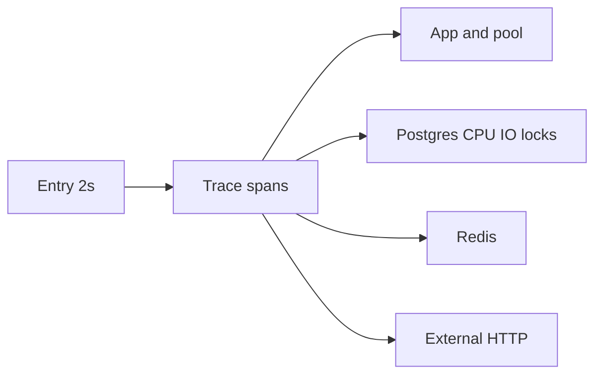
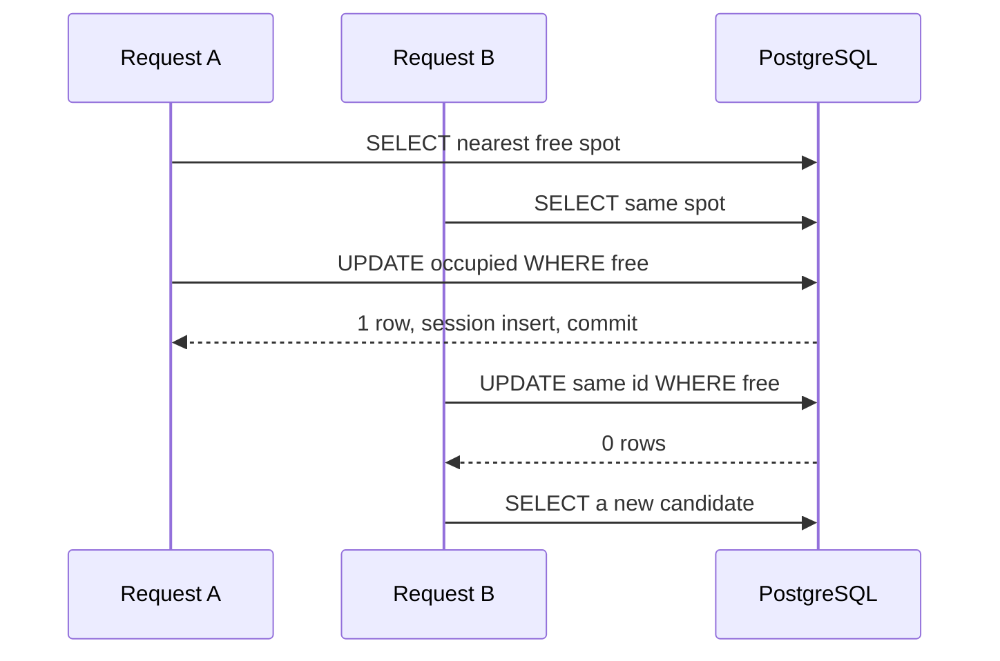
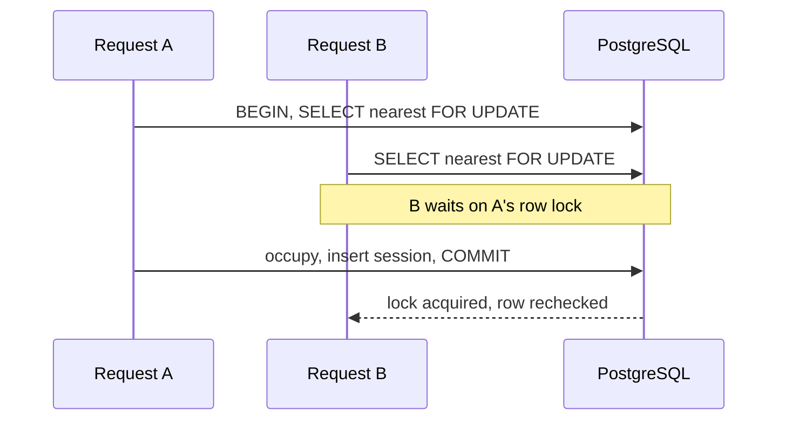
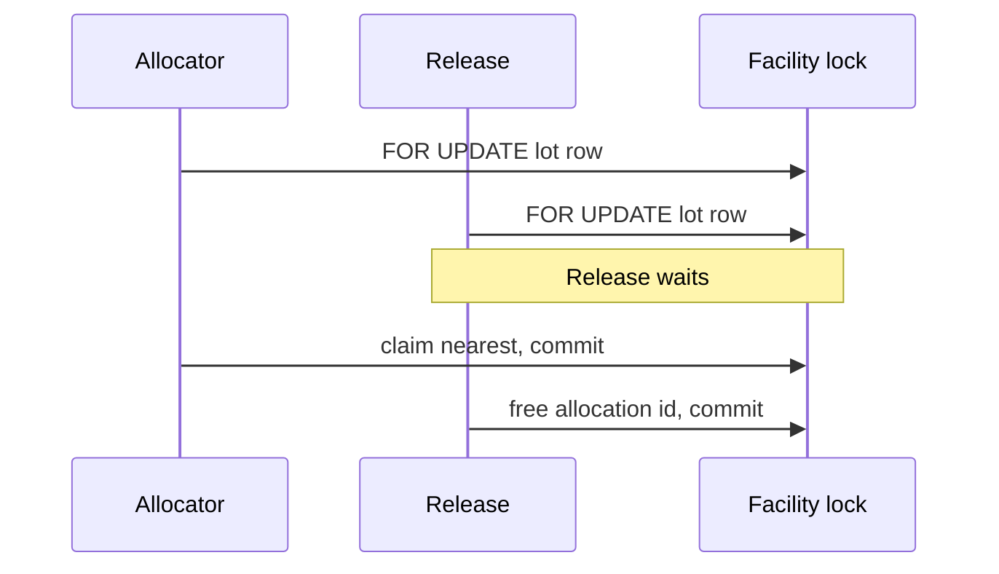
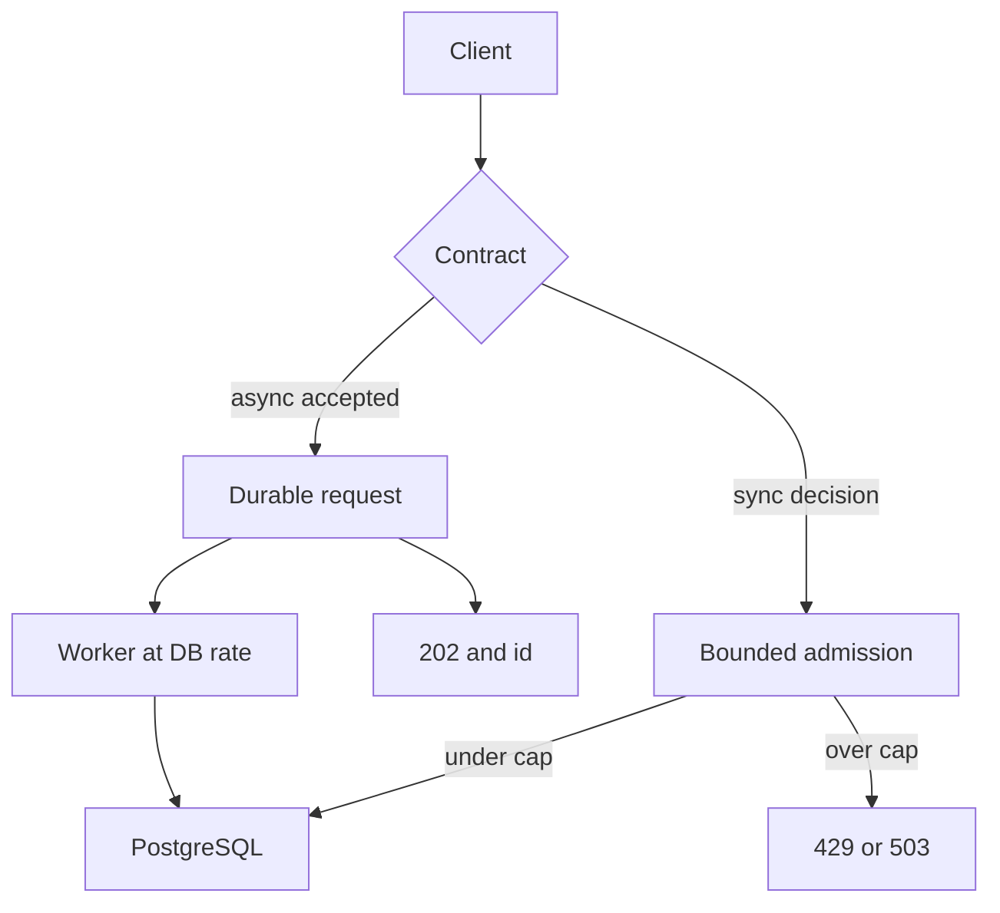
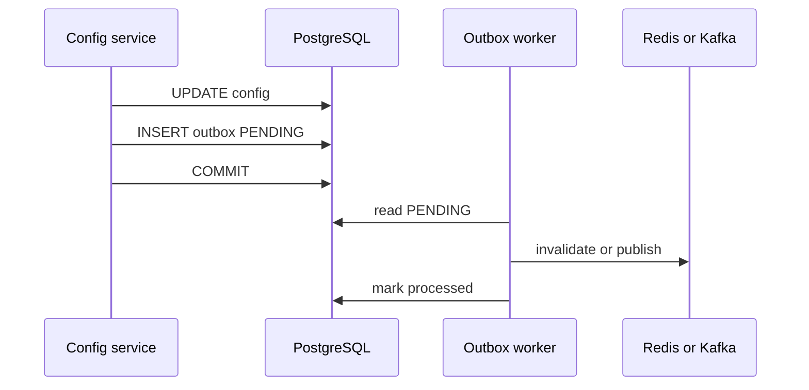

# Lesson 10 — Performance, Scalability, and Optimization in LLD

Running example: **Parking Lot** allocation against PostgreSQL, with Redis as a cache and Kafka only when the API is allowed to accept work asynchronously. SQL and Java are **illustrative**. They show the decision, not a tuned production module.

Related: [Lesson 4](04-encapsulation-invariants-and-tell-dont-ask.md) (claim and `release(allocationId)`), [Lesson 7](07-state-modeling-and-transitions.md) (conditional updates, do not hold a transaction across HTTP), [Lesson 8](08-error-handling-and-failure-modeling.md) (idempotency, outbox, retry versus reconcile).

**Database assumption:** PostgreSQL is the source of truth for occupancy. `EXPLAIN` output, partial indexes, `FOR UPDATE`, and `SKIP LOCKED` below are **PostgreSQL** behaviour. Drills that reuse this chapter are in [Lesson 9](09-practice-transfer-problems.md).

---

## Learning outcomes

- Separate latency, throughput, and scalability, and name the bottleneck before editing Java.
- Let PostgreSQL filter, order, and **claim** a spot. Do not treat a prior `SELECT` as a reservation.
- Choose optimistic claim, blocking `FOR UPDATE`, or `SKIP LOCKED` from the nearest-spot rule, not from a preference for throughput.
- Keep transactions short without pretending that moving Java outside the transaction preserves strict nearest allocation.
- Apply backpressure. A queue does not create database capacity.
- Treat replicas, PgBouncer, partitioning, and sharding as different tools.
- Invalidate cache through a durable outbox. Coalesce identical reads. Do not coalesce allocations.

---

## 1. Performance and scalability

**Performance** is how the system behaves at a given load: how fast one allocation finishes, how many finish per second, and how hard the CPU, disk, and pools work.

**Scalability** is whether useful throughput can grow when load grows, by adding capacity or by removing a serial section. A design that is fast for one user and collapses at the exit rush does not scale. A design that scales by dropping the nearest-spot rule has changed the product, not only the hardware.

| Term | Meaning for entry |
| --- | --- |
| Throughput | Successful allocations per second |
| Latency | Time from request to a decided result |
| Average | Often hides the tail |
| p50 | Half of requests are at least this fast |
| p95 / p99 | The slow requests users and timeouts actually feel |
| Utilization | How full a CPU, disk, pool, or lock is |

Concurrency is many tasks in progress. Parallelism is tasks running at the same instant on different cores. One hundred threads blocked on one row lock are concurrent and not parallel. More threads do not raise throughput once the bottleneck is a lock, a single connection, or one Kafka partition. Extra threads then add queueing and context switches.

**Little's Law:** average number in the system L = λ × W (arrival rate times time spent). If PostgreSQL completes 5,000 allocations per second and each holds a connection for 200 ms, about 1,000 allocations are in flight. If you accept far more than that, time in the system grows: latency, not throughput, is what increases.

A gate with four lanes (zones) is only faster if cars may pick any lane. If every car must take the single nearest stall, the decision is one at a time no matter how many lanes exist.

---

## Percentiles and an SLA are not averages

P50 is the median observation, P95 is a near-tail observation, and P99 is further into the tail.
They describe a latency distribution rather than averaging individual request times. A lower P99
is an improvement because the near-tail got faster; it does **not** prove exactly 99% of individual
requests became faster.

For an SLA “P99 under 15 minutes” across 10,000 explicitly defined observations, about 9,900 must
fall below the threshold and up to about 100 can exceed it under the usual percentile convention.
Define the observation before interpreting it: transaction, Kafka batch, processing window, or
end-to-end job. Do not silently equate a batch/process-window SLA with a per-transaction promise.



**Memory trick:** P99 is **near-tail performance, not average performance**. A 5–8 ms GC pause
does not by itself explain a 2.5-second API P99; inspect database/external-call latency, executor
or connection-pool queueing, lock contention, network delays, and CPU saturation before blaming GC.

## 2. Find the bottleneck first

An entry API moves from **100 ms to 2 s**. That fact does not say the Java method is slow. Split the request before changing code.

| Place | What to look at |
| --- | --- |
| App CPU and memory | Process CPU, allocation rate, not a guess from a thread dump alone |
| JVM heap and GC | Pause time and GC CPU. A 2 s pause looks like a slow query |
| Tomcat / executor queues | Pool size, queue depth, rejected tasks |
| HikariCP | Active, idle, pending, acquisition timeout |
| PostgreSQL | CPU, I/O, and **lock waits**. High CPU is not the only saturation signal |
| Redis | Command latency and hit ratio. A miss storm is not “Redis is down” |
| Network | Time to the database or provider that the app cannot see inside one JDBC call |
| Trace | One span per hop so the 1.9 s is attributed |



If the span inside `claim` is 1.8 s of `Lock` wait and Java is 20 ms, rewriting the allocator does not help. If the connection waits 1.5 s to **borrow** a connection, the pool or the transaction length is the problem. If PostgreSQL CPU is 30% and sessions are `idle in transaction`, the database is not CPU-saturated; something is holding transactions open.

Measure, then optimize the stage that dominates p95.

---

## 3. Query the database, do not filter in Java

Loading every free spot into the JVM and sorting there moves 10 million rows, or a large fraction of them, across the network. The database should apply the predicate, the order, and `LIMIT 1`.

```sql
SELECT spot_id
FROM parking_spot
WHERE parking_lot_id = :parkingLotId
  AND zone_id = :zoneId
  AND compatible_vehicle_type = :vehicleType
  AND occupied = FALSE
ORDER BY distance_from_entrance ASC, spot_id ASC
LIMIT 1;
```

`spot_id` as a tie-break makes the choice stable when two stalls share a distance.

### The partial composite index

```sql
CREATE INDEX idx_spot_available_lookup
ON parking_spot (
    parking_lot_id,
    zone_id,
    compatible_vehicle_type,
    distance_from_entrance,
    spot_id
)
WHERE occupied = FALSE;
```

A B-tree keeps keys ordered. Equality on a **left prefix** (`parking_lot_id`, then `zone_id`, then `compatible_vehicle_type`) lands on a slice. The next columns match `ORDER BY`, so the planner can walk that slice and stop at `LIMIT 1` instead of sorting the whole zone.

Leading-column rule: a query that does not constrain `parking_lot_id` cannot use this index as a tight prefix. An index for `zone_id` alone would be a different index. Putting `distance_from_entrance` before the equality columns would not serve this `WHERE`.

`occupied = FALSE` is the index **predicate**, not a key column. The index stores available rows only. With 10 million spots and 1 million free, the index is about the free set, not the historical full set. Occupying a spot removes it from this index; freeing it inserts it. That write cost is the price of the smaller read structure. Do not add the same shape of index “for safety” on every column.

This is PostgreSQL partial-index syntax. The predicate must match the query (`occupied = FALSE`, not a different expression) or the planner will ignore the index.

### The planner still chooses

An index does not force an index scan. PostgreSQL estimates cost from statistics. A zone that is almost entirely free may be cheaper as a sequential scan. After a bulk load, stale stats can pick the wrong plan. `EXPLAIN` shows the plan without running it. `EXPLAIN ANALYZE` runs it and adds actual time. `EXPLAIN (ANALYZE, BUFFERS)` adds shared-buffer hits and reads so you can see I/O, not only a node name.

```sql
EXPLAIN (ANALYZE, BUFFERS)
SELECT spot_id
FROM parking_spot
WHERE parking_lot_id = 10
  AND zone_id = 2
  AND compatible_vehicle_type = 'CAR'
  AND occupied = FALSE
ORDER BY distance_from_entrance ASC, spot_id ASC
LIMIT 1;
```

Read `Seq Scan` versus `Index Scan` / `Index Only Scan` against the **actual** row counts. A bad index that the planner does not use still slows writes.

`CREATE INDEX CONCURRENTLY` builds the index without taking a long lock that blocks writes the way a plain `CREATE INDEX` does. It cannot run inside a transaction block. It takes longer and can leave an **invalid** index if the session dies; drop that invalid index and retry. It is an operational tool for a live 10 million-row table, not a hint that belongs inside application SQL.

---

## 4. Atomic claim

A `SELECT` of spot 101, then a later `UPDATE` that sets `occupied = TRUE`, is not a claim. Two instances both read 101 as free and both update it. `synchronized` in the service only serializes threads **inside one JVM**. The second pod does not see that monitor.

The invariant lives in the row:

```sql
UPDATE parking_spot
SET occupied = TRUE
WHERE spot_id = :spotId
  AND occupied = FALSE
  AND compatible_vehicle_type = :vehicleType;
```

| Update count | Meaning |
| --- | --- |
| 1 | This transaction claimed that spot |
| 0 | The row was taken, the type did not match, or the id was wrong |

Do not retry that same `UPDATE` in a loop. The candidate is gone. Query again for a new nearest free spot, then try that id. Bound the attempts.

Also set the allocation id in the **same** statement so a later release can match it ([Lesson 4](04-encapsulation-invariants-and-tell-dont-ask.md)):

```sql
UPDATE parking_spot
SET occupied = TRUE,
    allocation_id = :allocationId
WHERE spot_id = :spotId
  AND occupied = FALSE
  AND compatible_vehicle_type = :vehicleType;
```

Insert the parking session in the **same** transaction as the successful claim. A claim that commits without a session, or a session that commits without a claim, is the split [Lesson 8](08-error-handling-and-failure-modeling.md) already forbids for one database.

Illustrative outcomes, not a single catch-all:

| Situation | Exception |
| --- | --- |
| Fresh query returns no row | `NoAvailableSpotException` — business, no session |
| Several claims lose and attempts are exhausted while free spots may still exist | `AllocationContentionException` — caller may retry the **operation** with a new search |
| Connection failure, deadlock, disk error | Technical failure. Not “someone else took the spot” |

A deadlock retry repeats the **whole** transaction ([Lesson 8](08-error-handling-and-failure-modeling.md)). It is not an `AllocationContentionException`.

---

## 5. Optimistic claim versus pessimistic lock

**Optimistic**

1. Find a candidate outside, or in a short read.
2. Do work that does not need the row (score, fee preview, request hash).
3. Conditional `UPDATE`.
4. On 0 rows, search again.

**Pessimistic**

1. Begin a transaction.
2. Select the candidate `FOR UPDATE`.
3. Mark it occupied and insert the session.
4. Commit.

Optimistic concurrency lets many requests **search** at once. Only the conditional update is the decision, so two winners cannot occupy one row. It does **not** promise that the winner is still the nearest stall on the lot at commit time. Section 9 is that race.

Pessimistic locking of the chosen row stops a second transaction from claiming **that** row until you finish. It does not, by itself, stop a closer stall from being released beside you, and it holds the connection for the whole transaction. Locking every free spot “to be safe” turns the lot into a queue.





---

## 6. `FOR UPDATE` and `SKIP LOCKED`

Blocking:

```sql
SELECT spot_id
FROM parking_spot
WHERE parking_lot_id = :lotId
  AND compatible_vehicle_type = :vehicleType
  AND occupied = FALSE
ORDER BY distance_from_entrance ASC, spot_id ASC
LIMIT 1
FOR UPDATE;
```

Non-blocking:

```sql
SELECT spot_id
FROM parking_spot
WHERE parking_lot_id = :lotId
  AND compatible_vehicle_type = :vehicleType
  AND occupied = FALSE
ORDER BY distance_from_entrance ASC, spot_id ASC
LIMIT 1
FOR UPDATE SKIP LOCKED;
```

**`FOR UPDATE`** waits when the chosen row is already locked. Under PostgreSQL `READ COMMITTED`, a row that no longer matches `occupied = FALSE` after the lock is acquired is skipped and the scan can continue (EvalPlanQual). That helps two transactions that both wanted spot 101: the waiter does not occupy a row the winner already took. It does **not** rewind the scan to a closer spot that became free after the scan passed it. Isolation level and the rest of the transaction still matter. `FOR UPDATE` on one candidate is not a facility-wide order.

Waiting on the single nearest stall also **queues** every entry behind whoever locked that row. Throughput falls while that transaction runs. If it then calls a payment provider, the queue is the HTTP timeout, not the index.

**`FOR UPDATE SKIP LOCKED`** skips locked rows and locks the next free one. Throughput is higher when many workers compete. The worker can take a farther stall while a closer one is locked by a transaction that later **rolls back**. The closer stall becomes free again, and the farther allocation has already happened. That is best-effort nearest, not strict nearest.

`SKIP LOCKED` fits a queue: each worker should take a different job and must not block on a row another worker holds. It is the wrong default when “always the nearest compatible stall” is an invariant. It is a reasonable design when the product accepts a nearby free stall. Say which rule you are implementing.

---

## 7. Transaction time is not SQL time

A statement may run in **20 ms**. Java between statements may take **400 ms**. The transaction may stay open **800 ms**. The connection is checked out for all 800 ms. The row lock, if you took one, is held for all 800 ms. `idle in transaction` in `pg_stat_activity` is that gap.

HikariCP then shows many **active** connections, **pending** threads blocked in `getConnection`, and acquisition timeouts. Idle connections are not the symptom. A leak is a connection never returned (no close, or a transaction that never completes).

Holding the connection across a provider call, a Redis round trip you do not need, or a large in-memory sort copies the external wait into the pool. Raising `maximum-pool-size` from 20 to 200 gives PostgreSQL more sessions to schedule. If the bottleneck is lock waits or disk, the extra sessions make the wait worse. Size the pool from database capacity, not from thread count.

Useful checks:

- Actuator / Micrometer: `hikaricp.connections.active`, `pending`, `timeout`.
- `leak-detection-threshold` only as a diagnostic, not as a fix.
- `pg_stat_activity`: `wait_event_type` of `Lock` versus `IO` versus `Client`, and `state` of `active` versus `idle in transaction`.
- `pg_stat_statements`: which SQL dominates total time.

CPU at 40% plus a long lock wait is saturation of **concurrency**, not a signal to add vCPUs first.

---

## 8. Shorten the transaction without weakening the claim

Do computation that does not decide occupancy **outside** the transaction. The claim stays one transactional method on a **separate** Spring bean. A `@Transactional` method called through `this` on the same class skips the proxy and runs with no transaction.

Illustrative. Not a production allocator.

```java
@Service
public class SpotClaimService {

    private final JdbcTemplate jdbc;

    public SpotClaimService(JdbcTemplate jdbc) {
        this.jdbc = jdbc;
    }

    @Transactional
    public Optional<Long> claimAndOpenSession(
            long spotId, String vehicleType, String allocationId, long vehicleId) {
        int updated = jdbc.update("""
                UPDATE parking_spot
                SET occupied = TRUE, allocation_id = ?
                WHERE spot_id = ?
                  AND occupied = FALSE
                  AND compatible_vehicle_type = ?
                """, allocationId, spotId, vehicleType);
        if (updated == 0) {
            return Optional.empty();
        }
        jdbc.update("""
                INSERT INTO parking_session(vehicle_id, spot_id, allocation_id, status)
                VALUES (?, ?, ?, 'ACTIVE')
                """, vehicleId, spotId, allocationId);
        return Optional.of(spotId);
    }
}

@Service
public class AllocationOrchestrator {

    private static final int MAX_ATTEMPTS = 3;

    private final SpotLookup lookup;
    private final SpotClaimService claims;

    public AllocationOrchestrator(SpotLookup lookup, SpotClaimService claims) {
        this.lookup = lookup;
        this.claims = claims;
    }

    public long allocate(long lotId, long vehicleId, String vehicleType) {
        for (int attempt = 1; attempt <= MAX_ATTEMPTS; attempt++) {
            Optional<Long> candidate = lookup.nearestFree(lotId, vehicleType);
            if (candidate.isEmpty()) {
                throw new NoAvailableSpotException();
            }
            String allocationId = prepareAllocationId(vehicleId);
            Optional<Long> claimed = claims.claimAndOpenSession(
                    candidate.get(), vehicleType, allocationId, vehicleId);
            if (claimed.isPresent()) {
                return claimed.get();
            }
        }
        throw new AllocationContentionException();
    }

    private String prepareAllocationId(long vehicleId) {
        return vehicleId + ":" + java.util.UUID.randomUUID();
    }
}
```

`nearestFree` is a hint. Another transaction can take that row before `claimAndOpenSession`. The `UPDATE` is the authority. `NoAvailableSpotException` is only for an empty lookup. Losing a race is not an empty lot.

Moving `prepareAllocationId` outside the transaction does **not** make the committed spot the nearest one on the lot. It only stops the UUID work from holding a connection.

---

## 9. Strict nearest needs one decision protocol

Invariant: **always allocate the nearest available compatible spot.**

Obvious race: A and B both see 101 at 10 m. A’s conditional update wins. B must search again, not spin on 101.

Subtle race:

1. A reads 101 at 10 m. Spot 99 at 5 m is occupied.
2. The exit of 99 commits and 99 is free.
3. A’s claim of 101 succeeds.
4. 99 is free and closer.

A correct conditional update prevented a double occupant. It did not implement the invariant. B, starting later, may receive 99. A already has the worse stall. Under concurrency, “I claimed the nearest I saw” is not “I claimed the nearest that existed at commit.”

A facility lock makes allocate **and release** take the same lock before they change occupancy:

```sql
SELECT parking_lot_id
FROM parking_allocation_lock
WHERE parking_lot_id = :lotId
FOR UPDATE;
```

Then, still in that transaction: pick the nearest free compatible row, claim it, insert the session, commit. Release does the same lock, checks `allocation_id`, frees the row, commits. A release cannot publish a closer stall in the middle of someone else’s decision, and two allocations cannot both pass the “nearest” read.

The cost is a **single queue per facility**. Every entry and exit for that lot serializes on one row. That is the coordination the invariant demands. If the lock is only on allocate, a release bypasses it and the subtle race returns.

`SERIALIZABLE` can abort one of the conflicting transactions. You still retry the whole decision, and you still need a protocol you can explain. A facility lock is the straightforward form. It is not free.



---

## 10. Zones and a hot facility

A **hot facility** is one lot that dominates traffic. A **hot partition** is one slice of work that cannot be split: one facility lock, one Kafka partition, one shard. Partitioning work (zones A–D) is an application split. **Table partitioning** is how PostgreSQL stores one logical table in pieces. **Sharding** is different PostgreSQL servers with a routing key. Do not use those words as synonyms.

Four zones can be searched in parallel only if the business allows any zone. If nearest is global, a worker that commits a stall in zone D while zone A still has a free stall has broken the rule.

Ordered zones mean: do not commit a farther zone while a closer zone might still produce a winner. A stale `free_count` on zone A is an optimization. If it says zero and is wrong, you skip a closer stall. If it says positive and is wrong, you take a lock and find nothing. Recount or select on the **primary** before committing a farther zone. Zone metadata is not the occupancy authority.

Parallel zone workers plus a strict global order need a merge step that still serializes the final choice. You pay for fan-out and then for the same decision the facility lock already made. Use zones to reject empty far regions **before** that decision, not as four independent allocators, unless nearest-in-zone is the real rule.

---

## 11. Spikes and backpressure

10 million requests arrive. The database completes **5,000** allocations per second. The other requests cannot be “queued safely” without a bound. An unbounded queue stores the failure as latency and memory. Little’s Law: the line grows by about 10 million minus whatever you finish. The queue did not add a sixth thousand transactions per second.

| Mechanism | Role |
| --- | --- |
| Rate limit | Cap a client’s request rate |
| Concurrency limit | Cap in-flight allocations |
| Admission control | Refuse new work when the system is past a measured limit |
| Load shedding | Drop or refuse the cheapest work you cannot do |
| Bounded queue | Absorb a short burst, then refuse |
| Backoff and jitter | Stop clients from retrying in lockstep |
| Circuit breaker | Stop calling a dependency that is failing fast |
| Bulkhead | One pool for allocation, another for reporting, so a report cannot take every connection |
| Consumer lag | How far asynchronous workers are behind durable input |
| Autoscaling | More instances help only if the bottleneck is the app, not one lock or one primary |

**Synchronous API.** The client waits for a stall or a no. Bound admissions. **429** when that client is over its limit, with `Retry-After` when you can say when. **503** when the service cannot take more work. Do not accept the HTTP call, push it to Kafka, and return 200. That changed a synchronous decision into a workflow the client did not agree to.

**Asynchronous API.** This must be an explicit contract. Durably store the request, return **202** and an id, process later, and expose status. You still need idempotency, expiry, cancellation, and a fairness rule so one lot cannot fill the worker forever. 202 means accepted, not allocated.

Retries without jitter turn a 503 into a second spike. Shed load at the door when the pool’s pending count or the database lock wait crosses a line you have measured.



---

## 12. Kafka when acceptance is asynchronous

Kafka is a durable buffer **after** the product allows 202. It is not a faster lock.

- Idempotency key on the request, unique in PostgreSQL, so a redelivered record does not allocate twice ([Lesson 8](08-error-handling-and-failure-modeling.md)).
- Poll a **bounded** batch. Limit consumer concurrency to what PostgreSQL can claim, not to the size of the topic.
- If claim latency or pool pending climbs, stop fetching. Lag is allowed to grow; the database is not.
- Retries of a failed record must be safe. A timeout from the claim is not “publish a second allocate.”
- Cars and bikes that never share stalls can be separate streams. That does not relax nearest **within** cars.

```java
String kafkaKey = parkingLotId + ":" + vehicleType;
```

| Key | Effect |
| --- | --- |
| `parking_lot_id` | One partition per lot. Cars and bikes are ordered together and cannot be consumed in parallel for that lot |
| `vehicle_type` | All lots for “CAR” share partitions. One hot lot sticks to one partition and blocks other lots on that key |
| `parkingLotId:vehicleType` | Independent order for cars and bikes at the same lot. Still one partition per pair |

Kafka orders records **inside one partition**. It does not order across partitions. A consumer that processes a batch with several threads can commit the database transaction for record 2 before record 1. Offset commit order is not allocation order.

One partition is read by one consumer in a group. Adding consumers does not parallelize that partition. More partitions for one lot allow more consumers and **lose** a single order. Strict nearest then needs the same facility protocol as section 9. Ingestion can be parallel. The allocation **decision** cannot, if nearest is strict.

A hot lot on one partition is a hot partition. The fix is not twenty consumers on that group.

---

## 13. Scaling the database

**Vertical scaling.** More CPU, RAM, and IOPS help a plan that is actually CPU or disk bound. They do not remove a facility-lock queue. The lock wait remains.

**Read replicas.** Reports, history, and “how many stalls were free five seconds ago” can use a replica. Allocation and any decision that must see the latest occupancy use the **primary**. Replica lag would hand out a stall that the primary already gave away. A replica is not a second writer.

**PgBouncer.** It multiplexes many app connections onto fewer database sessions, especially in transaction pooling. That can cut connection storms. It does not add IOPS or remove lock waits. Transaction pooling breaks session state: `SET`, prepared statements that assume one session, advisory locks held “on the connection,” and `LISTEN`. Match the pool mode to how the app uses sessions.

**Table partitioning.** One logical table, many physical pieces, one server. Example: `parking_session` partitioned by month. Queries that include the month prune other partitions. Vacuum and drop of old months get easier. A lookup by `spot_id` that does not include the partition key can become many indexes unless you design the key. Partitioning is not ten independent allocators.

**Sharding.** Several PostgreSQL primaries, routed for example by `parking_lot_id`. A transaction that must update two lots is a distributed transaction or a saga. Rebalancing moves data. A single famous lot is still one **hot shard**; more shards do not split it until you change the key, and changing the key fights the facility lock.

A **standby** that can be promoted is high availability for one primary. It is not an independently writable shard. You do not allocate on the standby.

---

## 14. Cache-aside

Availability summaries and fee configuration may be cached. Occupancy claims may not be decided from Redis.

1. Read Redis.
2. On a miss, read PostgreSQL.
3. Store the value in Redis.
4. On a change, **commit PostgreSQL first**.
5. Invalidate the key.

A TTL bounds how long a missed invalidation can live. It does not make the value fresh. If the commit succeeds and the `DEL` fails, readers repopulate Redis from a replica or from a race:

- Transaction commits “zone A has no car stalls.”
- A reader misses the key, reads a replica that still shows a stall, and `SET`s Redis.
- The invalidation `DEL` then runs, or it ran **before** the `SET` and the stale `SET` wins.

Delete-after-commit can lose to a stale refill. Short TTL, versioned keys, or “set the cache from the same transaction’s result on the primary” reduce the window. They are still not the occupancy authority. The claim `UPDATE` remains the decision.

---

## 15. Transactional outbox

Two failures:

- PostgreSQL commits the new rate and the Kafka publish throws. Consumers never see the change. Redis stays stale if it depended on that message.
- The publish succeeds and the transaction rolls back. Consumers invalidate or act on a change that does not exist.

Put the event in the same commit as the business row:

```sql
CREATE TABLE outbox_event (
    event_id BIGSERIAL PRIMARY KEY,
    event_type VARCHAR(100) NOT NULL,
    aggregate_id VARCHAR(100) NOT NULL,
    payload JSONB,
    status VARCHAR(20) NOT NULL DEFAULT 'PENDING',
    created_at TIMESTAMP NOT NULL DEFAULT CURRENT_TIMESTAMP
);
```

Illustrative. A production table usually has a claim column and a unique business event id so workers do not double-send without the consumer also being idempotent.

1. Update configuration (or occupancy, if the event is a fact about a commit).
2. Insert `outbox_event` as `PENDING`.
3. Commit both.
4. A worker reads pending rows.
5. It deletes the Redis key or publishes to Kafka.
6. It marks the row processed.

If the worker publishes and crashes before the mark, it publishes again. That is **at-least-once**. Consumers and the invalidation must tolerate duplicates. This is not exactly-once delivery. It is the same outbox boundary as [Lesson 8](08-error-handling-and-failure-modeling.md), here applied to cache and configuration as well as to domain events.



---

## 16. Cache stampede and single-flight

Five hundred requests miss `config:lot:10` together. Five hundred identical PostgreSQL reads follow. **Request coalescing** shares the in-flight load. It is not a cache of the result. When the future completes, the map entry is removed. The next request after that misses again unless a real cache `SET` happened inside the loader.

Illustrative, JVM-local:

```java
public final class SingleFlight<K, V> {

    private final ConcurrentHashMap<K, CompletableFuture<V>> inFlight =
            new ConcurrentHashMap<>();
    private final Executor executor;

    public SingleFlight(Executor executor) {
        this.executor = executor;
    }

    public CompletableFuture<V> join(K key, Supplier<V> load) {
        CompletableFuture<V> created = new CompletableFuture<>();
        CompletableFuture<V> existing = inFlight.putIfAbsent(key, created);
        if (existing != null) {
            return existing.copy();
        }
        executor.execute(() -> {
            try {
                created.complete(load.get());
            } catch (Throwable error) {
                created.completeExceptionally(error);
            } finally {
                inFlight.remove(key, created);
            }
        });
        return created.copy();
    }
}
```

`copy()` so a caller can time out or cancel **its** future without completing the shared one exceptionally for everyone. `orTimeout` on the shared future would do that. `remove(key, created)` does not delete a newer flight that replaced this one. On failure the entry is removed, so a later call may try again. The map holds the operation only while it runs. It is not a TTL.

Use a **bounded** executor. An unbounded one moves the stampede into memory.

This map is one JVM. Other instances still miss. A distributed lock or a Redis lock has its own timeout and failure story; do not add it for a config read until the stampede is measured.

Do **not** coalesce parking allocations. Two cars are not one shared read. Folding them into one future would allocate once and hand the same stall to both, or couple their failures. Coalesce identical configuration and price lookups. Claim spots in PostgreSQL.

---

## 17. Prove it

| Test | Question |
| --- | --- |
| Load | Does p95 stay acceptable at the expected rate? |
| Stress | Where does it break, and how? |
| Spike | What happens when the 10 million-request burst hits a 5,000/s claim path? |
| Soak | Do pools leak or does latency drift over hours? |

Watch throughput, p50/p95/p99, error rate, lock waits, Hikari pending, consumer lag, queue depth, cache hit ratio, and GC pause time. Tools: Actuator, Micrometer, Prometheus, Grafana, OpenTelemetry, Java Flight Recorder, `pg_stat_activity`, `pg_stat_statements`, `EXPLAIN (ANALYZE, BUFFERS)`.

The 100 ms to 2 s investigation, in order: trace the slow requests, split app wait versus database wait versus Redis versus provider, check `idle in transaction` and pool pending, then `EXPLAIN` the lookup if the time is inside the `SELECT`. Only then change an index or a transaction boundary. A flame graph of a thread blocked on a socket is a waiting thread, not a Java hotspot.

---

## 18. Which architecture matches the rule

| Architecture | Throughput | Strict nearest | Complexity |
| --- | --- | --- | --- |
| Facility-level lock | Lower | Easier to enforce if release uses the same lock | Low |
| Blocking row lock | Moderate when many wait on the nearest row | Only for the rows the scan still covers. Not a global order by itself | Moderate |
| `SKIP LOCKED` | Higher | Not guaranteed. A rolled-back closer stall can lose | Moderate |
| Zone coordination | Higher only if the final decision is still ordered | Needs a protocol that refuses to commit a far zone early | High |
| Dedicated allocator | Limited by that coordinator | Can preserve order by being the only decider | High |
| Best-effort nearest | Higher potential | Relaxed on purpose | Moderate |

If the invariant is a total order of decisions, some section is single-threaded. Indexes, pools, and Kafka do not delete that section. They move it.

Ask whether the business needs the mathematically nearest stall or a nearby compatible one. If a nearby stall is acceptable, `SKIP LOCKED` or an optimistic claim is an honest optimization. If the nearest stall is a promise, say the facility lock (or one coordinator) is the design, and quote the throughput it implies. Do not present a high-throughput diagram that quietly drops the rule.

---

## 19. Interview principles

- Measure the 2 s before rewriting the allocator.
- SQL time and transaction time are different. The pool feels the second one.
- Shorten transactions. Do not move the **claim** out of PostgreSQL.
- Shared occupancy is a conditional write or a lock, not `synchronized` and not Redis.
- Parallel search is not a parallel decision. Strict nearest serializes the decision.
- Bound the queue. Scale consumers to the database, not to the topic size.
- Challenge the nearest-spot sentence before designing a distributed lock service.
- State the throughput you gave up, or the ordering you gave up. Do not claim both.

### Questions

1. **Why did latency become 2 s?** Walk spans, pool pending, and `pg_stat_activity` before an index. Lock wait and `idle in transaction` are common. CPU percent alone is not the diagnosis.

2. **Why not `synchronized`?** It does not run on the other instance. Two pods both see the stall free.

3. **Does the conditional `UPDATE` guarantee the nearest stall?** It guarantees one winner for that row. Another closer row can be freed after you chose. Strict nearest needs allocate and release on one protocol.

4. **When is `SKIP LOCKED` wrong?** When a locked nearer stall might roll back and you must not have given out a farther one. It is appropriate for job queues and for a product that allows a nearby stall.

5. **Why not a bigger Hikari pool?** You add sessions to a database that may be waiting on locks or disk. Fix the hold time and the bottleneck. Then size the pool.

6. **Why must the session insert share the claim transaction?** Otherwise a crash leaves an occupied stall with no session, or a session whose stall was not taken. One PostgreSQL transaction covers both. It does not cover Kafka or Redis.

7. **Self-invocation?** `@Transactional` on a method called via `this` does not start a transaction. The claim method belongs on another bean.

8. **Kafka key `lot:vehicleType`?** Order is per partition. Cars and bikes at one lot can proceed independently. Two partitions for one lot do not preserve one nearest-order. Extra consumers do not split a single partition.

9. **Replica for allocation?** Lag can show a free stall that the primary has claimed. Read the primary for the decision.

10. **Partitioning versus sharding?** Partitioning splits one table on one cluster and prunes by key. Sharding splits primaries. A standby is neither a shard nor a place to allocate.

11. **Outbox versus exactly once?** The config row and the event row commit together. The worker can publish twice if it crashes before marking the row. Consumers must be idempotent.

12. **Stampede versus allocation?** Coalesce one configuration load per JVM. Do not coalesce two entry requests. Remove the future when it finishes, including on failure, and do not let one caller’s timeout cancel the shared work.

13. **10 million requests, 5,000 completions per second?** Refuse or accept explicitly. An unbounded queue grows latency. Sync uses 429 or 503. Async uses 202, a stored id, and workers paced by the database.

---

## Revision checklist

- Lookup uses `WHERE`, `ORDER BY`, `LIMIT`, and a partial composite index the predicate can match. The planner may still seq-scan.
- Claim is an `UPDATE` that checks `occupied = FALSE`. Retry means a **new** candidate. Database errors are not contention.
- `FOR UPDATE` waits and rechecks. `SKIP LOCKED` skips and can miss a nearer stall whose transaction aborts.
- Facility lock covers release. Otherwise a closer stall appears mid-decision.
- Transaction duration owns the pool. No provider calls inside it.
- Kafka parallelism is ingestion. Strict order is a decision, usually one partition plus one database protocol.
- Cache is invalidated after commit, with an outbox if the delete must survive a crash. Redis is not the claim.
- Single-flight shares an in-flight read. It is not a second occupancy system.

## Key takeaways

Performance work starts from the span that grew from 100 ms to 2 s. Scalability work asks which rule is allowed to be parallel. PostgreSQL can atomically give a stall to one car. It can also order those gifts so the nearest stall wins, if allocate and release share one lock and you accept that lot’s throughput. `SKIP LOCKED`, zone workers, and Kafka partitions are how you stop promising that order. Say which one you are selling.
