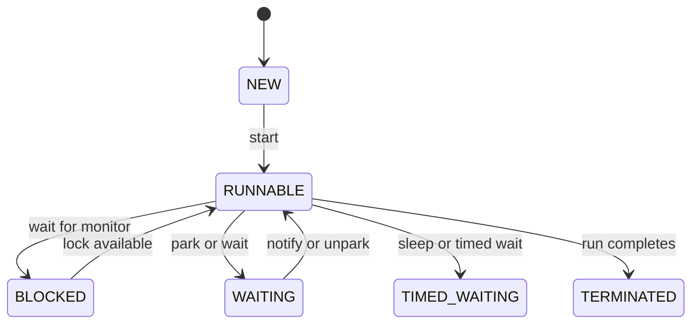

# Companion 1 — Concurrency Fundamentals

**Canonical source:** [Lesson 1 — Concurrency Fundamentals](../../../concurrency/01-concurrency-fundamentals.md).

## Definition

Concurrency means multiple tasks in progress; parallelism means simultaneous CPU work. Java exposes platform threads (and virtual threads on JDK 21+) sharing memory inside one process.

## Why it exists

Backend services handle overlapping requests; without a clear model you get corrupted state, stuck systems, or “works on my machine” races.

## Must remember

- **Safety** — no torn or lost updates to shared mutable state.
- **Liveness** — threads eventually progress (no deadlock/starvation).
- Default: shared mutable state is **unsafe** until confined, immutable, or synchronized.
- Process = isolated memory; threads in a process **share** heap.
- Platform threads ≈ OS threads; virtual threads = lightweight JVM scheduling ([Companion 14](14-virtual-threads.md)).

## Interview traps

- Treating “many threads” as “more CPU” — I/O concurrency ≠ parallelism.
- Assuming `HashMap` or `++` on a field is safe without proof.

## Frequently asked questions

- **Q:** Safety vs liveness?
  **A:** Safety = correctness of state; liveness = system keeps making forward progress.
- **Q:** When start with virtual threads?
  **A:** Many blocking I/O tasks per request; not for CPU-saturated compute.

## Interview flow



## ASCII / table recall

```text
Request threads --> shared heap (maps, counters) --> need HB or confinement
```

## Explain aloud (whiteboard)

1. “I separate **concurrency** (tasks in flight) from **parallelism** (cores busy).”
2. “Shared mutable state needs a deliberate strategy: immutability, thread confinement, or synchronization.”
3. “I also check **liveness** — can we deadlock or starve under load?”

## JDK and debug clues

- Thread dumps list state per thread — map to blocked vs waiting ([Companion 21](21-production-debugging.md)).
- High thread count with low CPU often means I/O wait, not useful parallelism.

## 30-second revision

- Safety + liveness; shared mutable = guilty until proven safe; concurrency ≠ more cores; platform vs virtual threads for I/O fan-out.

## Memory hooks

- **SLL** — **S**afety, **L**iveness, **L**ocation of shared state (heap).

## Cross-links

- [Companion 2 — JMM](02-java-memory-model.md)
- [Companion 3 — Races](03-race-conditions.md)
