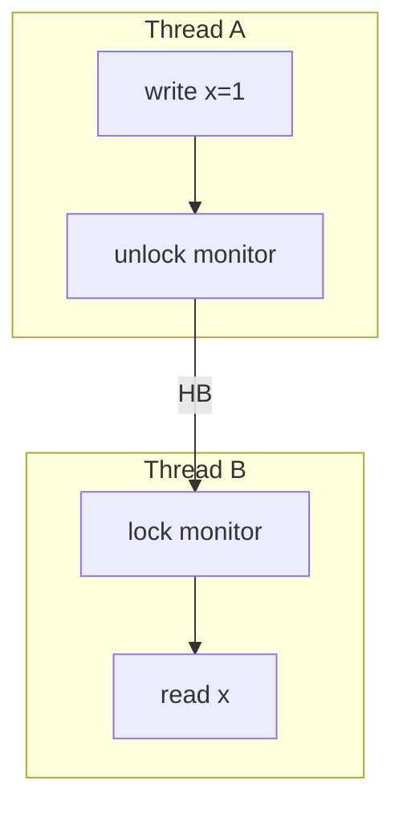

# Companion 2 — Java Memory Model

**Canonical source:** [Lesson 2 — Java Memory Model](../../../concurrency/02-java-memory-model.md).

## Definition

The JMM defines when writes by one thread are visible to another — via **happens-before** relationships, not “wall clock time.”

## Why it exists

Compilers and CPUs reorder instructions; without HB edges, other threads may see stale or surprising field values.

## Must remember

- No HB between threads → visibility and ordering are not guaranteed for plain fields.
- HB sources: `synchronized` unlock→lock, `volatile` write→read, `Thread.start/join`, `java.util.concurrent` utilities.
- **Visibility ≠ atomicity** — `volatile` does not fix `count++`.
- Reason in HB graphs, not intuition.

## Interview traps

- “I used a lock somewhere” — if the read happens outside the same lock’s HB chain, still stale.
- Assuming `volatile` makes compound updates atomic.

## Frequently asked questions

- **Q:** What does happens-before guarantee?
  **A:** Actions before the edge are visible to actions after it (for those variables).
- **Q:** Is program order enough across threads?
  **A:** No — only within a single thread.

## Interview flow

## ASCII / table recall

| Edge type | Example |
| --- | --- |
| Monitor | unlock on M → lock on M |
| Volatile | write v → read v |
| Thread lifecycle | `start()` → run in child; child end → `join()` return |

## Explain aloud (whiteboard)

1. “Without happens-before, I assume **no** cross-thread visibility for plain fields.”
2. “I draw edges: lock, volatile, start/join, or concurrent utility.”
3. “Visibility fixes stale reads; **atomicity** for read-modify-write still needs atomics or locks.”

## JDK and debug clues

- Heisenbugs under `-client` vs `-server` or different core counts → missing HB.
- `jcmd Thread.print` shows locks held — correlate with BLOCKED threads.

## 30-second revision

- HB not time; unlock→lock, volatile, start/join; volatile visible not atomic; draw edges in design reviews.

## Memory hooks

- **HB** — **H**appens-before edges, not **h**ope-based.

## Cross-links

- [Companion 5 — volatile](05-volatile.md)
- [Companion 3 — Races](03-race-conditions.md)
- [Visual quick reference](module-visual-quick-reference.md)
