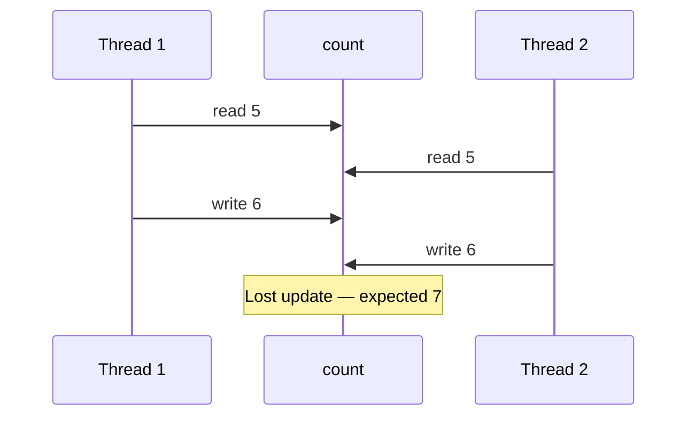

# Companion 3 — Race Conditions

**Canonical source:** [Lesson 3 — Race Conditions](../../../concurrency/03-race-conditions.md).

## Definition

A **data race**: two threads access the same variable, at least one writes, with no happens-before between them — undefined behavior for non-volatile, non-atomic fields.

## Why it exists

`count++` is three steps (read, add, write); interleaving loses updates or corrupts invariants.

## Must remember

- **Lost update** — two reads of same value, both increment, one write wins.
- **Check-then-act** — `if (!exists) insert` is a race unless atomic at the right layer ([Companion 22](22-backend-concurrency-scenarios.md)).
- Fixes: atomics, synchronization, confinement, or database conditional update.
- Application-level `synchronized` does not fix cross-instance races.

## Interview traps

- “We only have a few threads” — races are about interleaving, not thread count.
- Using `volatile` on a counter you increment.

## Frequently asked questions

- **Q:** Is `count++` atomic in Java?
  **A:** No — use `AtomicInteger`, lock, or confine to one thread.
- **Q:** Race vs deadlock?
  **A:** Race = wrong result; deadlock = no progress ([Companion 18](18-deadlock-livelock-starvation.md)).

## Interview flow



## ASCII / table recall

```text
T1: R(0) ---- write 1 ----
T2:      R(0) ---- write 1 ----  => final 1 not 2
```

## Explain aloud (whiteboard)

1. “I name the shared variable and the non-atomic steps.”
2. “I show an interleaving that breaks the invariant.”
3. “Fix at the right layer: JVM atomics, DB `UPDATE ... WHERE`, or idempotency key.”

## JDK and debug clues

- Rare wrong totals under load → suspect RMW races before scaling hardware.

## 30-second revision

- Data race = concurrent access + write + no HB; `++` loses updates; check-then-act fails across threads/instances.

## Memory hooks

- **RAW** — **R**ead, **A**ct, **W**rite interleaving.

## Cross-links

- [Companion 7 — Atomics](07-atomics-and-cas.md)
- [Companion 22 — Backend](22-backend-concurrency-scenarios.md)
