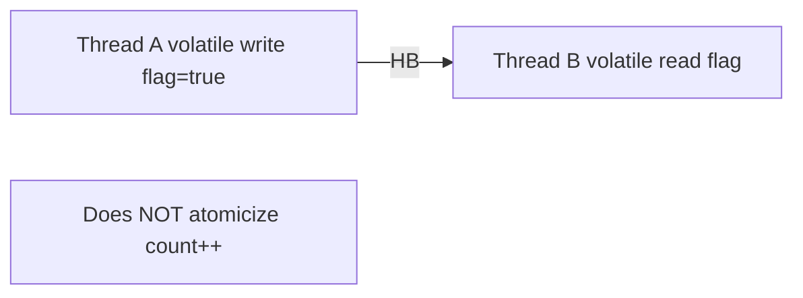

# Companion 5 — `volatile`

**Canonical source:** [Lesson 5 — volatile](../../../concurrency/05-volatile.md).

## Definition

A `volatile` write happens-before any subsequent read of that variable by another thread — flushes visibility, not full mutual exclusion.

## Why it exists

Cheap publication of status flags (`shutdown`, `ready`) without holding a lock for every read.

## Must remember

- Fixes **visibility** of single-field writes/reads across threads.
- Does **not** make `i++` or check-then-act atomic.
- Common pattern: one writer, many readers on a status flag.
- For counters under contention → atomics or `LongAdder` ([Companion 7–8](07-atomics-and-cas.md)).

## Interview traps

- `volatile boolean` guard around non-volatile compound state — other fields can still be stale.
- Replacing a lock with volatile on multiple related fields (broken invariant).

## Frequently asked questions

- **Q:** volatile vs synchronized?
  **A:** volatile = visibility for one field; synchronized = exclusion + HB for guarded region.
- **Q:** Can volatile prevent all races?
  **A:** No — only ordered visibility for that variable’s read/write.

## Interview flow

## ASCII / table recall

| Operation | volatile enough? |
| --- | --- |
| `shutdown = true` | Often yes |
| `count++` | No |
| `if (ready) use(x)` multi-field | No without sync |

## Scenario bite

Payments or order processing on more than one instance: apply this lesson at the right layer (JVM primitive vs database vs provider), and say the failure mode aloud before naming the API.

## Explain aloud (whiteboard)

1. “Volatile establishes a HB edge between write and read of **that** field.”
2. “Good for status flags and careful single-writer publication.”
3. “For read-modify-write or multi-field invariants I use atomics, locks, or immutability.”

## JDK and debug clues

- Loop never exits on shutdown flag → missing volatile or missing HB.

## 30-second revision

- volatile = cross-thread visibility for one field; not atomic RMW; not a lock replacement for invariants.

## Memory hooks

- **Vivid** — **V**olatile **i**s **v**isibility, **i**ncrement **d**oesn’t count.

## Cross-links

- [Companion 2 — JMM](02-java-memory-model.md)
- [Companion 7 — Atomics](07-atomics-and-cas.md)
