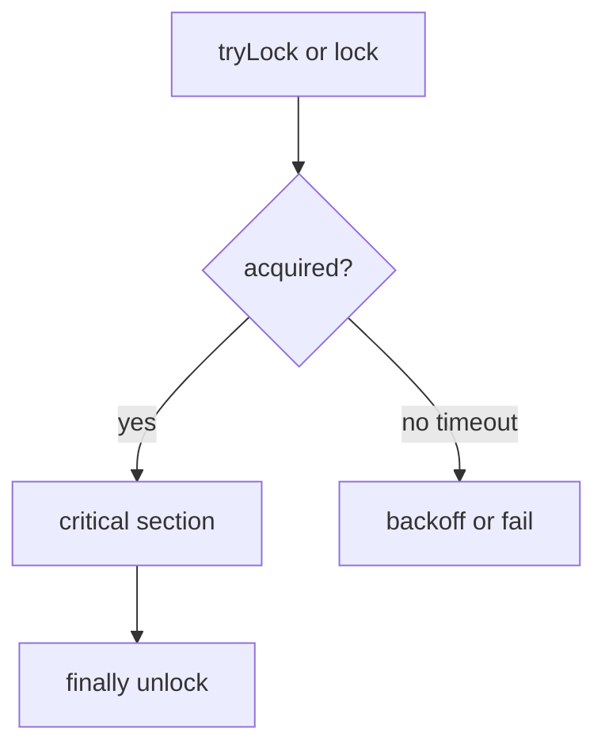

# Companion 6 — Locks

**Canonical source:** [Lesson 6 — Locks](../../../concurrency/06-locks.md).

## Definition

`java.util.concurrent.locks.Lock` (typically `ReentrantLock`) provides explicit mutual exclusion with optional fairness, timed try, and `Condition` queues.

## Why it exists

When `synchronized` is too coarse or you need `tryLock`, interruptible waits, or multiple wait sets per lock.

## Must remember

- **Always** `unlock()` in `finally` after `lock()`.
- `tryLock(timeout)` avoids indefinite deadlock — still need correct lock ordering ([Companion 18](18-deadlock-livelock-starvation.md)).
- Fair lock (`true`) reduces starvation, lowers throughput.
- `Condition` replaces `wait/notify` per lock with named condition queues.

## Interview traps

- `lock()` without `finally` unlock on exception path.
- Fair lock “for free” — performance cost is real.

## Frequently asked questions

- **Q:** When prefer `ReentrantLock` over `synchronized`?
  **A:** tryLock/timeouts, fairness choice, multiple Conditions, lock interruptibility.
- **Q:** Is `ReentrantLock` reentrant?
  **A:** Yes — same thread can acquire again.

## Interview flow



## ASCII / table recall

```text
lock.lock();
try { ... } finally { lock.unlock(); }  // mandatory pattern
```

## Scenario bite

Payments or order processing on more than one instance: apply this lesson at the right layer (JVM primitive vs database vs provider), and say the failure mode aloud before naming the API.

## Explain aloud (whiteboard)

1. “Explicit lock with try/finally — never unlock only on happy path.”
2. “tryLock with timeout for deadlock avoidance and degraded mode.”
3. “Fairness trades throughput for more even progress.”

## JDK and debug clues

- Thread dump: `java.util.concurrent.ReentrantLock` frames + parked threads.

## 30-second revision

- ReentrantLock + finally unlock; tryLock for timeouts; fair vs throughput; Condition for multiple wait sets.

## Memory hooks

- **FTU** — **F**inally **T**hen **U**nlock.

## Cross-links

- [Companion 4 — synchronized](04-synchronized.md)
- [Companion 18 — Deadlock](18-deadlock-livelock-starvation.md)
