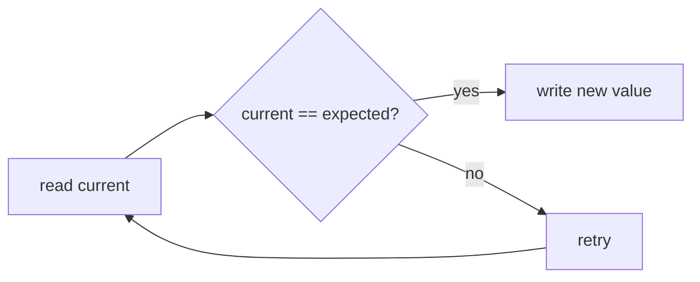

# Companion 7 — Atomics and CAS

**Canonical source:** [Lesson 7 — Atomics and CAS](../../../concurrency/07-atomics-and-cas.md).

## Definition

Atomics use **compare-and-set (CAS)** — read, compare to expected, swap if match, else retry — for single-variable updates without a full lock.

## Why it exists

Lock-free counters and flags with better scalability than one big mutex for hot counters.

## Must remember

- `incrementAndGet`, `compareAndSet` are safe for **one** atomic variable.
- **Compound invariants** (two fields) need locks, careful design, or DB constraints.
- High contention on one `AtomicLong` → CAS spin — use `LongAdder` ([Companion 8](08-longadder.md)).
- ABA matters for lock-free structures; less for `AtomicInteger` counters.

## Interview traps

- Two `AtomicReference`s updated separately — not one atomic transaction.
- Using atomics for “if balance sufficient then debit” without DB/application guard.

## Frequently asked questions

- **Q:** CAS vs lock?
  **A:** CAS optimizes uncontended/single-word updates; locks for multi-field critical sections.
- **Q:** Is `AtomicInteger` always faster than sync?
  **A:** Under extreme contention, spinning can lose to striped counters or locks.

## Interview flow



## ASCII / table recall

```text
do { exp = get(); } while (!compareAndSet(exp, exp+1));
```

## Scenario bite

Payments or order processing on more than one instance: apply this lesson at the right layer (JVM primitive vs database vs provider), and say the failure mode aloud before naming the API.

## Explain aloud (whiteboard)

1. “CAS is optimistic — retry if another thread won.”
2. “Great for counters and single-word state machines.”
3. “Multi-field business rules still need transactions or locks.”

## JDK and debug clues

- Hot CAS loops in async profilers → consider `LongAdder` or sharding.

## 30-second revision

- CAS retry; one variable OK; not multi-field invariants; contention → LongAdder.

## Memory hooks

- **CAR** — **C**AS **A** single **R**egister (variable).

## Cross-links

- [Companion 8 — LongAdder](08-longadder.md)
- [Companion 19 — Patterns](19-thread-safety-patterns.md)
