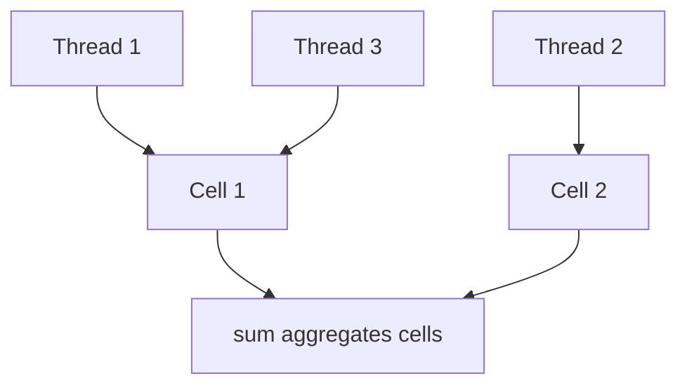

# Companion 8 — `LongAdder`

**Canonical source:** [Lesson 8 — LongAdder](../../../concurrency/08-longadder.md).

## Definition

`LongAdder` stripes increments across internal cells to reduce CAS collisions on a single hot `AtomicLong`.

## Why it exists

Metrics and request counters with many writers — `AtomicLong` becomes a scalability bottleneck.

## Must remember

- `increment()` spreads work; `sum()` aggregates cells.
- `sum()` is **not** a strict global snapshot under concurrent adds — OK for metrics, not ledger closing without stronger model.
- Pair with `ConcurrentHashMap` for per-key counters ([Companion 9](09-concurrent-collections.md)).
- Read-heavy exact balance → still use DB atomic update ([Companion 22](22-backend-concurrency-scenarios.md)).

## Interview traps

- Using `sum()` as authoritative financial total while writers still increment.
- LongAdder for a single-threaded counter — unnecessary complexity.

## Frequently asked questions

- **Q:** LongAdder vs AtomicLong?
  **A:** Many concurrent increments → LongAdder; few writers or need CAS on exact value → AtomicLong.
- **Q:** Is sum() exact?
  **A:** Can miss in-flight cells momentarily — approximate under load.

## Interview flow



## ASCII / table recall

```text
AtomicLong:  all threads --> one CAS hotspot
LongAdder:   threads --> cells[] --> sum() rolls up
```

## Scenario bite

Payments or order processing on more than one instance: apply this lesson at the right layer (JVM primitive vs database vs provider), and say the failure mode aloud before naming the API.

## Explain aloud (whiteboard)

1. “Striping reduces CAS contention on hot counters.”
2. “`sum()` is a rolling aggregate — fine for metrics dashboards.”
3. “Authoritative money movement stays in the database with conditional SQL.”

## JDK and debug clues

- Micrometer / metrics libraries often use LongAdder internally.

## 30-second revision

- Striped increments; sum approximate under load; metrics yes, ledger no without DB atomicity.

## Memory hooks

- **CELL** — **C**ontention **E**scapes via **L**ocal **L**anes.

## Cross-links

- [Companion 7 — Atomics](07-atomics-and-cas.md)
- [Companion 9 — CHM](09-concurrent-collections.md)
