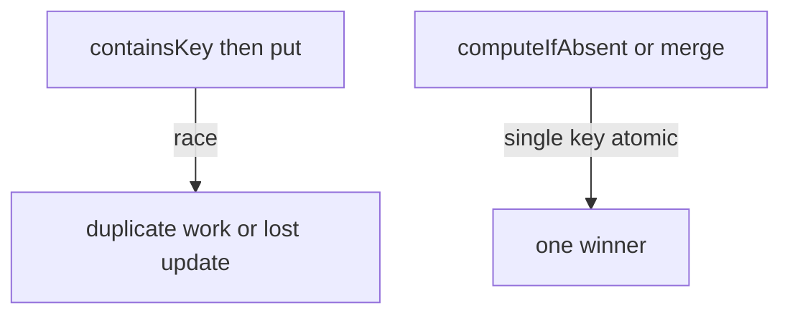

# Companion 9 — Concurrent Collections

**Canonical source:** [Lesson 9 — Concurrent Collections](../../../concurrency/09-concurrent-collections.md).

## Definition

`java.util.concurrent` collections provide thread-safe structures with finer-grained concurrency than wrapping `Collections.synchronizedMap`.

## Why it exists

Shared maps and queues in servers need safe publication, atomic single-key updates, and bounded backpressure without one global lock on the whole map.

## Must remember

- `ConcurrentHashMap` — no null keys/values; weakly consistent iterators.
- **Atomic single-key:** `putIfAbsent`, `computeIfAbsent`, `merge` — not multi-key transactions.
- `if (!map.containsKey(k)) map.put(k,v)` on CHM is **not** atomic.
- Queues: `ArrayBlockingQueue` (bounded), `LinkedBlockingQueue`, `ConcurrentLinkedQueue` (unbounded lock-free), `PriorityBlockingQueue`.
- Deepens [Collections M4 L12](../../../books/01-engineering-mastery/core-java/module-04-collections/12-concurrent-collections-overview.md).

## Interview traps

- CHM makes every compound workflow atomic — only single-key ops are.
- Using `ConcurrentHashMap` size as exact count under heavy writes without understanding weak consistency.

## Frequently asked questions

- **Q:** CHM vs `Collections.synchronizedMap`?
  **A:** CHM stripes/buckets for better read concurrency; still not a distributed lock.
- **Q:** Safe counter in CHM?
  **A:** `merge(k, 1L, Long::sum)` or `LongAdder` per key.

## Interview flow

## ASCII / table recall

| Pattern | API |
| --- | --- |
| Init once | `computeIfAbsent` |
| Add to counter | `merge(k, delta, Long::sum)` |
| Replace if absent | `putIfAbsent` |

## Scenario bite

Payments or order processing on more than one instance: apply this lesson at the right layer (JVM primitive vs database vs provider), and say the failure mode aloud before naming the API.

## Explain aloud (whiteboard)

1. “CHM gives atomic **single-key** operations — not arbitrary transactions.”
2. “I replace check-then-act with `computeIfAbsent` or `merge`.”
3. “For bounded memory between threads I pick a blocking queue with explicit capacity.”

## JDK and debug clues

- Duplicate cache loads → broken `containsKey` + `put` on CHM.

## 30-second revision

- CHM null ban; merge/computeIfAbsent; weak iterators; queues for producer-consumer ([Companion 17](17-producer-consumer-patterns.md)).

## Memory hooks

- **PCM** — **P**utIfAbsent / **C**ompute / **M**erge.

## Cross-links

- [Companion 17 — Producer–consumer](17-producer-consumer-patterns.md)
- [Companion 22 — Coalescing](22-backend-concurrency-scenarios.md)
