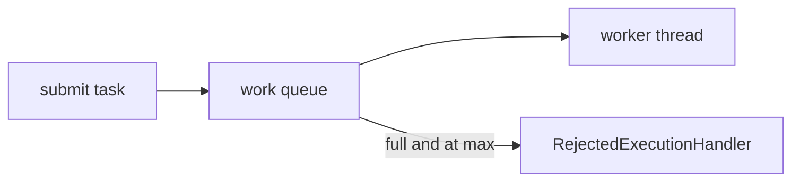

# Companion 10 — Executors and `ThreadPoolExecutor`

**Canonical source:** [Lesson 10 — Executors](../../../concurrency/10-executors-and-thread-pool-executor.md).

## Definition

`Executor` runs tasks; `ExecutorService` adds lifecycle and `submit`; `ThreadPoolExecutor` maps tasks to a bounded set of workers plus a work queue.

## Why it exists

Reuse threads, cap parallelism, and apply overload policy instead of unbounded `new Thread()` per request.

## Must remember

- Knobs: `corePoolSize`, `maximumPoolSize`, `keepAlive`, **queue**, **RejectedExecutionHandler**.
- Bounded queue + `CallerRunsPolicy` pushes backpressure to submitter.
- `Executors.newVirtualThreadPerTaskExecutor()` — one VT per task ([Companion 14](14-virtual-threads.md)).
- `ForkJoinPool.commonPool()` shared by parallel streams and default CF async ([Companion 12–13](12-completable-future.md)).

## Interview traps

- `Executors.newFixedThreadPool` with unbounded queue — hides overload until OOM/latency explosion.
- Shutting down JVM without `shutdown()` / `awaitTermination`.

## Frequently asked questions

- **Q:** core vs max pool size?
  **A:** Core threads stay alive; above core, tasks queue until max, then queue fills → rejection.
- **Q:** CallerRunsPolicy effect?
  **A:** Submitter thread runs task — slows producers naturally.

## Interview flow



## ASCII / table recall

```text
submit --> [queue] --> worker pool (core..max)
```

## Scenario bite

Payments or order processing on more than one instance: apply this lesson at the right layer (JVM primitive vs database vs provider), and say the failure mode aloud before naming the API.

## Explain aloud (whiteboard)

1. “I name core, max, queue type, and rejection policy together.”
2. “Unbounded queue defers failure — I prefer bounded + measured rejection.”
3. “Blocking work gets its own pool or virtual threads — not the common ForkJoin pool.”

## JDK and debug clues

- `RejectedExecutionException` in logs → saturation ([Companion 21](21-production-debugging.md)).
- Thread dump: pool name prefix + many WAITING workers.

## 30-second revision

- TPE = workers + queue + rejection; CallerRuns = backpressure; VT executor per task; isolate blocking pools.

## Memory hooks

- **CQR** — **C**ore, **Q**ueue, **R**ejection handler.

## Cross-links

- [Companion 11 — Sizing](11-thread-pool-sizing-and-backpressure.md)
- [Companion 12 — CF](12-completable-future.md)
