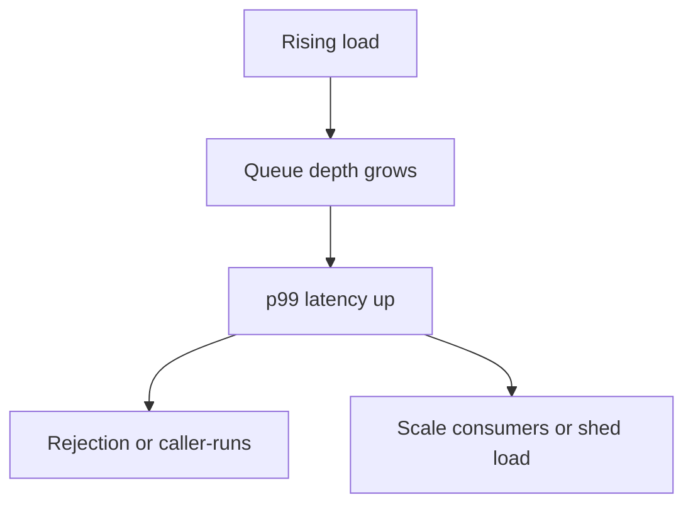

# Companion 11 — Thread Pool Sizing and Backpressure

**Canonical source:** [Lesson 11 — Pool sizing](../../../concurrency/11-thread-pool-sizing-and-backpressure.md).

## Definition

Pool sizing matches **work type** (CPU vs blocking I/O) and **downstream limits**; backpressure prevents unbounded queue growth under overload.

## Why it exists

Wrong pool size wastes cores or threads; unbounded queues hide saturation until p99 latency explodes.

## Must remember

- CPU-bound: pool ≈ cores (oversubscription hurts).
- I/O-bound platform threads: more threads can help **if** blocked on I/O — still bounded by DB/HTTP limits.
- Virtual threads change thread count economics, **not** downstream capacity ([Companion 14](14-virtual-threads.md)).
- Little’s law intuition: `L = λ × W` — growing queue depth = rising time-in-system.
- Prefer bounded queue + rejection or caller-runs over infinite `LinkedBlockingQueue`.

## Interview traps

- “Thread pool size = number of requests” — ignores blocking ratio and external limits.
- Rate limiting confused with concurrency limiting ([Companion 22](22-backend-concurrency-scenarios.md)).

## Frequently asked questions

- **Q:** Unbounded queue symptom?
  **A:** Accepts all tasks; latency grows; memory risk; hard to trigger rejection.
- **Q:** When add second limiter (semaphore + pool)?
  **A:** When downstream has stricter cap than your executor (e.g. 50 DB connections).

## Interview flow

## ASCII / table recall

| Signal | Action |
| --- | --- |
| Queue depth ↑ | Scale out, tune pool, or shed load |
| Rejection spikes | Overload or too-small pool |
| CPU 100% few threads | CPU-bound — don’t add threads |

## Scenario bite

Payments or order processing on more than one instance: apply this lesson at the right layer (JVM primitive vs database vs provider), and say the failure mode aloud before naming the API.

## Explain aloud (whiteboard)

1. “I classify work CPU-bound vs blocking I/O.”
2. “I bound the queue so overload surfaces as rejection or caller-runs, not silent latency.”
3. “Virtual threads don’t remove DB pool limits — I still bulkhead.”

## JDK and debug clues

- Metrics: pool active count, queue size, rejection rate ([Companion 21](21-production-debugging.md)).

## 30-second revision

- CPU ≈ cores; I/O needs limits; bounded queue; Little’s law; VT ≠ bigger connection pool.

## Memory hooks

- **BLQ** — **B**ounded **L**atency via **Q**ueue cap.

## Cross-links

- [Collections M4 L10 — Blocking queues](../../../books/01-engineering-mastery/core-java/module-04-collections/10-blocking-queues-and-backpressure.md)
- [Companion 22 — Rate vs concurrency](22-backend-concurrency-scenarios.md)
