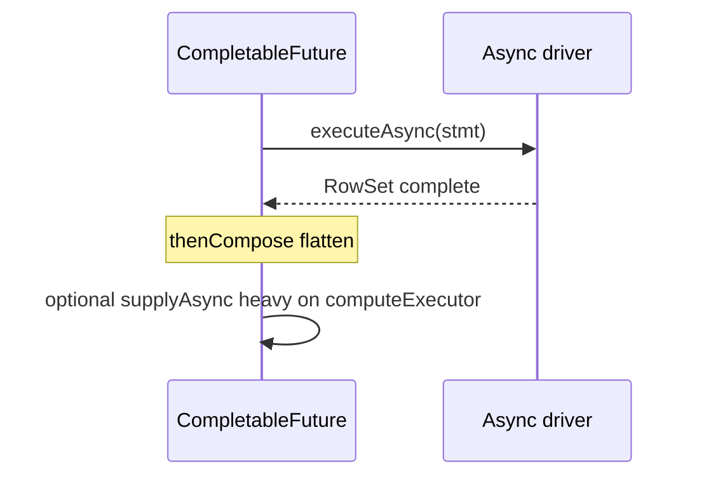

# Companion 12 — `CompletableFuture`

**Canonical source:** [Lesson 12 — CompletableFuture](../../../concurrency/12-completable-future.md).

## Definition

`CompletableFuture` composes asynchronous stages — map, flatMap, combine — with optional explicit executors.

## Why it exists

Express multi-step async workflows without blocking threads at each step; isolate CPU/blocking work from scarce completion threads.

## Must remember

- `thenApply` — map; `thenCompose` — flatten `CF<CF<T>>`; `thenCombine` — two inputs.
- Non-async stages run on **completing thread** — heavy work there blocks that worker.
- Default `*Async` → `ForkJoinPool.commonPool()` unless executor passed.
- Async driver `executeAsync` + `thenCompose` — don’t add executor per stage unless CPU/blocking on completion thread.
- `join()` unchecked `CompletionException`; `get()` checked `ExecutionException` / interrupt.
- Async execution ≠ non-blocking I/O — CF is task composition.

## Interview traps

- Blocking JDBC on `supplyAsync` without dedicated pool — starves common pool.
- `thenApply` when inner returns `CompletionStage` — need `thenCompose`.

## Frequently asked questions

- **Q:** When `thenComposeAsync`?
  **A:** When next step is blocking or CPU-heavy and must not run on driver completion thread.
- **Q:** Cancel stops JDBC?
  **A:** Only if task cooperates — often I/O continues.

## Interview flow

## ASCII / table recall

| Method | Use when |
| --- | --- |
| `thenApply` | `T → U` |
| `thenCompose` | `T → CompletionStage<U>` |
| `thenCombine` | two CFs complete → merge |

## Scenario bite

Payments or order processing on more than one instance: apply this lesson at the right layer (JVM primitive vs database vs provider), and say the failure mode aloud before naming the API.

## Explain aloud (whiteboard)

1. “CF composes async **tasks**, not magic network efficiency.”
2. “`thenCompose` flattens nested async like `session.executeAsync`.”
3. “I isolate blocking JDBC and CPU work from the common pool and driver completion threads.”

## JDK and debug clues

- Common pool saturation with few parallel streams + CF — thread dump shows `ForkJoinPool`.

## 30-second revision

- Apply/Compose/Combine; sync stage on completer; compose for DB; join vs get; executor isolation.

## Memory hooks

- **A-C-C** — **A**pply map, **C**ompose flatten, **C**ombine pair.

## Cross-links

- [Visual quick reference](module-visual-quick-reference.md)
- [Companion 13 — ForkJoinPool](13-forkjoin-pool.md)
- [Companion 14 — VT](14-virtual-threads.md)
