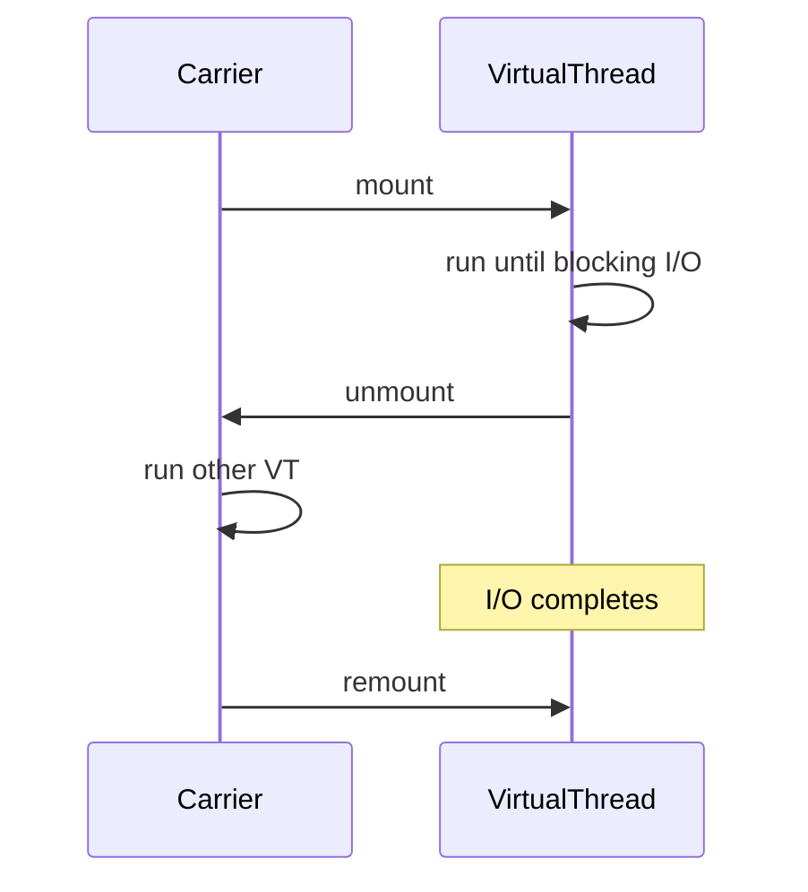

# Companion 14 — Virtual Threads

**Canonical source:** [Lesson 14 — Virtual Threads](../../../concurrency/14-virtual-threads.md).

## Definition

Virtual threads are JVM-scheduled lightweight threads mounted on **carrier** platform threads (M:N), unmounting on supported blocking operations.

## Why it exists

Massive blocking I/O concurrency without one OS thread per request — keep synchronous code style.

## Must remember

- Concurrency ≠ parallelism; VTs don’t add CPU cores.
- **Mount/unmount** on supported blocking I/O frees carrier for other VTs.
- **Pinning** when VT can’t unmount (`synchronized`/native — JDK version-specific; JEP 491 on newer releases).
- 50-connection pool + 5k VTs → ~50 concurrent DB work; rest wait/timeout.
- **Don’t pool VTs** — `newVirtualThreadPerTaskExecutor()` per task.
- Large `ThreadLocal` × many VTs → heap pressure.

## Interview traps

- Unlimited VTs = unlimited downstream throughput.
- CPU-bound work faster with more VTs.

## Frequently asked questions

- **Q:** VT vs platform thread pool for HTTP?
  **A:** Many blocking requests → VT; CPU crunch → sized platform pool.
- **Q:** How diagnose pinning?
  **A:** JFR `jdk.VirtualThreadPinned`, thread dumps on target JDK.

## Interview flow



## ASCII / table recall

```text
Carrier --mount--> VT1 --unmount on I/O--> Carrier runs VT2
OS scheduler still schedules carriers onto CPU cores
```

## Scenario bite

Payments or order processing on more than one instance: apply this lesson at the right layer (JVM primitive vs database vs provider), and say the failure mode aloud before naming the API.

## Explain aloud (whiteboard)

1. “VTs are cheap tasks; carriers are real OS threads.”
2. “Great for blocking I/O fan-out; useless for saturating CPU.”
3. “I still semaphore DB/HTTP pools and watch pinning on our JDK.”

## JDK and debug clues

- Carrier count ≈ parallel platform threads in VT scheduler — not request count.

## 30-second revision

- M:N carriers; mount/unmount; pinning version-dependent; pool/semaphore limits; no VT pooling.

## Memory hooks

- **MOUNT** — **M**any **O**perations, **U**nmount on **N**ative/supported block, **T**hrottle downstream.

## Cross-links

- [Visual quick reference](module-visual-quick-reference.md)
- [Companion 15 — ThreadLocal](15-threadlocal-and-scoped-value.md)
- [Companion 22E — VT limits](22-backend-concurrency-scenarios.md)
