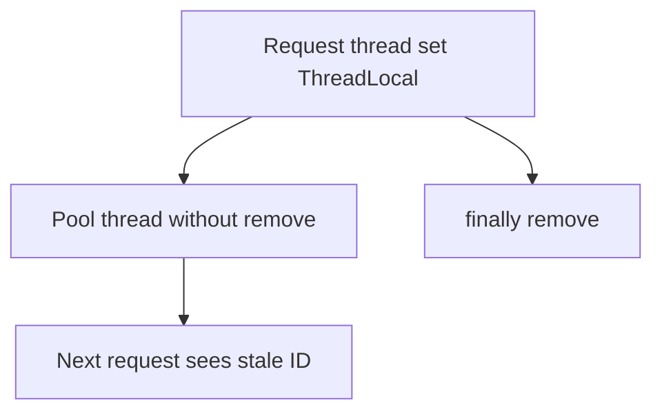

# Companion 15 — `ThreadLocal` and `ScopedValue`

**Canonical source:** [Lesson 15 — ThreadLocal and ScopedValue](../../../concurrency/15-threadlocal-and-scoped-value.md).

## Definition

`ThreadLocal` binds a value per platform/virtual thread; `ScopedValue` (JDK 21+) binds context for a **dynamic scope** without mutable per-thread map lookup.

## Why it exists

Carry request ID, trace ID, or security principal through synchronous call stacks without passing parameters everywhere.

## Must remember

- **Pooled threads:** `remove()` in `finally` — stale context on next task.
- Does **not** propagate to `ExecutorService`, `CompletableFuture`, or arbitrary async automatically.
- Many VTs + fat ThreadLocal → memory risk.
- `ScopedValue` — immutable contextual binding; does **not** guarantee all async frameworks inherit it without integration.
- Check JDK release notes for `ScopedValue` finalization (21 preview → later finalized).

## Interview traps

- Setting MDC/ThreadLocal then `supplyAsync` — child thread missing context.
- Using ThreadLocal as a global cache keyed only by thread.

## Frequently asked questions

- **Q:** Fix async tracing?
  **A:** Explicit propagation (MDC adapter, wrap tasks, OpenTelemetry context), not hope ThreadLocal flows.
- **Q:** ScopedValue vs ThreadLocal?
  **A:** Scoped = bounded scope + immutability; ThreadLocal = mutable per-thread bag.

## Interview flow



## ASCII / table recall

```text
handle(): set -> try { work } finally { remove() }
async: copy context into task or use framework support
```

## Explain aloud (whiteboard)

1. “ThreadLocal is thread confinement — pool reuse demands remove.”
2. “Async boundaries break implicit propagation — I copy or use ScopedValue/tracing APIs.”
3. “At VT scale I avoid large per-thread maps.”

## JDK and debug clues

- Wrong tenant ID intermittently → missing remove on pool thread.

## 30-second revision

- remove in finally; no async magic; ScopedValue for scoped immutable context; VT memory caution.

## Memory hooks

- **TRAP** — **T**hreadLocal **R**emove **A**fter **P**ool use.

## Cross-links

- [Companion 12 — CF](12-completable-future.md)
- [Companion 21 — Debug](21-production-debugging.md)
