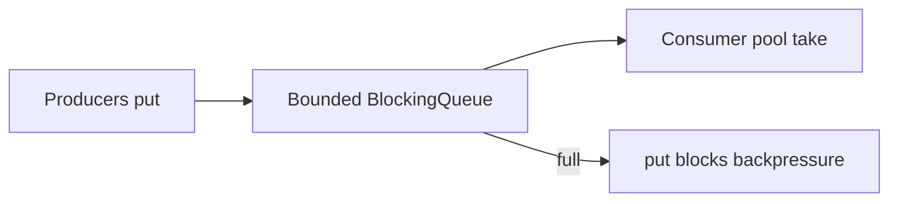

# Companion 17 — Producer–Consumer Patterns

**Canonical source:** [Lesson 17 — Producer–Consumer](../../../concurrency/17-producer-consumer-patterns.md).

## Definition

Producers and consumers communicate through a buffer — typically `BlockingQueue` — decoupling production rate from consumption rate.

## Why it exists

Smooth bursts, apply backpressure, and isolate failure domains within one JVM service.

## Must remember

- `put` blocks when full (backpressure); `take` when empty.
- `offer`/`poll` with timeout + interrupt handling for responsive shutdown.
- **Queue capacity ≠ consumer parallelism** — scale consumer threads separately.
- In-memory queue: **no durability** on crash; retries must be idempotent.
- Kafka: distributed log, offsets, retention, consumer groups — records not deleted on read.

## Interview traps

- Using unbounded queue to “never block producers” — latency death spiral.
- Expecting Kafka semantics from `ArrayBlockingQueue`.

## Frequently asked questions

- **Q:** Kafka vs BlockingQueue in one system?
  **A:** Kafka between services; in-process queue inside consumer for worker pool.
- **Q:** When Disruptor?
  **A:** Measured ultra-low latency hot path ([Companion 20](20-advanced-concurrency.md)).

## Interview flow

## ASCII / table recall

| | BlockingQueue | Kafka |
| --- | --- | --- |
| Scope | JVM | Cluster |
| Durability | Heap | Log + replication |
| Read | Removes element | Offset advances, record retained |

## Explain aloud (whiteboard)

1. “Bounded queue blocks producers — that’s intentional backpressure.”
2. “I scale consumers, not just queue size, for throughput.”
3. “Cross-service events are Kafka; local fan-out is in-process queue or disruptor.”

## JDK and debug clues

- Growing heap + single consumer thread → queue backing up.

## 30-second revision

- put/take backpressure; capacity ≠ parallelism; no crash durability; Kafka for distributed streaming.

## Memory hooks

- **PUT** — **P**roducers **U**nblock when **T**ake drains.

## Cross-links

- [Companion 9 — Queues](09-concurrent-collections.md)
- [Companion 20 — Disruptor](20-advanced-concurrency.md)
