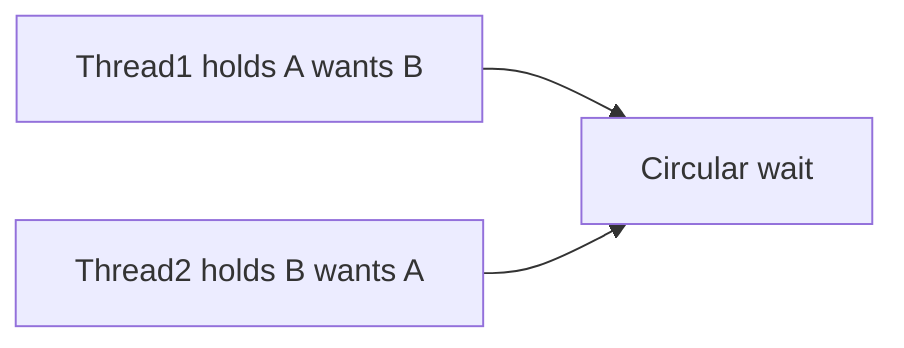

# Companion 18 — Deadlock, Livelock, and Starvation

**Canonical source:** [Lesson 18 — Deadlock, Livelock, and Starvation](../../../concurrency/18-deadlock-livelock-starvation.md).

## Definition

**Deadlock** — circular wait, no progress without intervention. **Livelock** — threads active but no useful work completes. **Starvation** — one thread persistently denied locks/CPU/permits.

## Why it exists

Nested locks, polite retries, and unfair scheduling create production stalls distinct from simple races.

## Must remember

- Deadlock prevention: **global lock ordering**, `tryLock` timeouts, smaller critical sections.
- Livelock fix: **jitter**, exponential backoff, mediator queue.
- Starvation: fair locks (throughput cost), avoid priority inversion patterns.
- Unbounded queues → overload/latency — not deadlock but operational liveness failure.

## Interview traps

- Calling any high latency “deadlock” — may be pool exhaustion or slow I/O.
- Fair lock “always better” — throughput drops.

## Frequently asked questions

- **Q:** Four conditions for deadlock?
  **A:** Mutual exclusion, hold-and-wait, no preemption, circular wait — break one (often ordering or timeouts).
- **Q:** Detect in prod?
  **A:** Thread dump “Java-level deadlock” section ([Companion 21](21-production-debugging.md)).

## Interview flow

## ASCII / table recall

| | Threads move? | Useful progress? |
| --- | --- | --- |
| Deadlock | Blocked | No |
| Livelock | Yes | No |
| Starvation | Some run | Victim starves |

## Scenario bite

Payments or order processing on more than one instance: apply this lesson at the right layer (JVM primitive vs database vs provider), and say the failure mode aloud before naming the API.

## Explain aloud (whiteboard)

1. “Deadlock is a cycle on locks — I enforce acquisition order.”
2. “Livelock is polite retry storm — I add backoff or a queue.”
3. “Starvation is fairness — fair lock or restructure who holds the hot lock.”

## JDK and debug clues

- `jcmd Thread.print` deadlock section; many BLOCKED on same monitor.

## 30-second revision

- Deadlock cycle; livelock retry; starvation fairness; bounded queues for overload.

## Memory hooks

- **DLS** — **D**eadlock **L**ivelock **S**tarvation.

## Cross-links

- [Companion 6 — Locks](06-locks.md)
- [Companion 21 — Debug](21-production-debugging.md)
