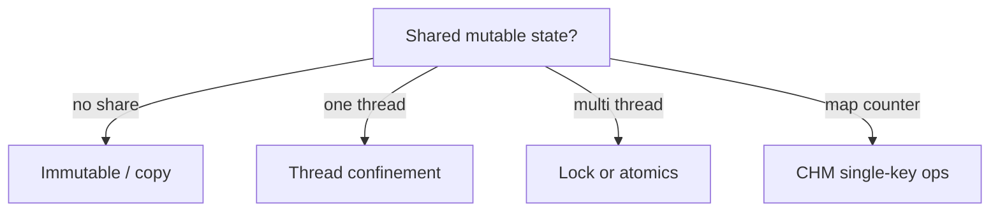

# Companion 19 — Thread-Safety Patterns

**Canonical source:** [Lesson 19 — Thread-Safety Patterns](../../../concurrency/19-thread-safety-patterns.md).

## Definition

Thread safety is achieved by eliminating shared mutation, confining mutation to one thread, or synchronizing access — method-safe ≠ workflow-safe.

## Why it exists

Libraries expose thread-safe methods, but application workflows still compose check-then-act races across methods.

## Must remember

- Prefer **immutability** and **defensive copies** on boundaries.
- `final` reference ≠ immutable object — mutable fields inside still race.
- **Thread confinement** — one thread owns mutable state.
- `ConcurrentHashMap.putIfAbsent` / `merge` for single-key atomicity.
- **Compound invariants** span fields — need transaction, lock, or DB constraint.
- Safe publication: initialize fully before sharing reference.

## Interview traps

- “CHM is thread-safe so my service is thread-safe.”
- Returning internal mutable collection from getter without copy.

## Frequently asked questions

- **Q:** Check-then-act on CHM?
  **A:** Use `computeIfAbsent` / `merge`, not `containsKey` + `put`.
- **Q:** Immutable config?
  **A:** Unmodifiable wrappers or records; copy on write for updates.

## Interview flow



## ASCII / table recall

```text
Method thread-safe + workflow check-then-act = still broken
```

## Explain aloud (whiteboard)

1. “I pick immutability or confinement first.”
2. “For shared maps I use merge/computeIfAbsent, not two-step checks.”
3. “Business invariants spanning DB + memory need transactional boundaries.”

## JDK and debug clues

- Intermittent duplicate processing → workflow-level race.

## 30-second revision

- Immutable/confinement first; final ≠ deep immutable; CHM atomic single-key; workflow atomicity separate.

## Memory hooks

- **ICS** — **I**mmutability, **C**onfinement, **S**ync/atomics ladder.

## Cross-links

- [Companion 9 — CHM](09-concurrent-collections.md)
- [Companion 22 — Payments](22-backend-concurrency-scenarios.md)
