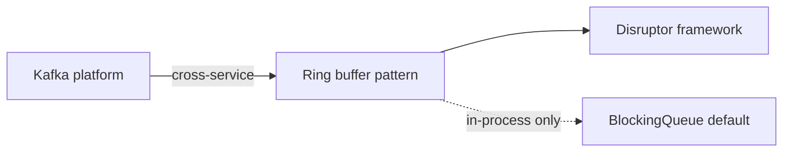

# Companion 20 — Advanced Concurrency

**Canonical source:** [Lesson 20 — Advanced Concurrency](../../../concurrency/20-advanced-concurrency.md).

## Definition

Low-latency patterns: ring buffers, cache-line effects, and LMAX Disruptor — specialized alternatives to default queues for measured hot paths.

## Why it exists

When allocation and lock contention dominate microseconds-scale pipelines, structured ring buffers and sequenced consumers reduce coordination overhead.

## Must remember

- Ring buffer = fixed array + sequence indices — **not** automatically thread-safe.
- **False sharing** — unrelated fields on same cache line (~64B typical, arch-dependent) hurt performance.
- **Cache-line bouncing** — true contention on one hot variable.
- `@Contended` / manual padding — benchmark; layout not portable guarantee.
- **Disruptor** = framework on ring buffer + barriers; **Kafka** = distributed log; **BlockingQueue** = default in-process.

## Interview traps

- Disruptor for every microservice — complexity/ops cost unjustified.
- Padding `long` fields “always fixes” false sharing.

## Frequently asked questions

- **Q:** Ring buffer vs BlockingQueue?
  **A:** Ring = pattern for sequenced slots; BlockingQueue = JDK blocking semantics out of the box.
- **Q:** False sharing vs data race?
  **A:** False sharing = perf coherence traffic; data race = correctness/JMM.

## Interview flow



## ASCII / table recall

```text
Cache line [ counterA | counterB ]  -- both hot --> false sharing
Ring: producerSeq, consumerSeq, slot reuse after sequence proves safe
```

## Explain aloud (whiteboard)

1. “Ring buffer is a storage/coordination pattern — I still prove thread safety.”
2. “False sharing is hardware — pad or `@Contended` only after profiling.”
3. “Disruptor for measured hot paths; Kafka between services; queues for normal CRUD.”

## JDK and debug clues

- Profiler shows cache-miss coherence on adjacent atomic counters.

## 30-second revision

- Ring not free thread-safe; false sharing perf; Disruptor in-process; Kafka distributed; default to queues.

## Memory hooks

- **RDK** — **R**ing pattern, **D**isruptor, **K**afka scopes.

## Cross-links

- [Companion 17 — Producer–consumer](17-producer-consumer-patterns.md)
