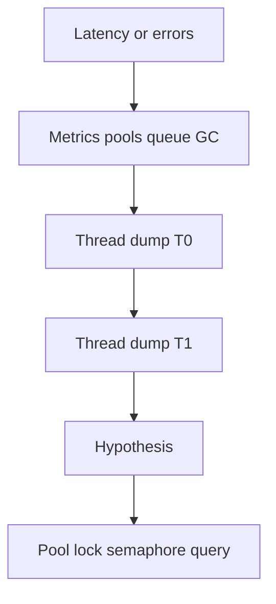

# Companion 21 — Production Debugging

**Canonical source:** [Lesson 21 — Production Debugging](../../../concurrency/21-production-debugging.md).

## Definition

Systematic concurrency debugging correlates symptoms, metrics, and **multiple** thread dumps before changing pool sizes or locks.

## Why it exists

Single snapshots mislead — `RUNNABLE` does not prove CPU burn; BLOCKED may be normal pool wait vs deadlock.

## Must remember

- Workflow: symptom → metrics → 2+ dumps spaced apart → hypothesis → targeted fix.
- States: `BLOCKED` (monitor), `WAITING`/`TIMED_WAITING` (park/wait/I/O), `RUNNABLE` (eligible, not necessarily on-CPU).
- Signatures: deadlock section, JDBC `getConnection` waits, growing executor queue, VT pinning events.
- ThreadLocal leaks in heap dominators; false sharing needs profiler not dumps alone.

## Interview traps

- One thread dump “proves” deadlock without cycle section.
- Scaling threads when downstream DB pool is the bottleneck.

## Frequently asked questions

- **Q:** Tools?
  **A:** `jcmd Thread.print`, JFR, async profiler, pool/DB metrics.
- **Q:** CPU high but all WAITING?
  **A:** Reconcile with profiler — dump timing vs actual CPU consumers.

## Interview flow

## ASCII / table recall

| State | Interview caution |
| --- | --- |
| RUNNABLE | Not equal to using CPU now |
| BLOCKED | Look for lock cycle vs pool |

## Scenario bite

Payments or order processing on more than one instance: apply this lesson at the right layer (JVM primitive vs database vs provider), and say the failure mode aloud before naming the API.

## Explain aloud (whiteboard)

1. “I take repeated dumps and correlate with queue depth and DB pool active.”
2. “RUNNABLE is eligibility — I confirm CPU with profiler.”
3. “Fix the bottleneck layer — not always more threads.”

## JDK and debug clues

- `jcmd <pid> Thread.print`; JFR virtual thread pinning (JDK-dependent).

## 30-second revision

- Multi-dump + metrics; state semantics; deadlock section; pool/JDBC waits; evidence before tuning.

## Memory hooks

- **2D** — **2** dumps + **D**ata metrics.

## Cross-links

- [M9 — OOM diagnostics](../../../books/01-engineering-mastery/core-java/module-09-jvm-basics/07-diagnosing-outofmemoryerror-in-production.md)
- [Companion 18 — Deadlock](18-deadlock-livelock-starvation.md)
