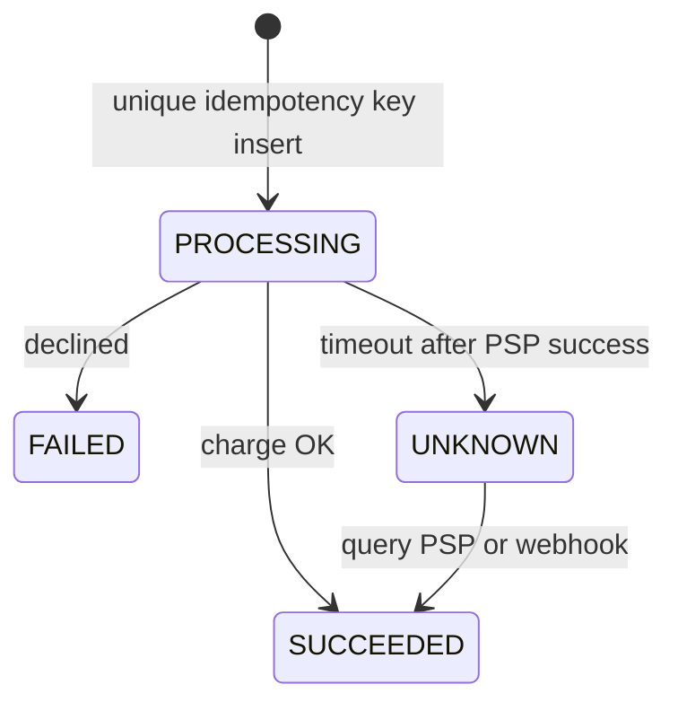

# Companion 22 — Backend Concurrency Scenarios

**Canonical source:** [Lesson 22 — Backend Scenarios](../../../concurrency/22-backend-concurrency-scenarios.md).

## Definition

Interview scenarios tying JVM concurrency to distributed correctness: idempotency, coalescing, limits, and database atomicity.

## Why it exists

Senior interviews test whether you can reason about **multiple instances**, retries, and external systems — not single-JVM `synchronized`.

## Must remember

- **A Payments:** stable **idempotency key** or shared payment intent — fresh UUID per click fails unique constraint dedup.
- States: `PROCESSING`, `SUCCEEDED`, `FAILED`, `UNKNOWN`; PSP idempotency + webhooks + reconciliation.
- No long DB txn across PSP HTTP; txn cannot roll back external charge.
- **B Coalescing:** `ConcurrentHashMap` of in-flight `CompletableFuture` + `whenComplete` cleanup.
- **C Rate vs concurrency:** token bucket (RPS) vs semaphore (parallel slots) vs pool vs bounded queue.
- **D Lost update:** `UPDATE ... WHERE balance >= X` affected rows; JPA `@Version`; `SELECT FOR UPDATE`.
- **E VT + 50 connections:** semaphore/bulkhead; timeouts — VT count ≠ DB throughput.

## Interview traps

- Customer+amount+time as dedup key — legitimate duplicate purchases exist.
- `synchronized` payment method on two pods.

## Frequently asked questions

- **Q:** Exactly-once payment?
  **A:** Effectively-once via idempotency + reconciliation — not universal exactly-once across systems.
- **Q:** Reuse idempotency key different payload?
  **A:** Reject — key bound to first payload hash/body.

## Interview flow

## ASCII / table recall

| Scenario | Core mechanism |
| --- | --- |
| Double pay | Stable idempotency key + unique constraint |
| Stampede | Coalesced in-flight future |
| 429 storm | Rate limit + jittered backoff |
| Debit | Conditional SQL or version column |

## Scenario bite

Payments or order processing on more than one instance: apply this lesson at the right layer (JVM primitive vs database vs provider), and say the failure mode aloud before naming the API.

## Explain aloud (whiteboard)

1. “Two instances break JVM locks — durable idempotency key is the dedup identity.”
2. “I separate rate limiting from concurrency limiting and from pool queue depth.”
3. “Virtual threads still wait on fifty connections — I semaphore acquires.”

## JDK and debug clues

- Duplicate charges correlate with check-then-act logs, not synchronized stack traces.

## 30-second revision

- Idempotency key reuse; coalescing map; rate≠concurrency; SQL CAS; VT≠pool size.

## Memory hooks

- **ICRLV** — **I**dempotency, **C**oalesce, **R**ate, **L**ost update SQL, **V**T limits.

## Cross-links

- [M8 idempotency companion](../../../books/02-interview-companion/core-java/module-08-exception-handling/03-production-spring-retries-idempotency.md)
- [DB concurrency](../../../distributed-systems/database-concurrency-and-isolation.md)
- [Visual quick reference](module-visual-quick-reference.md)
