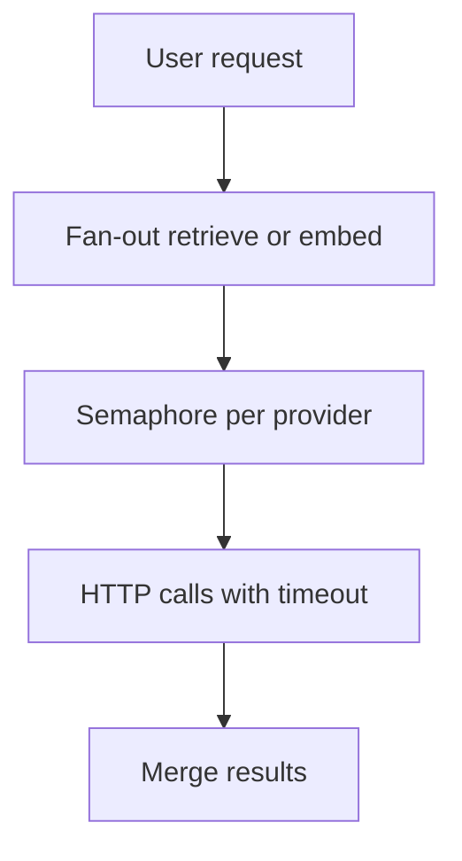

# Companion 23 — AI-System Concurrency

**Canonical source:** [Lesson 23 — AI-System Concurrency](../../../concurrency/23-ai-system-concurrency.md).

## Definition

Concurrent backend patterns around LLM/embedding provider calls: fan-out, quotas, cancellation, and bounded executors — product-agnostic.

## Why it exists

RAG and agent flows multiply parallel HTTP calls; unbounded parallelism hits provider 429s and wastes memory on large responses.

## Must remember

- Fan-out retrieval/embeddings — cap with **semaphore/bulkhead** per provider.
- **Rate limit** (tokens/min) ≠ **concurrency limit** (parallel requests).
- Deadlines: per-call + overall (`orTimeout`, `CompletableFuture` composition).
- Isolate blocking HTTP from CPU post-processing ([Companion 12](12-completable-future.md)).
- Coalesce identical in-flight prompts ([Companion 22](22-backend-concurrency-scenarios.md)).
- Respect **Retry-After**; avoid thundering herd on 429.
- VT helpful for blocking HTTP if pinning controlled — still respect provider caps.

## Interview traps

- `parallelStream` over 200 chunk embeds on common pool.
- Ignoring client disconnect — waste provider quota.

## Frequently asked questions

- **Q:** VT for AI gateways?
  **A:** Many blocking waits OK; semaphore enforces provider concurrent cap.
- **Q:** Distributed rate limit?
  **A:** Redis/token bucket across instances for RPS; semaphore per instance insufficient alone.

## Interview flow

## ASCII / table recall

| Concern | Tool |
| --- | --- |
| Parallel cap | Semaphore |
| RPS cap | Rate limiter |
| Slow tail | Deadline / cancel |

## Explain aloud (whiteboard)

1. “I bulkhead provider concurrency separately from thread count.”
2. “Rate limits and concurrency limits solve different overload modes.”
3. “I propagate cancellation and use jittered backoff on 429.”

## JDK and debug clues

- Spike in `ForkJoinPool` + 429 logs → unbounded parallel fan-out.

## 30-second revision

- Bulkhead + rate limit + deadlines; coalesce; no unbounded parallelStream to provider.

## Memory hooks

- **429** — **4** limits: **2** rate+concurrency, **9** = respect Retry-After (mnemonic stretch).

## Cross-links

- [Companion 16 — Semaphore](16-coordination-primitives.md)
- [Companion 22 — Coalescing](22-backend-concurrency-scenarios.md)
