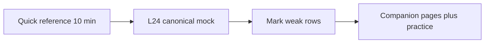

# Companion 24 — Senior Interview Assessment Hub

**Full mock with model answers:** [Canonical Lesson 24 — Senior Interview Assessment](../../../concurrency/24-senior-interview-assessment.md).

This companion page is a **drill guide** — not a duplicate of every `
` answer.

## How to use

1. Attempt [canonical L24](../../../concurrency/24-senior-interview-assessment.md) **without notes** (45–60 min).
2. Grade with rubric below; revisit companion lessons for weak rows.
3. Supplement with [module interview practice](module-interview-practice.md) for extra drills.

## Scoring rubric (self-assessment)

| Score | Meaning |
| --- | --- |
| 0 | Missing mechanism (e.g. no idempotency key) |
| 1 | Names tool but no failure mode |
| 2 | Correct mechanism + one trade-off |
| 3 | Senior: multi-instance, retries, metrics, operational recovery |

Target **≥2** on payment, CF/executor, VT+pool, and debugging scenarios.

## Topic coverage matrix

| Topic area | Canonical | Companion visual |
| --- | --- | --- |
| JMM / races | L2–3 | [02](02-java-memory-model.md), [03](03-race-conditions.md) |
| Sync / volatile / locks | L4–6 | [04](04-synchronized.md)–[06](06-locks.md) |
| Atomics / CHM | L7–9 | [07](07-atomics-and-cas.md)–[09](09-concurrent-collections.md) |
| Pools / CF / FJP / VT | L10–14 | [10](10-executors-and-thread-pool-executor.md)–[14](14-virtual-threads.md) |
| Context / coordination | L15–16 | [15](15-threadlocal-and-scoped-value.md), [16](16-coordination-primitives.md) |
| Queues / failure modes | L17–18 | [17](17-producer-consumer-patterns.md), [18](18-deadlock-livelock-starvation.md) |
| Patterns / advanced | L19–20 | [19](19-thread-safety-patterns.md), [20](20-advanced-concurrency.md) |
| Prod / backend / AI | L21–23 | [21](21-production-debugging.md)–[23](23-ai-system-concurrency.md) |

## Interview flow (assessment day)

## Explain aloud (whiteboard)

1. “For each scenario I state **shared state**, **failure mode**, and **layer** (JVM vs DB vs provider).”
2. “I mention **horizontal scale** before suggesting `synchronized`.”
3. “I close with **observability** — what metric proves the fix worked.”

## 30-second revision

- Drill canonical L24; use matrix to patch gaps; [visual quick reference](module-visual-quick-reference.md) before interview.

## Cross-links

- [Practice questions](module-interview-practice.md)
- [Answers](module-interview-assessment-answers.md)
