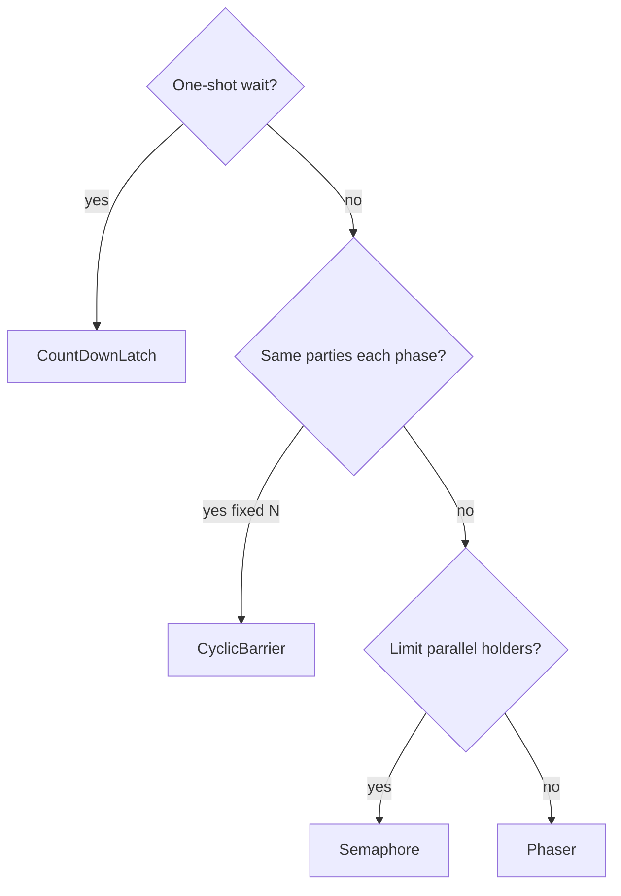
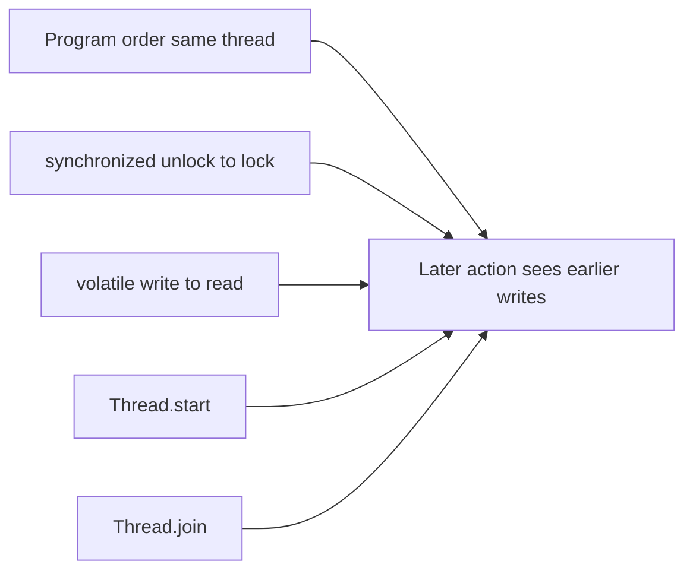
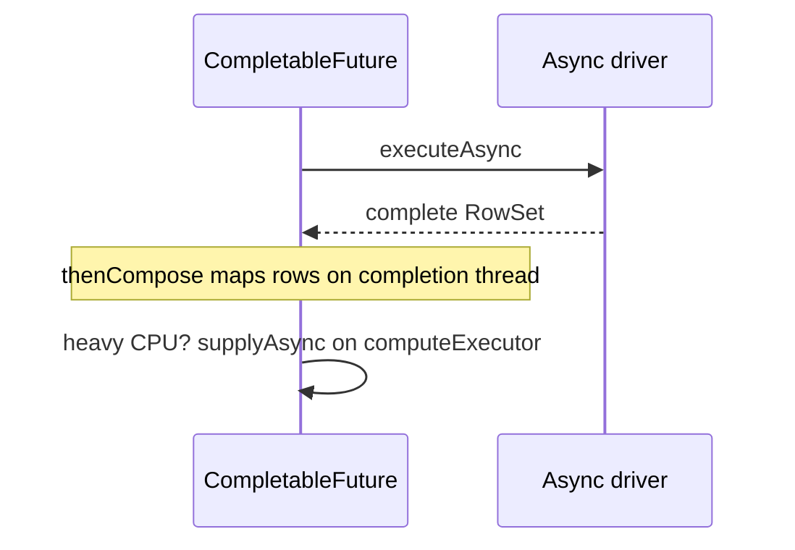
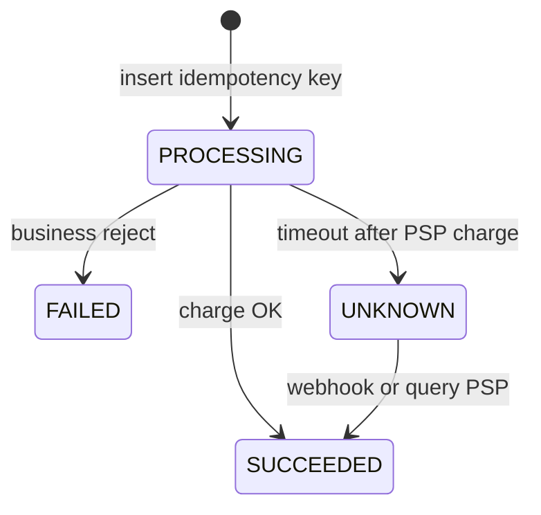

# Concurrency — Visual Quick Reference

Use with [companion index](index.md). Canonical depth: [Concurrency curriculum](../../../concurrency/index.md).

Open this site with `mkdocs serve` so Mermaid flowcharts render. Raw editor preview often shows the source only.

## Coordination primitive picker

| Need | Use | Not |
| --- | --- | --- |
| Wait once for N startup tasks | **CountDownLatch** | Barrier (repeats) |
| Fixed team, repeated phases | **CyclicBarrier** | Latch (one-shot) |
| Cap concurrent downstream calls | **Semaphore** | Rate limiter alone |
| Phases + dynamic worker count | **Phaser** | Static barrier only |



## JMM happens-before (summary)



**Trap:** HB gives visibility — not `count++` atomicity without atomics or locks.

## CompletableFuture composition

| API | Shape | Interview line |
| --- | --- | --- |
| `thenApply` | `T → U` | Map on same stage thread unless `*Async` |
| `thenCompose` | `T → CF<U>` | Flatten nested async (DB `executeAsync`) |
| `thenCombine` | two CFs → merge | Parallel inputs, one combiner |



**Default `*Async`:** `ForkJoinPool.commonPool()` — isolate blocking JDBC.

## Virtual threads (JDK 21+)

```text
Carrier (OS thread) --mount--> VT runs
VT blocks on supported JDK I/O --> unmount, carrier runs other VTs
VT resumes --> remount (maybe different carrier)
```

| Check | Action |
| --- | --- |
| CPU-bound work | Platform pool / limited parallelism — VTs do not add cores |
| 50 DB connections, 5k VTs | Semaphore or pool wait — not unlimited throughput |
| Pinning | JFR `jdk.VirtualThreadPinned`; JDK 24+ JEP 491 reduces `synchronized` pin |
| ThreadLocal at scale | Memory — prefer `ScopedValue` where applicable (JDK 21+) |

## Backend scenarios mini-map



| Scenario | Core fix |
| --- | --- |
| Double pay | **Stable idempotency key** — not fresh UUID per click |
| Cache stampede | `computeIfAbsent` + shared `CompletableFuture` + cleanup |
| Rate vs concurrency | Token bucket (RPS) vs semaphore (parallel slots) |
| Lost update | `UPDATE ... WHERE balance >= X` or `@Version` |
| VT + small pool | Bulkhead on acquire; timeouts |

## Thread dump states (snapshot)

| State | Often means |
| --- | --- |
| `BLOCKED` | Waiting for monitor |
| `WAITING` / `TIMED_WAITING` | `park`, `wait`, join, I/O (driver-dependent) |
| `RUNNABLE` | Eligible to run — **not proof of burning CPU** |

## Lesson index (visual focus)

See [index table](index.md) for all 24 companion pages.
