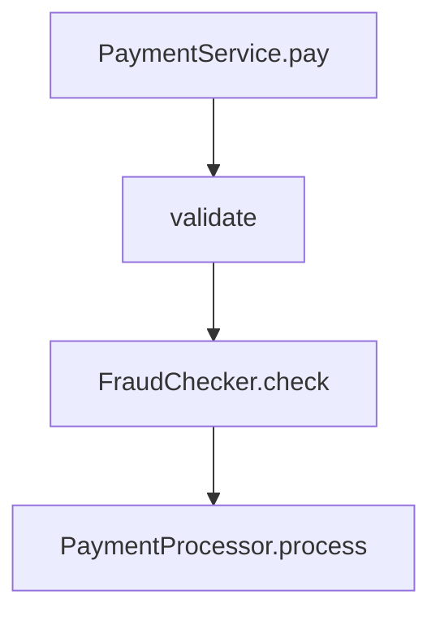

# Companion 2 — Composition vs Inheritance

**Canonical source:** [Mastery lesson](../../../01-engineering-mastery/core-java/module-01-java-object-model/02-composition-vs-inheritance.md).

**Cheat sheet:** [Module visual quick reference](module-visual-quick-reference.md).

## Definition

Use inheritance for a substitutable IS-A. Use composition when a type has collaborators such as `FraudChecker` and `PaymentProcessor`.

## Must remember

- `PaymentService.pay` validates, checks fraud, then processes. It does not subclass those jobs.
- A final template method can lock step order. `FraudChecker` is still injected.
- A default interface method cannot be `final`, so it cannot lock that workflow.
- Composition is not automatically the winner.

## Interview traps

- "Composition is always better."
- Trying to mark a default method `final`.

## Interview flow

## Scenario bite

Card and UPI processors are interchangeable `PaymentProcessor` implementations. Fraud checking is a separate dependency so tests can fake it without a payment subclass.

## Decision table

| Situation | Prefer |
| --- | --- |
| Responsibilities vary independently | Orchestrator plus interfaces |
| Every subtype must run the same steps and must not skip one | Abstract class with a `final` workflow |
| Only need a helper method | Collaborator, not a superclass |

## Explain aloud (whiteboard)

1. IS-A versus HAS-A on the payment service.
2. Where fraud checking is injected.
3. Why the interface cannot freeze `process`.

## 30-second revision

- HAS-A delegates. IS-A substitutes. Final template method locks the sequence. Default methods stay overridable.

## Memory hook

- **IS-A vs HAS-A.**

## Cross-links

- [Module visual quick reference](module-visual-quick-reference.md)
