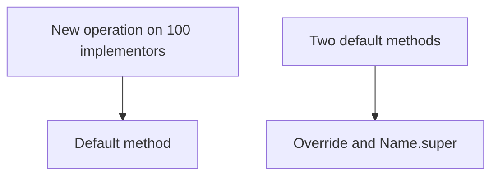

# Companion 3 — Interfaces vs Abstract Classes

**Canonical source:** [Mastery lesson](../../../01-engineering-mastery/core-java/module-01-java-object-model/03-interfaces-vs-abstract-classes.md).

**Cheat sheet:** [Module visual quick reference](module-visual-quick-reference.md).

## Definition

An interface is a contract. An abstract class is a shared foundation. A default method evolves a contract without forcing every implementor to recompile against a new abstract method.

## Must remember

- No instance fields or constructors on an interface. Fields there are `public static final`.
- One superclass. Many interfaces.
- Default methods cannot be `final`.
- Two unrelated default methods with the same signature must be overridden. Call `InterfaceName.super.method()` to keep one.

## Interview traps

- Expecting a new interface method to be source-compatible when it has no default.
- Expecting the compiler to choose between two default methods.

## Interview flow

## Scenario bite

Adding `supports(String rail)` as a default keeps existing payment processors compiling. `Auditable` and `Loggable` both defaulting `description()` force `CardAudit` to override.

## Decision table

| Situation | Prefer |
| --- | --- |
| Substitutable processors, no shared fields | Interface |
| Shared `final` workflow and instance state | Abstract class implementing the interface |
| Source-compatible API growth | Default method with a safe body |

## Explain aloud (whiteboard)

1. Contract versus foundation.
2. What breaks for 100 implementors.
3. How you resolve a default-method clash.

## 30-second revision

- Interface = contract. Abstract class = shared foundation. Default method = evolving contract. Conflicts need an explicit override.

## Memory hook

- **Contract / foundation / evolution.**

## Cross-links

- [Module visual quick reference](module-visual-quick-reference.md)
