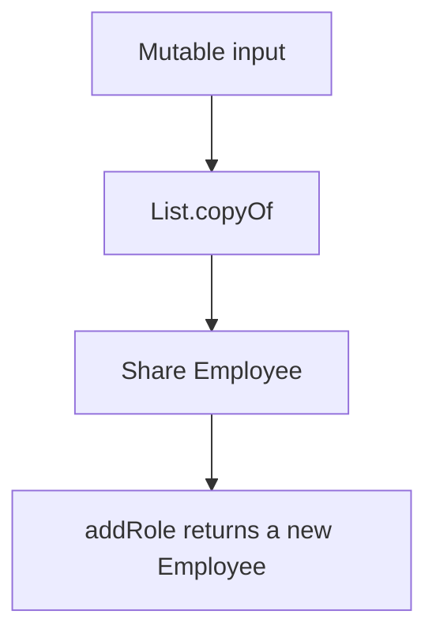

# Companion 4 — Immutability and Defensive Copying

**Canonical source:** [Mastery lesson](../../../01-engineering-mastery/core-java/module-01-java-object-model/04-immutability-and-defensive-copying.md).

**Cheat sheet:** [Module visual quick reference](module-visual-quick-reference.md).

## Definition

Observable state stays fixed after a finished constructor. Share the object. Return a new one to "change" it.

## Must remember

- `final` blocks reassignment, not mutation of a list or `Address`.
- `List.copyOf` is unmodifiable and shallow, rejects nulls, and need not allocate a new copy every time.
- The city example prints `Mumbai` because the nested `Address` is shared.
- `addRole` returns a new `Employee`. It does not assign `this.roles`.
- `final` fields are safely visible after construction if `this` did not escape. A shared holder variable can still lose updates.

## Interview traps

- Calling a `final` list immutable.
- Calling `List.copyOf` a deep copy.
- Claiming lookup or concurrency bugs always disappear because the value type is immutable.

## Interview flow

## Scenario bite

One mutable `PaymentRequest` is validated, then a fraud component changes the amount, then the processor charges the mutated request. An immutable request makes that change a new object instead of a surprise write.

## Decision table

| Situation | Prefer |
| --- | --- |
| Nested type is immutable | Share references; shallow copy of the collection is enough |
| Nested type stays mutable | Deep copy at input and output boundaries |
| Caller needs a list it may modify | Return a new `ArrayList`, not the internal list |
| Current employee pointer moves under contention | Atomic update of the reference; immutability is not that lock |

## Explain aloud (whiteboard)

1. Rules you actually used on `Employee`.
2. Why `getRoles()` is safe for `List<String>` from `List.copyOf`.
3. What immutability does not coordinate.

## 30-second revision

- Fixed state after construction. `final` reference is not a frozen object. `List.copyOf` is a shallow unmodifiable copy. New object for updates.

## Memory hook

- **New object, same original.** Reference versus object.

## Cross-links

- [Module visual quick reference](module-visual-quick-reference.md)
