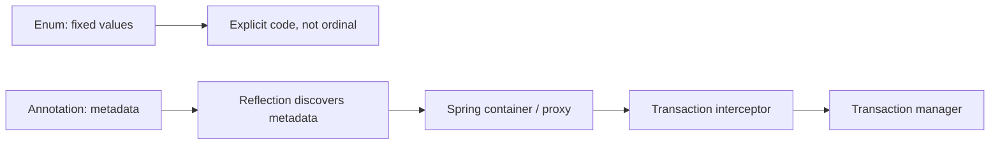

# Companion 5 - Enums, Annotations, Reflection, and Spring AOP

**Canonical source:** [Engineering Mastery lesson](../../../01-engineering-mastery/core-java/module-01-java-object-model/05-enums-annotations-reflection-and-spring-aop.md).

## 30-second map

- Enum = fixed, type-safe values; singleton does not make mutable fields thread-safe.
- Annotation = metadata; it needs a framework, processor, interceptor, or custom code to act on it.
- Reflection discovers runtime metadata; annotation processing generates code at compile time.
- `@Transactional` is applied by a Spring proxy and transaction interceptor, not by reflection alone.

## Questions: enums

| Question | Key discussion points | Common incorrect answer |
| --- | --- | --- |
| Enum or dynamically configurable domain model? | Enum for code-owned fixed states; config/DB for administrators adding providers. Dynamic metadata still needs a shipped adapter/strategy. | “An enum can add constants at runtime.” |
| Can mutable state live in an enum? | It is shared global state per class loader. `count++` loses updates; prefer service-owned state, locks, atomics, or a database. | “Enum singleton means thread-safe.” |
| `AtomicInteger` or `LongAdder`? | AtomicInteger supports exact CAS-style updates; LongAdder improves write throughput under high contention but `sum()` is not a decision-safe snapshot. | “LongAdder is always faster.” |
| Persist enum safely? | Persist an explicit stable code or deliberate name; never ordinal. | “Ordinal is compact, therefore safe.” |
| Unknown external enum value? | Reject by default or intentionally map/log/measure a configured default. Consider compatibility and endpoint risk. | “Always silently use `UNKNOWN`.” |
| Evolving enum constants? | Preserve external codes, version contracts, and make consumers tolerant only where semantics allow. | “Renaming/reordering constants is harmless.” |
| Fixed status or state machine? | Enum can name states; transitions, guards, events, and persistence rules may need a state-machine/domain model. | “An enum itself enforces legal transitions.” |

## Questions: annotations and reflection

| Question | Key discussion points | Common incorrect answer |
| --- | --- | --- |
| Why runtime annotation metadata in Spring? | It supplies declarative configuration for components, injection, web mappings, transactions, and AOP. | “The annotation executes the behavior.” |
| How does Spring discover injection points? | Scanning/bean definitions plus reflective inspection of constructors, fields, and methods such as `@Autowired`. | “Reflection itself creates dependencies.” |
| Add a custom annotation with no processor? | It is inert metadata until code inspects/interprets it. | “Declaring `@Auditable` starts auditing.” |
| Reflection versus annotation processing? | Reflection inspects loaded classes at runtime; processors inspect compiler models and generate code at compile time. | “Lombok is runtime reflection.” |
| Runtime reflection trade-offs? | Overhead, access/module restrictions, weaker compile-time safety, refactor fragility; cache lookup and prefer explicit APIs. | “Reflection is free because metadata is in the class.” |
| Design `@Auditable`? | Define target/retention, stable action/value, safe defaults, and an aspect/interceptor that captures contextual audit data. | “Put a `Map` element in the annotation.” |
| Explain `@Inherited`. | Class annotation lookup via superclass only; not methods, fields, or interfaces. | “It works through every interface method.” |

## Questions: Spring AOP and transactions

| Question | Key discussion points | Common incorrect answer |
| --- | --- | --- |
| How does `@Transactional` work? | External proxy call -> interceptor reads metadata -> transaction manager begins/joins -> method -> commit/rollback JDBC/JPA resources. | “Reflection catches exceptions and rolls back.” |
| Why does self-invocation bypass it? | `this.inner()` does not cross the proxy, so inner advice/propagation is not applied. Use another Spring-managed bean. | “Any annotated method starts a transaction.” |
| Inner transactional method throws? | Through a proxy it can mark a participating transaction rollback-only; propagation determines boundaries. Self-call changes that behavior. | “The inner annotation always creates `REQUIRES_NEW`.” |
| Outer catches the exception? | Catching in the same method may allow commit; if an intercepted inner call marked rollback-only, outer completion can produce `UnexpectedRollbackException`. | “Catching always cancels rollback.” |
| How does propagation matter? | It decides join/suspend/new transaction semantics only for intercepted calls. | “Propagation overrides proxy boundaries.” |
| Metadata versus rollback execution? | Annotation declares attributes; interceptor and transaction manager coordinate actual resource commit/rollback. | “`@Transactional` directly controls the database.” |

## Memory triggers

- **Enum:** fixed set; explicit code, never ordinal.
- **CAS:** compare, set, retry.
- **Retention:** SOURCE / CLASS / RUNTIME.
- **Metadata != behavior.**
- **Reflection finds; Spring wires; proxy intercepts; manager commits/rolls back.**
- **`this.` skips proxy.**
