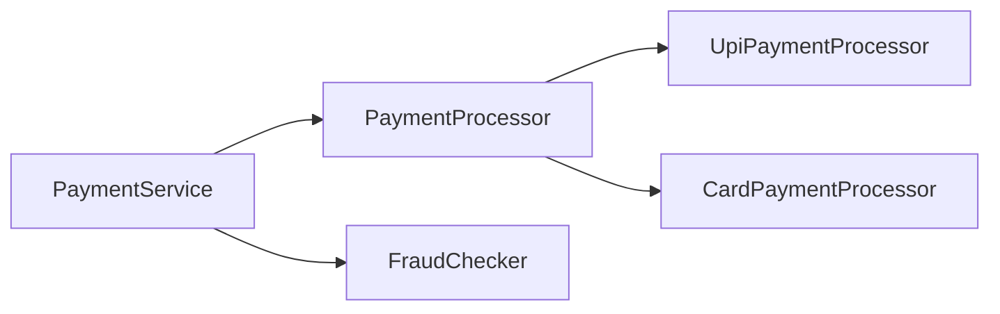

# Object model — Visual Quick Reference

| Cue | Line |
| --- | --- |
| A PIE | Abstraction hides implementation; polymorphism is many implementations; inheritance is IS-A; encapsulation protects state |
| HAS-A | Composition. Prefer it when the type is not substitutable |
| Interface | Contract. Multiple interfaces. No instance state. Default methods are not `final` |
| Abstract class | Shared foundation. One superclass. `final` methods allowed |
| `final` field | Fixed reference, not a frozen mutable object |
| `List.copyOf` | Unmodifiable shallow copy. No null elements |
| Update | Return a new object |
| Enum | Fixed type-safe set; explicit code, not ordinal |
| Annotation | Metadata needs an interpreter; `RUNTIME` enables reflection |
| Transaction | Proxy -> interceptor -> manager; `this` bypasses proxy |

- [01 OOP](01-oop-principles.md)
- [02 Composition](02-composition-vs-inheritance.md)
- [03 Interfaces](03-interfaces-vs-abstract-classes.md)
- [04 Immutability](04-immutability-and-defensive-copying.md)
- [05 Enums, annotations, reflection, Spring AOP](05-enums-annotations-reflection-and-spring-aop.md)
