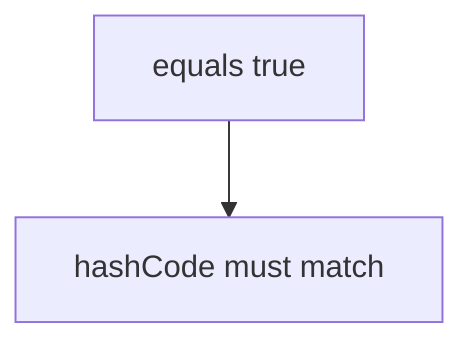

# Companion 1 — equals and hashCode

**Canonical source:** [Mastery lesson](../../../01-engineering-mastery/core-java/module-02-equals-and-hashcode/01-equals-and-hashcode-contracts.md).

**Cheat sheet:** [Module visual quick reference](module-visual-quick-reference.md).

## Definition

equals must be an equivalence relation; equal objects must share hashCode.

## Must remember

- Reflexive, symmetric, transitive, consistent.
- Equal objects → same hashCode; not the reverse.
- Override both or neither.
- Use the same fields in both.

## Interview traps

- Unequal objects must have different hash codes — false.

## Interview flow

## Scenario bite

Two Payment records with the same id compare equal and land in the same HashMap bucket.

## Decision table

| Situation | Prefer |
| --- | --- |
| Value object | equals and hashCode on business key |
| Entity identity | id only, document it |

## Explain aloud (whiteboard)

1. Contract in one sentence.
2. Hash consequence.
3. Fields included.

## 30-second revision

- Equality contract plus matching hashCode.

## Memory hook

- **ESH** — Equals, Symmetric, Hash.

## Cross-links

- [Module visual quick reference](module-visual-quick-reference.md)
