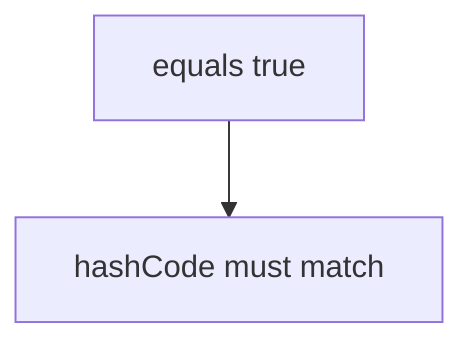

# Companion 1 — equals and hashCode

**Canonical source:** [Mastery lesson](../../../01-engineering-mastery/core-java/module-02-equals-and-hashcode/01-equals-and-hashcode-contracts.md).

**Cheat sheet:** [Module visual quick reference](module-visual-quick-reference.md).

## Definition

equals must be an equivalence relation; equal objects must share hashCode.

## Must remember

- **RSTCN:** reflexive, symmetric, transitive, consistent, non-null.
- Equal objects must have equal hash codes. Unequal objects may collide.
- `HashSet` uses a `HashMap`. Inconsistent hashes can leave logically equal objects both in the set.
- One field: `Objects.hashCode(transactionId)` is enough. It is not the same integer as `Objects.hash(transactionId)`.
- `getClass()` rejects subclasses. `instanceof` accepts them and can break symmetry.
- Mutating a key field may break lookup. It does not always return null.

## Interview traps

- Unequal objects must have different hash codes — false.
- `HashSet` always collapses `equals` duplicates even when `hashCode` disagrees — false.
- After a key mutates, `get` always returns null — false. It depends on the bucket.

## Interview flow

## Scenario bite

Two Payment records with the same id compare equal and land in the same HashMap bucket.

## Decision table

| Situation | Prefer |
| --- | --- |
| Value object | equals and hashCode on business key |
| Entity identity | id only, document it |

## Explain aloud (whiteboard)

1. Contract in one sentence.
2. Hash consequence.
3. Fields included.

## 30-second revision

- RSTCN. Equal objects, equal hashes. Never mutate key fields. `getClass` versus `instanceof` is a symmetry choice.

## Memory hook

- **RSTCN** — Reflexive, Symmetric, Transitive, Consistent, Non-null. Equals first, then the same fields in `hashCode`.

## Cross-links

- [Module visual quick reference](module-visual-quick-reference.md)
