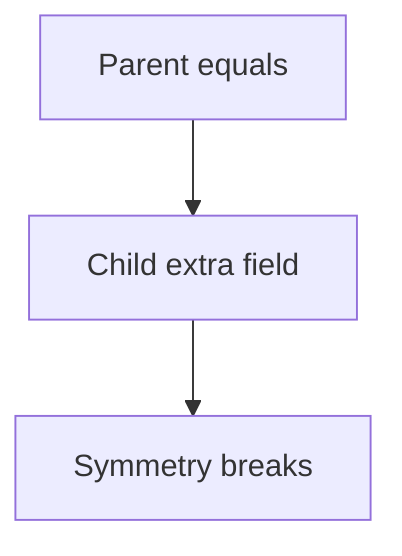

# Companion 2 — Inheritance and records

**Canonical source:** [Mastery lesson](../../../01-engineering-mastery/core-java/module-02-equals-and-hashcode/02-inheritance-records-and-equality.md).

**Cheat sheet:** [Module visual quick reference](module-visual-quick-reference.md).

## Definition

Equality across inheritance is fragile; records generate equals and hashCode from components.

## Must remember

- Subclass adding fields breaks symmetry if superclass equals is used.
- Prefer composition.
- Records are shallow equals on components.
- Don't mix getClass and instanceof casually.

## Interview traps

- instanceof equals in a parent and child both ways.

## Interview flow

## Scenario bite

Order subclass ExpressOrder with extra fee: don't use Order.equals that ignores fee if both types share a set.

## Decision table

| Situation | Prefer |
| --- | --- |
| Need subclass | Composition or sealed types with care |
| DTO | record |

## Explain aloud (whiteboard)

1. Show symmetry break.
2. Recommend composition.
3. Records are component equality.

## 30-second revision

- Inheritance plus equals is a trap; records fit simple values.

## Memory hook

- **SYM** — Symmetry first.

## Cross-links

- [Module visual quick reference](module-visual-quick-reference.md)
