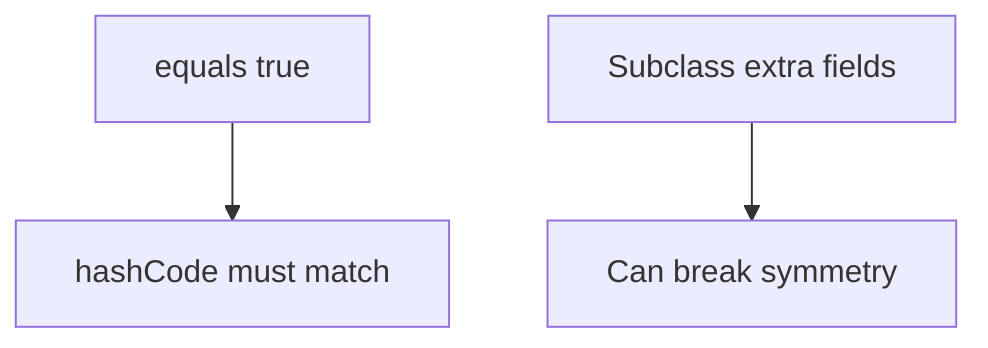
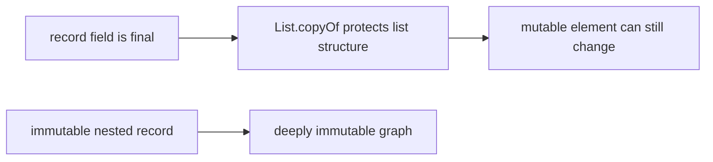

# equals / hashCode — Visual Quick Reference

| Rule | Line |
| --- | --- |
| Contract | RSTCN — reflexive, symmetric, transitive, consistent, non-null |
| Hash | equal ⇒ same hash; unequal may collide |
| Inheritance | prefer composition; records for component equality |

## Record immutability recall

| Phrase | Correct meaning |
| --- | --- |
| Shallowly immutable record | Component references cannot be reassigned; referenced objects may mutate. |
| `List.copyOf` | Unmodifiable structural snapshot; rejects nulls; no element deep copy. |
| `unmodifiableList` | Read-only view over an existing backing list. |
| Compact constructor | Normalize parameters; compiler then assigns final component fields. |

**Memory trick:** Final reference != frozen object graph.

- [01 contracts](01-equals-and-hashcode-contracts.md)
- [02 inheritance and records](02-inheritance-records-and-equality.md)
