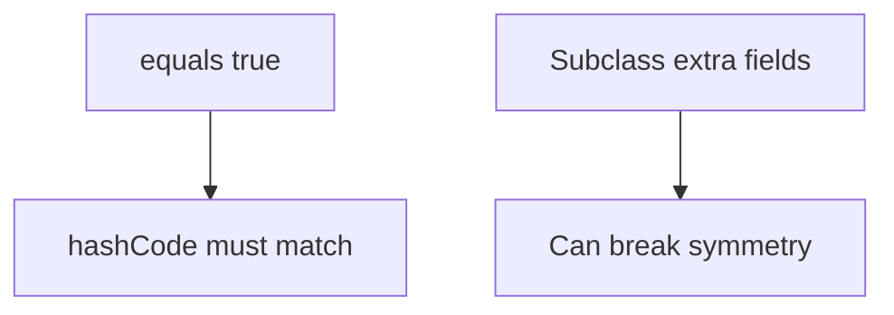

# equals / hashCode — Visual Quick Reference

| Rule | Line |
| --- | --- |
| Contract | reflexive, symmetric, transitive, consistent |
| Hash | equal ⇒ same hash; unequal may collide |
| Inheritance | prefer composition; records for component equality |

- [01 contracts](01-equals-and-hashcode-contracts.md)
- [02 inheritance and records](02-inheritance-records-and-equality.md)
