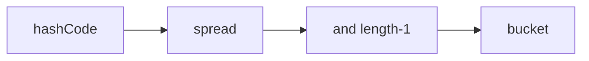

# Companion 1 — Hash indexing

**Canonical source:** [Mastery lesson](../../../01-engineering-mastery/core-java/module-03-hashmap-internals/01-internal-table-and-hash-indexing.md).

**Cheat sheet:** [Module visual quick reference](module-visual-quick-reference.md).

## Definition

HashMap spreads hashCode and masks with table length minus one to pick a bucket.

## Must remember

- index = (n - 1) & spread.
- spread mixes high bits of hashCode.
- Capacity is power of two.
- Poor hashCode clusters buckets.

## Interview traps

- Using raw hashCode as the index.

## Interview flow

## Scenario bite

Employee ids that differ only in high bits still need spread so small tables do not collide.

## Decision table

| Situation | Prefer |
| --- | --- |
| Need bucket | Explain spread and mask |
| Need collision story | equals walk |

## Explain aloud (whiteboard)

1. Write the index formula.
2. Why XOR shift.
3. Power-of-two mask.

## 30-second revision

- Spread then mask into a power-of-two table.

## Memory hook

- **SIM** — Spread, Index, Mask.

## Cross-links

- [Module visual quick reference](module-visual-quick-reference.md)
