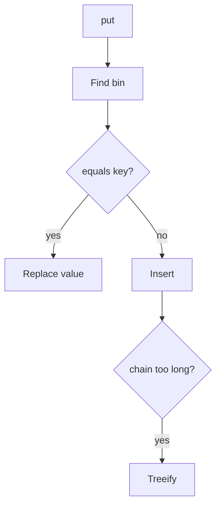

# Companion 2 — Put, get, treeify

**Canonical source:** [Mastery lesson](../../../01-engineering-mastery/core-java/module-03-hashmap-internals/02-put-get-flow-and-treeify.md).

**Cheat sheet:** [Module visual quick reference](module-visual-quick-reference.md).

## Definition

put hashes to a bin, walks equals, inserts or replaces; long chains treeify under JDK thresholds.

## Must remember

- Treeify when chain is long and table is large enough (bin count and capacity thresholds).
- get uses same hash then equals.
- Existing key replaces value, size unchanged.
- Trees revert to lists when small (untreeify).

## Interview traps

- Every bucket becomes a tree at length 8 regardless of capacity.

## Interview flow

## Scenario bite

Duplicate order id put replaces the previous Order value; size stays the same.

## Decision table

| Situation | Prefer |
| --- | --- |
| New key | Insert, maybe resize |
| Same key | Replace value |

## Explain aloud (whiteboard)

1. Walk equals.
2. Replace vs insert.
3. Treeify conditions.

## 30-second revision

- Hash, then equals; treeify is conditional.

## Memory hook

- **GET** — Go to bin, Equals, Tree if needed.

## Cross-links

- [Module visual quick reference](module-visual-quick-reference.md)
