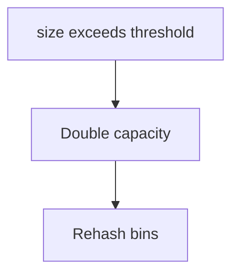

# Companion 3 — Resize and load factor

**Canonical source:** [Mastery lesson](../../../01-engineering-mastery/core-java/module-03-hashmap-internals/03-resize-load-factor-and-threshold.md).

**Cheat sheet:** [Module visual quick reference](module-visual-quick-reference.md).

## Definition

Threshold is capacity times load factor; exceeding it doubles the table and rehashes entries.

## Must remember

- Default load factor 0.75.
- Size is mappings, not occupied buckets.
- Resize is O(n) occasionally.
- Pre-size when you know cardinality.

## Interview traps

- Threshold equals number of non-empty buckets.

## Interview flow

## Scenario bite

Bulk-loading 1e6 employees: new HashMap<>(expected) to avoid repeated resizes.

## Decision table

| Situation | Prefer |
| --- | --- |
| Known size | Presize |
| Unknown | Default 0.75 |

## Explain aloud (whiteboard)

1. Define threshold.
2. Double and rehash.
3. Presize for bulk.

## 30-second revision

- Resize when size passes capacity times load factor.

## Memory hook

- **075** — three quarters full, grow.

## Cross-links

- [Module visual quick reference](module-visual-quick-reference.md)
